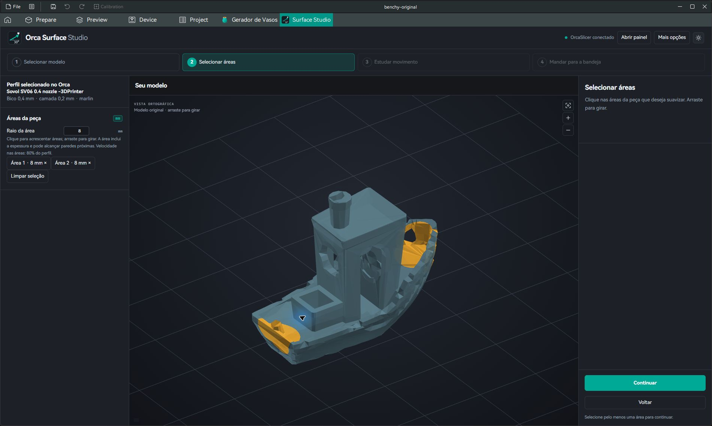
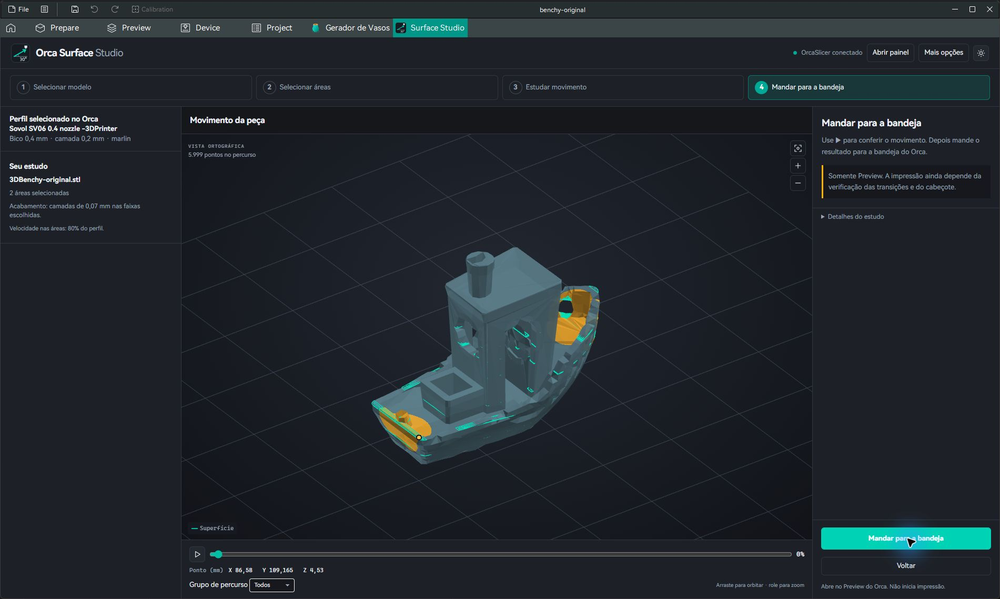
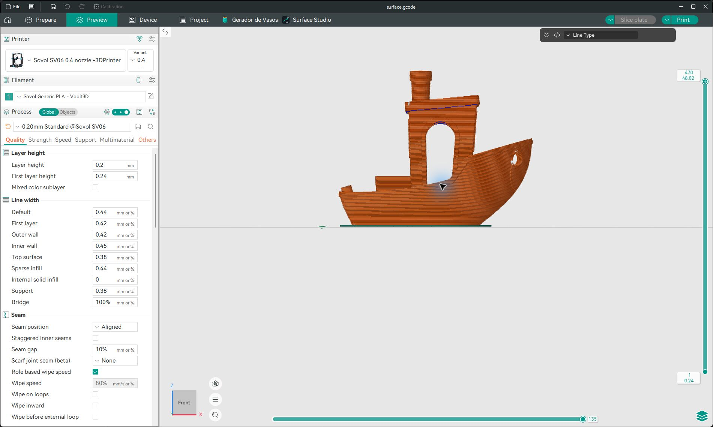
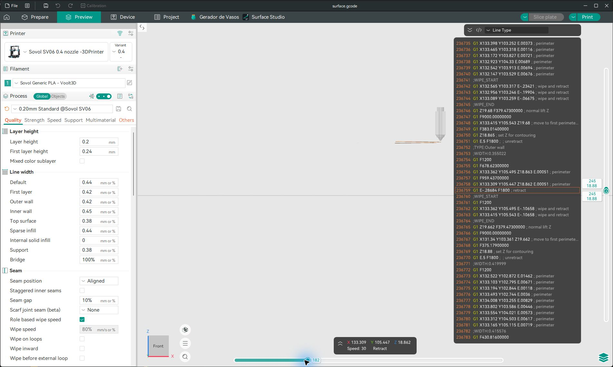
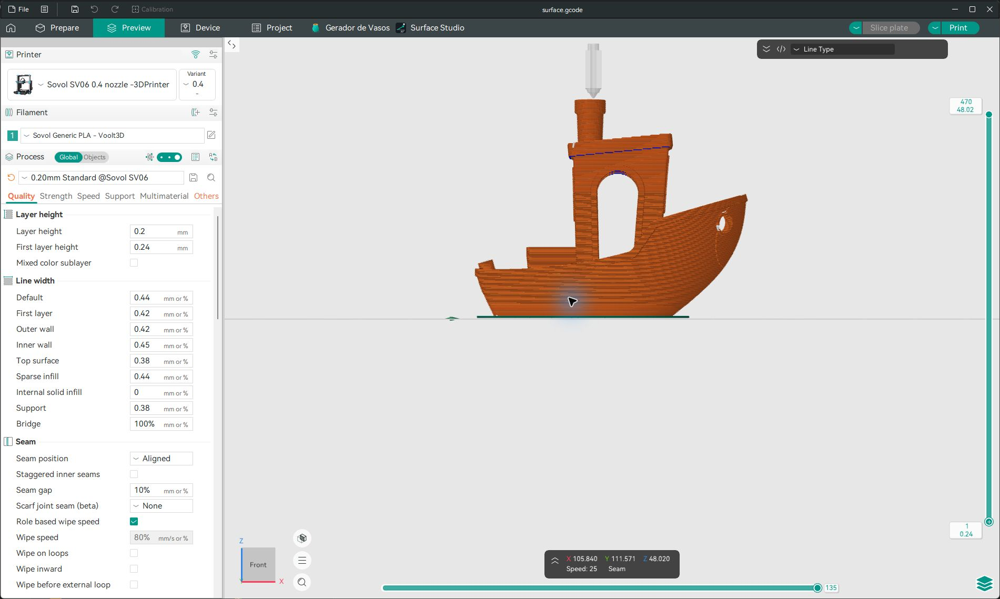

# Acabamento e transições do Benchy — 0.10.0

O uso continua: **selecionar modelo → selecionar áreas → estudar movimento →
mandar para a bandeja**. Não há parâmetro adicional obrigatório.

O Studio prepara automaticamente camadas mais finas nas faixas de altura das
áreas escolhidas, respeitando o mínimo do perfil da impressora. O resumo mostra
a altura usada. Na SV06 deste estudo, o acabamento passou de 0,20 para 0,07 mm:
a amostragem vertical fica 65% menor nessas faixas. A primeira camada de 0,24 mm
permanece. As camadas mais finas atravessam a seção inteira da peça nessas
alturas; somente as áreas escolhidas recebem contorno em Z.

A correção agressiva adicional das paredes foi desativada. O Orca continua
calculando as trajetórias e a extrusão na malha original. Se uma transição de
extrusão ainda exceder o limite escolhido, o Studio recusa o resultado antes
de disponibilizar um novo arquivo. Essa verificação inclui movimentos curtos.

## Estudo de integração

Uma cópia da seleção anterior foi reproduzida com o motor atualizado:

| Medida | 0.9.1 | Ensaio de integração 0.10.0 |
|---|---:|---:|
| Camada nominal do perfil | 0,20 mm | 0,20 mm |
| Camada nas faixas de acabamento | 0,20 mm | 0,07 mm |
| Maior inclinação de extrusão | 63,36° | 26,12° |
| Primeira camada | 0,24 mm | 0,24 mm |
| Vértices/triângulos do modelo alterados | 0 | 0 |

A comparação confirmou igualdade dos 112.569 vértices e 225.154 triângulos
em coordenadas da mesa. A faixa refinada foi de 2,6 a 27,4 mm. As duas áreas
tiveram efeito e nenhuma extremidade ajustada saiu do escopo sob a margem do
verificador. Os XYZ/E calculados nativamente não foram remodelados pelo Studio.

Camadas menores reduzem a escala dos degraus; o percentual acima mede a
amostragem vertical e não a rugosidade física. Não foi demonstrada uma superfície
perfeitamente lisa. A malha, os furos e o formato original permanecem.

## Teste na interface

**Concluído em 21/11/2026**, no OrcaSlicer 2.5.1 para Windows. O cálculo foi
acionado pelo botão do plugin na janela real do Orca. Os arquivos foram apenas
lidos depois para conferir os resultados. Não houve envio à impressora.

Antes da atualização, o projeto original e o pacote do ensaio anterior foram
preservados. A 0.10.0 foi instalada mantendo ativação e autorizações existentes.
O novo comando de fatiamento exigiu uma autorização adicional do Orca; o
usuário respondeu diretamente à janela de segurança. O Studio não aprova
permissões automaticamente.

### 1. Selecionar modelo

Abri o projeto original do Benchy e conferi **Sovol SV06 0.4 nozzle -3DPrinter**,
**Sovol Generic PLA - Voolt3D** e **0.20mm Standard @Sovol SV06**. Na aba
**Surface Studio**, selecionei **3DBenchy-original.stl**, de 60 × 31 × 48 mm,
e avancei para **Selecionar áreas**. Nenhum ajuste avançado foi necessário.

### 2. Selecionar áreas

Usei raio de **8 mm** e cliquei na borda da proa e na da popa, repetindo a
seleção do teste anterior. As marcas amarelas e os dois botões de área
confirmaram a seleção. Cliquei em **Continuar**. Cada clique seleciona um
volume esférico, incluindo a espessura da parede e eventuais paredes próximas.

### 3. Estudar movimento

Cliquei em **Estudar movimento**. O modelo continuou visível durante o cálculo.
Ao terminar, o Studio mostrou **Acabamento: camadas de 0,07 mm nas faixas
escolhidas**. O Preview ainda não havia sido aberto. O estudo ficou disponível
no centro da tela, sem exigir a escolha manual de altura fina ou de transição.

### 4. Mandar para a bandeja

Cliquei em **Mandar para a bandeja**. No diálogo nativo **Drop project file**,
escolhi **Open as project** e confirmei em **OK**. Essa escolha carrega o pacote
já fatiado. O Orca abriu diretamente no Preview, com **470 camadas**, preservando
o perfil nominal de 0,20 mm e a primeira camada de 0,24 mm. O botão **Print**
não foi acionado.

Usei a vista frontal para inspecionar as bordas. O refinamento não remove todas
as marcas de camada; a proa e as regiões fora da seleção ainda exibem degraus
residuais. O teto não foi selecionado neste ensaio.

Isolei a **camada 245**, nominal **Z 18,88 mm**, e avancei pelos movimentos.
O inspetor nativo mostrou as linhas **236756** e **236758** com extrusão
relativa positiva de **0,00051 mm**, em **Z 18,863** e **18,862 mm**.
São movimentos de deposição da parede externa dentro da mesma camada lógica.
O marcador mostrou Z 18,863 no passo 180 e Z 18,862 no passo 182, imediatamente
após a segunda extrusão, já no início da retração.

Ao terminar, restaurei todas as camadas e deixei o resultado aberto no Preview.

## Conferência do resultado aberto

O ensaio pela interface repetiu **26,12°** como maior inclinação de extrusão.
Os **112.569 vértices e 225.154 triângulos** coincidem com a cópia de referência
em coordenadas da mesa. As duas áreas tiveram efeito: **97 e 155 segmentos**
afetados, **166** deles com Z variável, sem extremidades ajustadas fora do
escopo sob a margem do verificador. Foram conferidos **26 campos** do perfil.

As **269.293 identidades de movimento XYZ/E** coincidem antes e depois do
pós-processamento do Studio. Somente velocidades e estatísticas são tratadas
nessa etapa; a deposição vem do fatiador nativo. O SHA-256 coincide entre o
G-code gerado, o conteúdo do pacote, o cache lido pelo Preview e seu recibo:

`a8b06ce87f01a8f7fdf13567f53b74494e6678bf685667ec984ca8fc72129f22`

O limite conservador do corpo do cabeçote no CAD nominal permaneceu positivo,
em **1,24 mm**. Esse cálculo não registra a posição do cabeçote instalado, não
avalia contato do bico e não certifica a deposição. A informação aproximada de
8 mm fornecida pelo usuário não foi convertida em uma medição certificada.

As [evidências numéricas públicas](evidence/benchy-finish-v0100.json) distinguem
este teste nativo do ensaio de integração. Configurações privadas, permissões,
projetos e G-code da máquina não foram incluídos no repositório público.

Validação adicional: **218 testes automatizados passaram**; o passo a passo
também passou na interface de teste com WebGL, desenho alternativo e largura
de 390 pixels. Esses testes de componente não substituem a conferência nativa
registrada nas capturas acima.

## Limites

A mudança não certifica a folga do cabeçote instalado, o contato do bico ou a
deposição. O resultado continua identificado como Preview até a qualificação
física. Nenhuma impressão é iniciada pelo cálculo ou pelo botão de transferência.
O refinamento também pode aumentar o tempo de impressão.
