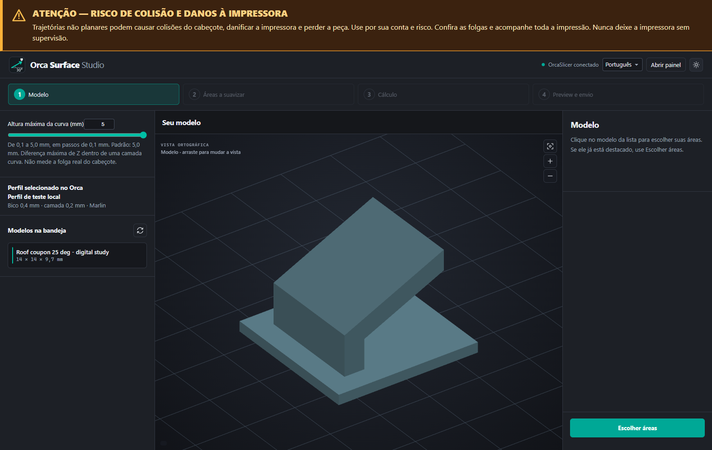
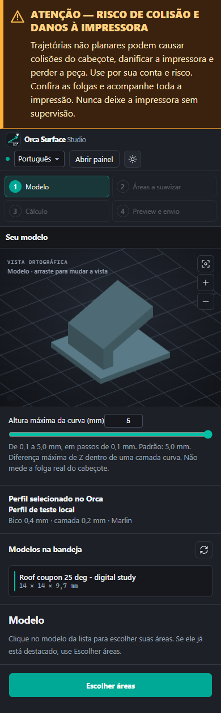

# Altura máxima da curva — Surface Studio 0.16.4

Data: 23/11/2026. Versão experimental; sem publicação no Orca Cloud.

## Uso

No passo **1 — Modelo**, ajuste **Altura máxima da curva (mm)** pela barra
ou pelo campo numérico. O padrão é **5,0 mm**, o intervalo é **0,1–5,0 mm** e
cada incremento é de **0,1 mm**. Depois escolha as áreas e calcule normalmente.

O valor limita a diferença entre o ponto mais baixo e o mais alto de uma
mesma camada curva. Não é a altura total da peça, a altura do cordão ou uma
medida do espaço livre sob o cabeçote. Não demonstra ausência de colisões.

Mudar o valor invalida o resultado anterior. O novo limite exige novo cálculo;
não altera um G-code que já está imprimindo. Se o formato e as transições não
couberem no limite, o Studio explica o motivo e preserva o original.

O limite vale para **Peça inteira** e **Pintar áreas**. No primeiro modo, o
planejador procura um campo contínuo dentro do limite. No segundo, os percursos
nativos do Orca são conferidos e recusados se ultrapassarem o valor escolhido.
Não se corta o Z do G-code para fazê-lo caber.

Capturas do componente local, com peça de teste e sem conexão com impressora:

## Verificação do cálculo

311 testes automatizados locais aprovados. A interface passou em 1580 e 390 px,
incluindo a alternativa sem WebGL, sincronização da barra com o campo, rejeição
de valores inválidos e invalidação do resultado ao mudar a altura.

A atualização foi instalada preservando as permissões e a ativação existentes.
A conferência do novo controle no Orca após reinício ficou pendente porque o
controle nativo retornou acesso negado e falha de captura do monitor. Não foi
forçado o encerramento da janela durante a impressão. As capturas acima são do
componente local, não uma alegação de validação nativa.

O campo cúbico usa coeficientes dentro de um intervalo comum com amplitude
limitada. A base não negativa da B-spline mantém o deslocamento dentro desse
intervalo. Em uma camada de coordenada de superfície constante, a diferença
de Z físico não pode ultrapassar essa amplitude. O certificado verifica o
intervalo completo dos coeficientes, incluindo a extensão zero.

O limite faz parte da identidade do cache. Propostas reutilizadas passam pela
mesma conferência. Uma proposta que já cabe usa o caminho esparso existente;
as restrições adicionais entram somente quando necessárias.

Há também conferência independente da diferença de Z dos percursos de
deposição emitidos em cada camada lógica, tanto no modo contínuo quanto no
modo de áreas pintadas. Os limites de altura efetiva dos cordões e do perfil
da impressora permanecem ativos. A verificação não certifica o cabeçote.

Além dos testes automatizados, uma cunha foi calculada com limite ativo de
2,0 mm. O intervalo certificado foi **1,999900004 mm**, mantendo a referência
e o formato; o cálculo levou aproximadamente 119 segundos neste ambiente.
Uma configuração incompatível de 0,1 mm foi recusada antes de amostrar o
interior ou fatiar. Limites apertados ainda podem exigir mais processamento.

## Benchy iniciado nesta sessão

O usuário solicitou expressamente iniciar o teste supervisionado na SV06,
com PLA Voolt3D e proa voltada para SOVOL. Foi utilizado o arquivo já conferido
no Preview da 0.16.3, antes de instalar este novo controle. O limite da 0.16.4
**não foi aplicado retroativamente a esse arquivo**.

O arquivo foi enviado sem seleção nem início. Antes de iniciar, foram
conferidos novamente a identidade da impressora, o estado livre, o conteúdo
recebido e a seleção exata. Houve um único pedido de início; o OctoPrint
confirmou **Printing** e avançou no arquivo correto.

A cópia de transporte removeu comentários, mantendo a sequência completa dos
comandos executáveis do Preview. O servidor acrescentou somente o rodapé inerte
conhecido do DisplayLayerProgress; isso foi comparado explicitamente, sem aceitar
outras alterações e sem repetir o envio. O recibo sanitizado registra os hashes.
Veja o [recibo do início supervisionado](evidence/benchy-supervised-start-v0163.json).

A confirmação por conta e risco não alterou `physical_validation` nem
`print_allowed`. O CAD nominal, cuja posição no cabeçote instalado não foi
medida, ainda apresenta um testemunho de possível interferência da carcaça.
Este início supervisionado não comprova folga nem valida a impressão completa.

O envio normal pelo plugin continua sendo upload sem início automático.
O início desta sessão foi uma ação separada, solicitada explicitamente pelo
usuário. Nenhuma configuração do servidor ou da impressora foi alterada.
