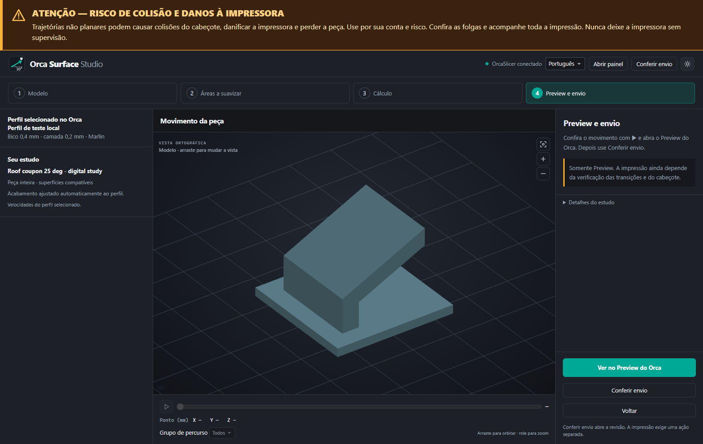
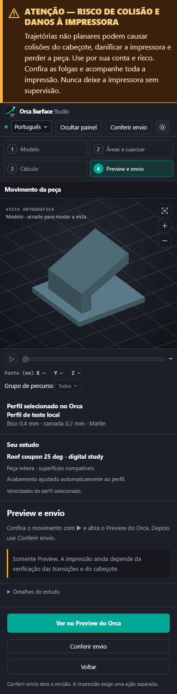

# Aviso de risco destacado — Surface Studio 0.16.1

O banner no início da aba e do painel passou de 12 px para um título de 20 px
e texto de 16 px. Em larguras menores, o título usa 18 px e o texto mantém
16 px. Ícone de alerta, faixa lateral âmbar, contraste e quebra de linha
mantêm o aviso legível sem cobrir os controles.

O texto agora nomeia as consequências concretas: colisão do cabeçote, danos
à impressora e perda da peça. A orientação é conferir as folgas, acompanhar
toda a impressão e nunca deixar a máquina sem supervisão. Foi removida a
formulação anterior de certeza de 100%; a visualização não constitui garantia
de segurança física.

Título em português:

> ATENÇÃO — RISCO DE COLISÃO E DANOS À IMPRESSORA

O aviso permanece visível e usa o idioma selecionado entre os sete pacotes
offline. A alteração não acrescenta confirmações, não muda os cálculos nem
modifica qualquer liberação de impressão.

## Verificação

- Cinco testes existentes de idioma e persistência passaram.
- O teste do componente passou nos sete idiomas, na aba de 1580 px e no painel
  de 390 px, preservando o resultado e sem transbordamento horizontal.
- O fluxo guiado passou com WebGL, alternativa Canvas e largura de 390 px.
- Bundle e wheel da 0.16.1 foram gerados. Nenhum arquivo foi enviado à impressora.
- As imagens abaixo são do teste local da interface. A atualização foi preparada
  sem instalar ou reiniciar o Orca durante o estudo do Benchy que estava em execução.

