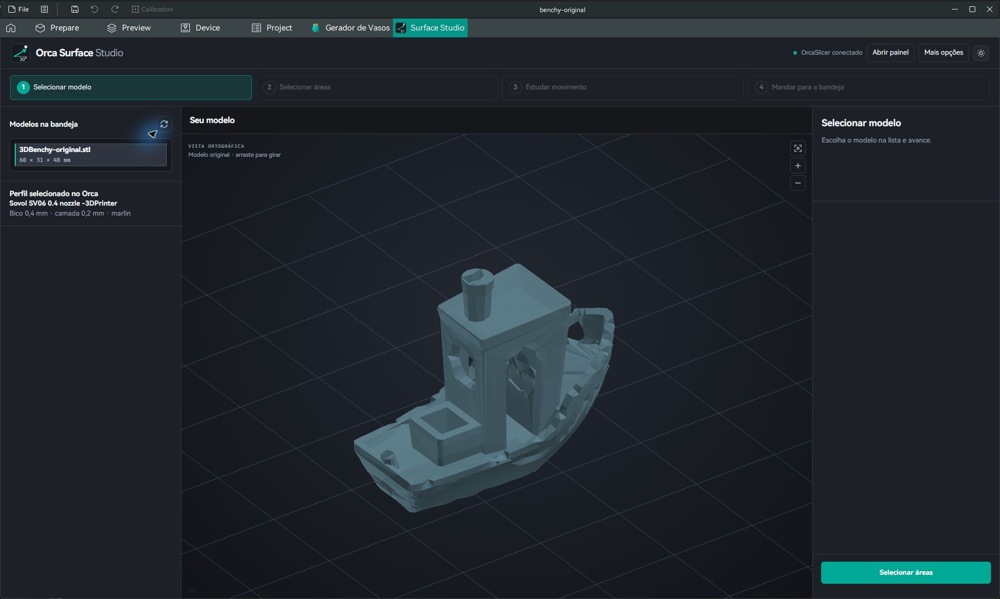
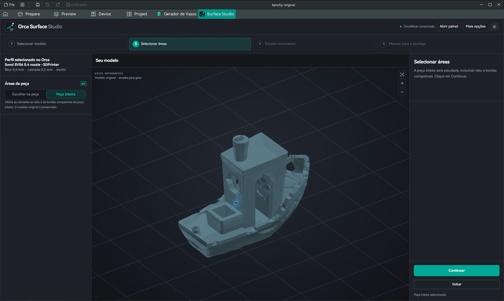
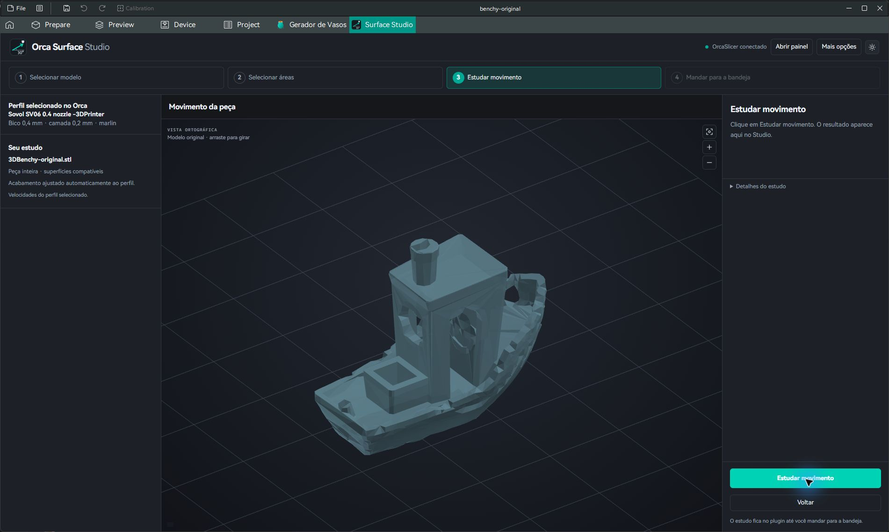
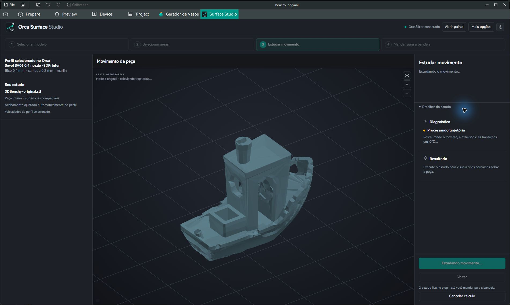
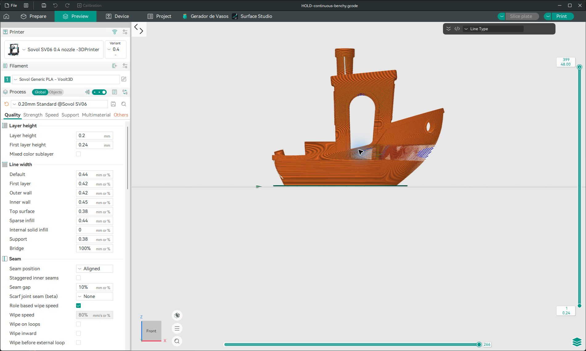
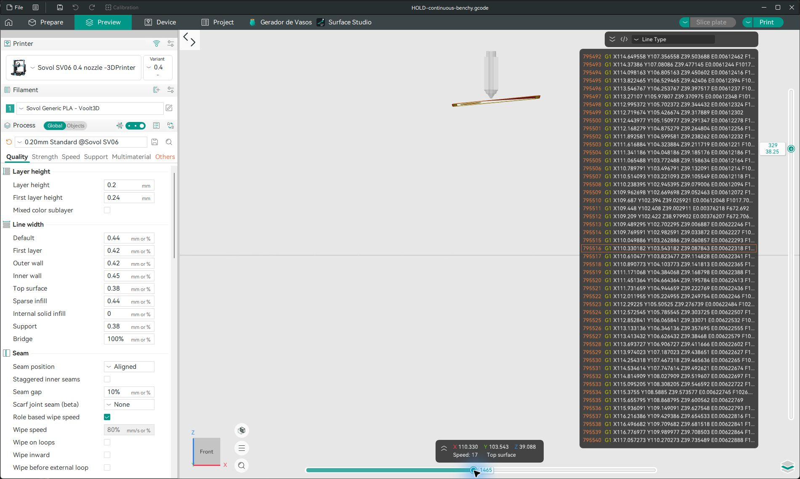
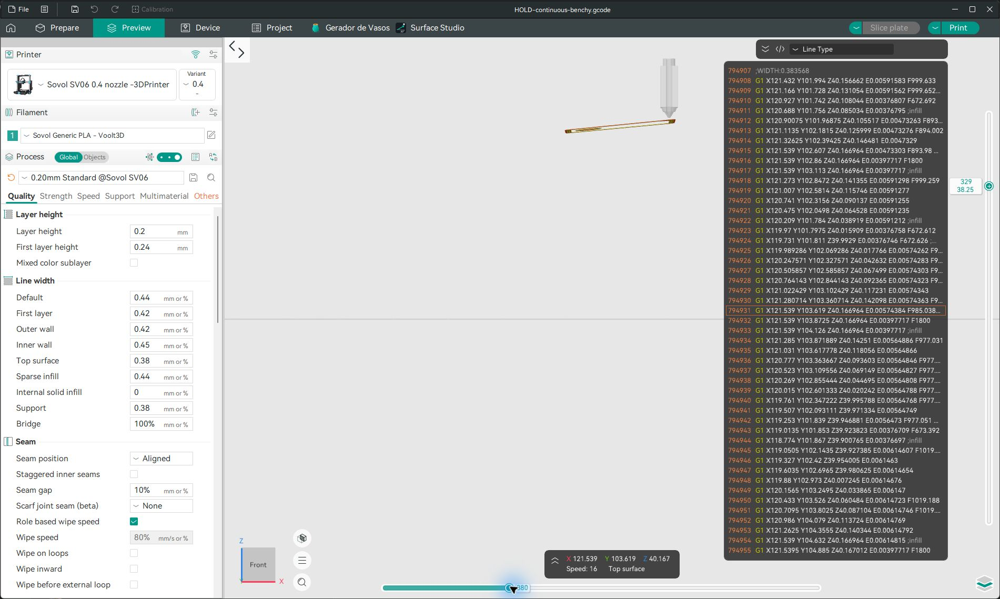
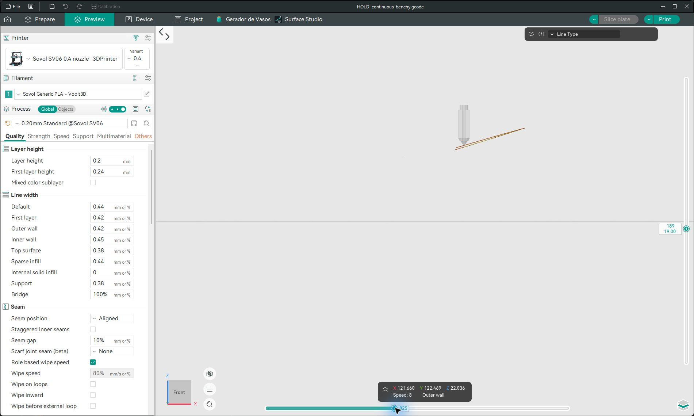

# Camadas contínuas no Surface Studio — estudo experimental

O modo **Peça inteira** passa a calcular as camadas em relação às superfícies
da peça. O objetivo é percorrer as bordas inclinadas da proa e da popa e o teto
do Benchy na mesma camada lógica, em vez de voltar periodicamente a um plano
horizontal. O modelo original continua preservado.

**Estado da validação: não aprovado para imprimir o Benchy.** Há 240 testes
locais aprovados e teste local dos quatro passos em três condições de interface,
separado do Orca nativo. A auditoria completa do arquivo de referência encontrou
uma transição de 52,7° e espaçamento excessivo entre camadas. O Preview de
diagnóstico foi inspecionado no Orca, sem iniciar impressão. A eliminação de
todos os degraus e a conclusão do fluxo pelo plugin continuam pendentes.

## Como usar

1. Coloque o modelo na mesa, escolha a impressora e o filamento no Orca e abra
   **Surface Studio**. Selecione o modelo e avance.
2. Em **Selecionar áreas**, use **Peça inteira** para o novo cálculo. A opção
   **Escolher na peça** continua disponível com o acabamento localizado anterior.
3. Clique **Continuar** e **Estudar movimento**. A peça permanece visível enquanto
   o cálculo prepara e fatia uma cópia privada. Aguarde a conclusão.
4. Quando o estudo concluir com resultado válido, confira-o e clique
   **Mandar para a bandeja**. Se o Orca apresentar
   o diálogo de importação, escolha **Open as project** para abrir o pacote já
   fatiado no Preview.

### Passos conferidos no Orca

Seleção do Benchy original, com o perfil da SV06 e o PLA Voolt3D selecionados:

Seleção de **Peça inteira** para estudar teto e bordas compatíveis juntos:

Um único botão inicia o estudo; a peça original permanece visível:

Nesta rodada, a execução pela interface chegou à restauração dos movimentos
XYZ. Uma execução de referência independente, com sua própria cópia da malha e
fatia nativa correspondentes, terminou a auditoria e reprovou o resultado. A
execução repetida na interface foi cancelada; não foi observado seu retorno
final de erro, nem concluído o passo **Mandar para a bandeja**.

No Preview, examine uma camada isolada nas bordas e no teto. O Z precisa variar
durante a extrusão dentro dessa camada. Deslocar uma camada horizontal inteira
ou apenas reduzir a altura das camadas não comprova o novo comportamento.

## Conferência do Preview de diagnóstico

Foi aberto manualmente um pacote separado, chamado **HOLD-continuous-benchy**,
somente para inspecionar a falha. Esse pacote não é um resultado aprovado pelo
botão do Studio. **Não pressione Print nesse diagnóstico.**

A vista completa mostra trajetórias curvas e falhas nas ligações do casco:

Na camada 329 exibida pelo Orca, o bico passou por Z **39,088 mm** e
**40,167 mm**, em movimentos de extrusão classificados como Top surface.
O marcador e o inspetor mostram o Z variando na mesma camada lógica:

A camada 189 também apresentou a borda inclinada da proa; nesta posição de
extrusão da parede externa, o marcador indica Z **22,036 mm**:

O G-code do diagnóstico, o extraído de seu pacote e o arquivo temporário lido
pelo Orca têm o mesmo SHA-256. Isso confirma o conteúdo visualizado; não é uma
aprovação de deposição ou de impressão.

| Verificação da referência | Resultado |
|---|---|
| Perfil selecionado | 23 campos conferidos, correspondentes |
| Cópia da malha | 2.135.318 faces; limite normal/quinas de 0,010 mm |
| Cordas emitidas | Limite máximo calculado de 0,009977 mm |
| Novos segmentos subdivididos | Mínimo de 0,182 mm, acima de 0,15 mm |
| Inclinação dos movimentos | **52,664°; excede o limite de 30°** |
| Espaçamento normal amostrado | **0,065 a 0,954 mm; deposição não qualificada** |
| Trechos com espaçamento acima da largura da linha | **1.170** |
| Impressão física | **Não iniciada** |

O mínimo dos novos segmentos não inclui deslocamentos nem arestas curtas
originais preservadas para o estudo. Os sete núcleos de referência ficaram na
mesma faixa de corte; essa medida considera os 90% centrais ponderados por área
e não representa uma porcentagem da peça sem degraus.

As regiões precisam ser coordenadas em conjunto, com limites de inclinação e
de espaçamento entre camadas. Os mapas atuais preservam a referência geométrica,
mas sua composição ainda concentra a deformação em certas transições. A versão
permanece experimental. As [medidas e hashes](evidence/continuous-v0110-benchy.json)
registram o resultado recusado.

## O que o cálculo preserva e verifica

- Cópia intermediária reversível, com XY preservado, furos e primeira camada plana.
- Perfil de impressora e filamento selecionado, incluindo início/fim, limites
  de movimento, vazão e transporte nativo.
- ContourZ desligado na cópia: há um único mapeamento de volta ao formato original.
- Referências de faces paralelas alinhadas e núcleos de superfície na mesma faixa
  de corte, sem apagar os pequenos chanfros presentes no STL.
- Certificados geométricos das faces e das quinas, com orçamento inicial conjunto
  de 0,02 mm para a cópia da malha e as cordas emitidas.

O ajuste de uma superfície tem resíduos próprios. Sua medida não é apresentada
como porcentagem da peça lisa. Paredes verticais, pequenas regiões não usadas
como referência e superfícies inferiores não recebem uma promessa de acabamento
sem marcas. Uma máscara pintada ainda usa o método localizado anterior.

## Impressão

Este estudo não inicia impressão. O resultado mantém a liberação física
desativada até conferir cabeçote, contato do bico, deposição, suportes e ordem
dos percursos. Aproximadamente 8 mm de afastamento informados pelo usuário e o
sucesso do cupom de 25° não certificam automaticamente o Benchy completo.

Veja a decisão técnica em [ADR-0015](decisions/0015-continuous-surface-coordinate-layers.md).
