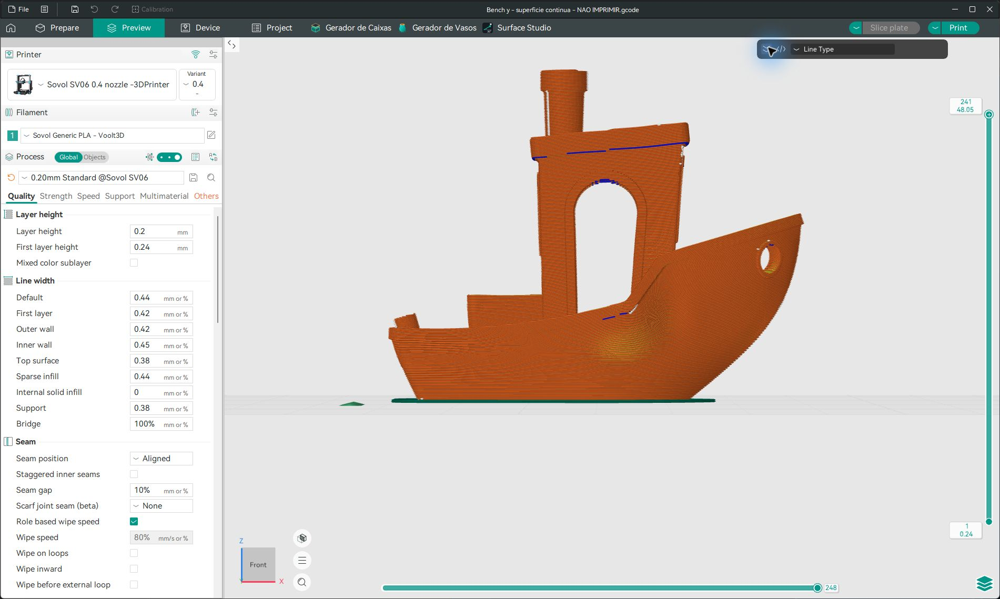
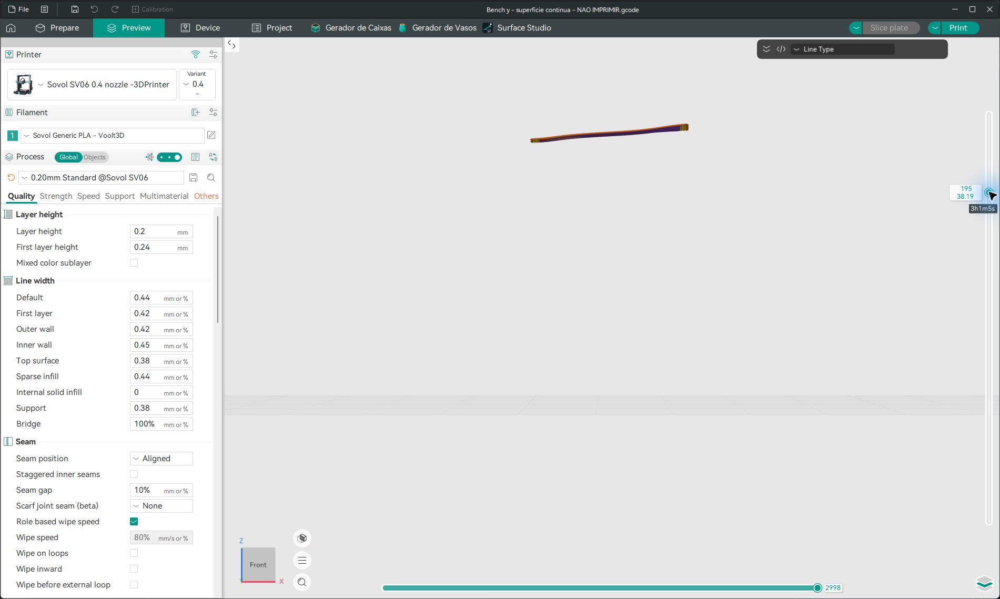
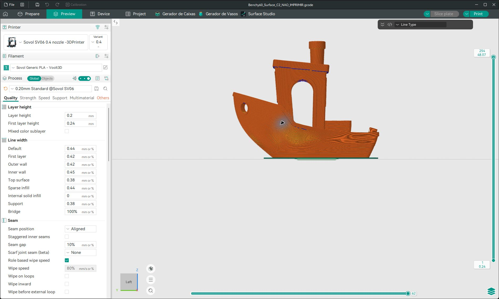
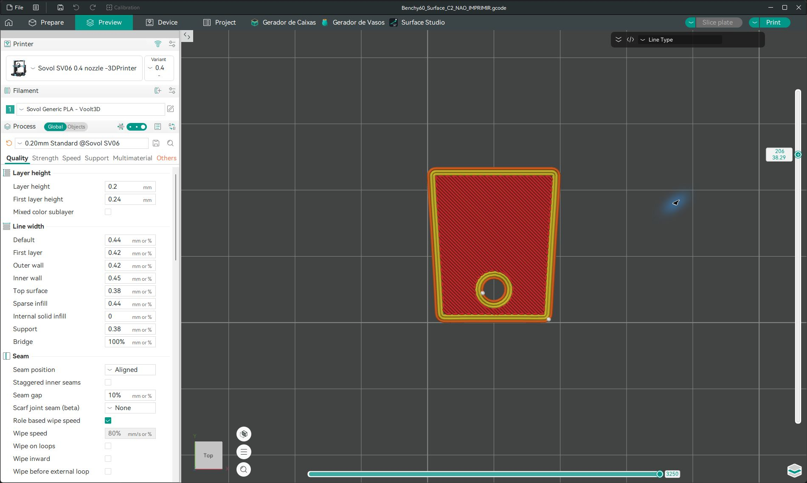
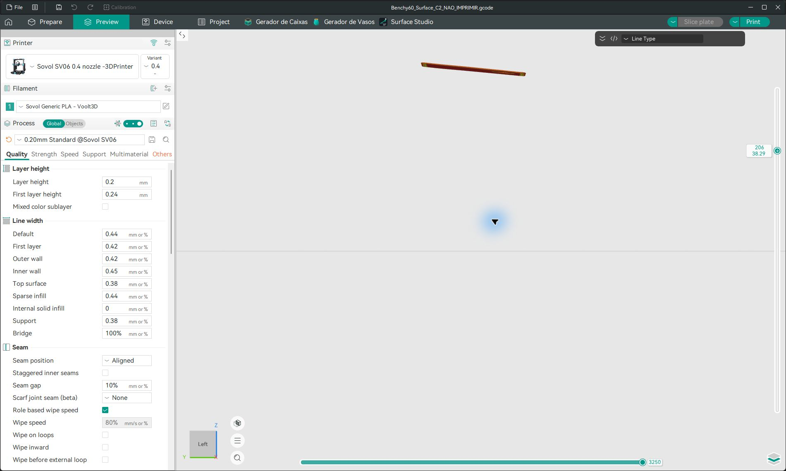

# Camadas contínuas sobre superfícies — estudo 0.14.0

**Em validação; sem liberação geral de impressão.** O objetivo é obter linhas
contínuas acompanhando cada superfície, com espaçamento regular e formato
preservado. O arquivo do Preview não deve ser enviado enquanto houver
pendências do cabeçote e da deposição.

## Uso pelo plugin

1. Em **Prepare**, adicione o modelo e escolha os perfis da impressora,
   filamento e processo. Abra **Surface Studio** e selecione o modelo.
2. Em **Selecionar áreas**, use **Peça inteira** para o novo cálculo conjunto.
   A pintura de regiões continua usando o cálculo local existente.
3. Clique em **Estudar movimento**. Aguarde o cálculo, o fatiamento de uma cópia
   e a conferência dos percursos. O original é preservado. Se uma verificação
   falhar, o resultado é recusado e o motivo aparece no Studio.
4. Clique em **Mandar para a bandeja** para abrir o G-code completo no Preview
   do Orca. Confira teto, casco, transições e movimentos de Z durante extrusão.
   O diálogo de envio usa a conexão da impressora selecionada, mas a liberação
   de um arquivo depende das verificações daquele arquivo e do cabeçote.

No Preview, **L** alterna a exibição de uma camada. **Shift+G** permite escolher
uma camada. Use a vista lateral para enxergar sua subida e descida em Z.
Não usar apenas a cor ou o nome da camada como prova de movimento não planar.

## O que foi corrigido

- Campo cúbico C2 conjunto, em vez de compor várias transições que comprimiam
  excessivamente algumas camadas. A redução global da tentativa 0.13.0 foi rejeitada.
- Referências incluem o interior das faces grandes. Usar somente os vértices
  deixava variações internas no teto e produzia contornos extras no fatiamento.
- Conferência da área de referência por limites completos da Hessiana em
  subtriângulos originais. Pelo menos 90% de cada referência deve caber em
  uma faixa nativa; pequenos resíduos e chanfros preservados são distinguidos.
- Geometria da cópia e cordas têm orçamentos separados, somando até 0,02 mm.
  Esse orçamento é da transformação matemática, não uma tolerância física
  garantida da peça impressa ou do arredondamento de camadas do fatiador.
- Extrusão e seção do cordão são recalculadas. Contribuições apoiadas fora
  da altura mínima/máxima do perfil impedem a geração.
- Cache guarda uma proposta geométrica; não guarda liberação de impressão.
  Resultados antigos exigem um novo estudo.

## Primeiro candidato: melhoria parcial, ainda reprovado

O primeiro candidato C2 foi gerado e aberto no Orca com o perfil **Sovol SV06
0.4 nozzle -3DPrinter** e PLA Voolt3D. A conferência do arquivo encontrou:

| Verificação | Observação |
| --- | --- |
| Camadas lógicas | 241 |
| Inclinação máxima emitida | 26,4435° |
| Alturas equivalentes emitidas, cordões apoiados | 0,104054–0,265525 mm |
| Alturas equivalentes fora de 0,07–0,28 mm | 0 |
| Movimentos de extrusão subindo / descendo | 188.035 / 187.126 |
| Pacote contém o mesmo G-code | Sim |
| SHA-256 | `75528bfe86aab6713044374d7df8c70ec75ec68092d7910df271b1c8c4b9aa28` |

O relatório original falhou ao serializar um contador NumPy. A falha foi
corrigida e recebeu teste de regressão. As observações acima foram recuperadas
por leitura independente do G-code completo e comparação do pacote; o
relatório original completo não foi recuperado.

O casco apresentou linhas contínuas, mas o teto ainda tinha contornos extras.
Foi isso que motivou a correção dos interiores das faces. As capturas são do
**primeiro candidato**, não uma aprovação da correção seguinte.

## Benchy de 60 mm: segundo cálculo conferido no Orca

O tamanho solicitado foi mantido: **60,001 × 31,004 × 48 mm** na malha
original. Uma rotação rígida de 90° na mesa troca os eixos XY e favorece a
folga; não reduz a escala nem modifica o formato. O motor integrado gerou
uma nova cópia, uma nova fatia nativa e uma única restauração de XYZ/E.

| Verificação do arquivo completo | Resultado |
| --- | --- |
| Camadas lógicas no Preview | 254 |
| Inclinação máxima durante deposição | 29,3658°; limite 30° |
| Cordões apoiados, altura equivalente | 0,094812–0,240000 mm |
| Contribuições fora dos limites de 0,07–0,28 mm | 0 |
| Passo lógico nativo | 0,20 mm; primeira camada plana de 0,24 mm |
| Subidas / descidas durante extrusão | 200.565 / 198.788 |
| Maior velocidade Z calculada dos segmentos restaurados | 4,4722 mm/s |
| Maior vazão na peça | 5,2584 mm³/s |
| Cobertura certificada das sete referências em uma faixa nativa | 97,31–100%; teto 100% |
| G-code gerado, pacote e arquivo temporário do Preview | Idênticos byte a byte |
| SHA-256 do G-code | `62c3d8f33ec2cd3f534b9e39de86d46f74cbb64336aead44d311e7b02d4e7789` |

O teto foi isolado na **camada 206 do Preview**. A vista superior mostrou o
preenchimento contínuo entre as bordas e ao redor da chaminé, sem os grandes
contornos extras do primeiro candidato. A vista lateral mostrou a mesma
camada inclinada. O valor único de Z na etiqueta do Orca não representa todos
os pontos daquela trajetória.

As transições do casco ficaram contínuas nas vistas inspecionadas, mas seu
espaçamento físico não é perfeitamente constante: o intervalo acima continua
variável. A conferência visual não comprova ausência de todo degrau em toda
a malha, nem acabamento ou adesão reais. Pontes mantêm sua seção nativa; sua
metainformação de altura não deve ser confundida com o limite dos cordões
apoiados.

O início e o término do perfil foram preservados, inclusive homing,
nivelamento, aquecimento e purga. Movimentos nativos de deslocamento podem
pedir avanço acima do limite de Z; o firmware os limita por `M203 Z10`,
preservado no arquivo e confirmado na configuração ativa. A purga nativa
alcança 14,43 mm³/s; ela não está incluída na vazão da peça acima. Nenhum
desses valores é uma medição da deposição física.

## Folga e estado do teste

O modelo nominal do cabeçote, deslocado para a hipótese de folga mínima de
4 mm informada pelo usuário, encontrou um ponto de material anterior dentro
do duto: linha atual 671.738, camada 110; material da linha 667.132, camada 109.
Isso reprova aquele candidato sob as hipóteses do estudo. Não comprova o
registro físico do CAD na máquina instalada.

Na análise anterior, uma hipótese de rotação teve um limite global positivo
microscópico, insuficiente para liberar. A rotina foi corrigida para consultar
a altura do material próximo quando o limite global não prova a margem
exigida. A margem continua **0,5 mm**; não foi diminuída para aceitar o arquivo.

No segundo cálculo de 60 mm, todos os movimentos lineares etiquetados foram
conferidos contra envoltórias do material anterior e do cordão atual. Sob a
**hipótese de afastamento mínimo de 4 mm informada pelo operador**, o limite
nominal conservador passou de 0,500002 mm. Esse valor é um limite da análise,
não a folga mínima medida da máquina. O CAD de fábrica sem esse deslocamento
continuou **inconclusivo**, com limite de **0,491789 mm** após refinar a grade
espacial até 0,05 mm e quatro faces analíticas do duto em subdomínios UV
completos. A margem exigida permaneceu 0,5 mm. Isso não comprova colisão;
o limite conservador ainda não demonstra a margem exigida nesse registro.
O registro físico do CAD e o contato bico/cordão permanecem não calibrados.
O resultado conserva `physical_validation=False` e `print_allowed=False`.

Uma consulta sem movimentos obteve os limites ativos da SV06: Z 10 mm/s e
100 mm/s²; o deslocamento XY do sensor informado pelo firmware é X25/Y−18.
O valor Z de `M851` é a compensação de disparo do sensor, **não** a altura
física de sua carcaça. A conferência inicial terminou sem impressão.
Posteriormente, com nova confirmação de presença e preparação da máquina,
o ensaio supervisionado de 60 mm teve seu início aceito em 22/11/2026,
00:36 (America/Sao_Paulo), usando a hipótese de 4 mm informada pelo operador.
O resultado físico permanece pendente. Transporte, reconciliação dos
comentários do servidor e limites estão no [ADR-0021](decisions/0021-supervised-benchy60-c2-trial.md).

## Alcance dos testes

**280 testes Python passaram**, incluindo preservação da base, interiores de
faces, inversão, reutilização da proposta sem liberação física, cordões fora
do perfil e refinamento conservador da folga. O wheel teve identidade e
dependências conferidas e foi aceito pela verificação de instalação sem
modificar o ambiente.

O motor integrado foi executado pela bancada com o perfil real, fatiador
nativo e verificações completas; o pacote final foi aberto e inspecionado
no Orca. O componente da interface passou nos quatro passos com WebGL,
alternativa sem WebGL e largura de 390 pixels. A instalação 0.14.0 preservou
o estado existente e o Studio carregou após reiniciar. Esse conjunto ainda
não equivale a repetir toda a geração pelos quatro botões nativos nesta
mesma revisão. Resultados antigos exigem um novo estudo.

Arquitetura e limites: [ADR-0020](decisions/0020-smooth-joint-surface-phase.md).
O teste de componente dos quatro passos não substitui o teste nativo no Orca,
e nenhum desses testes substitui a validação física.
