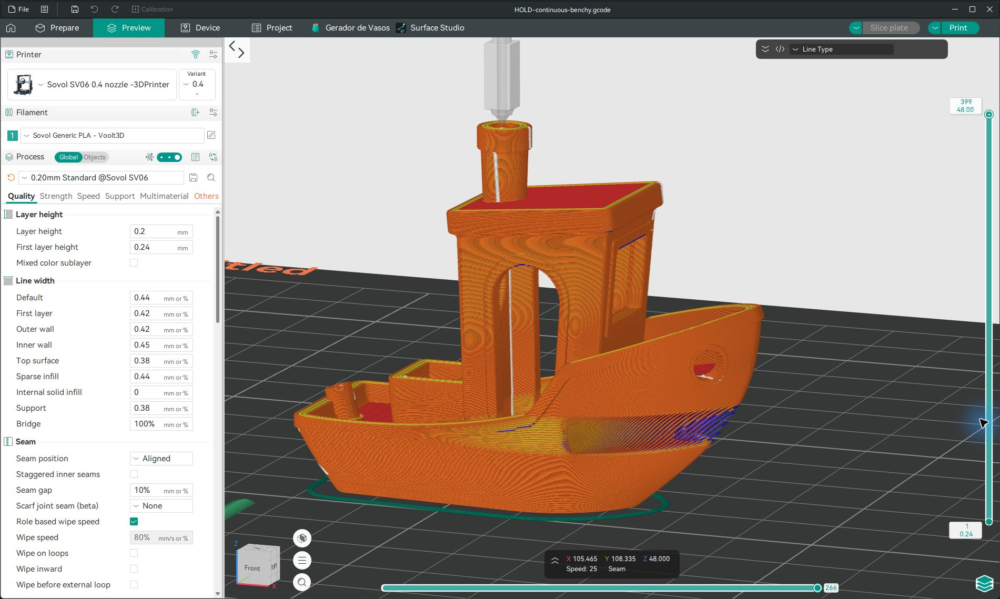
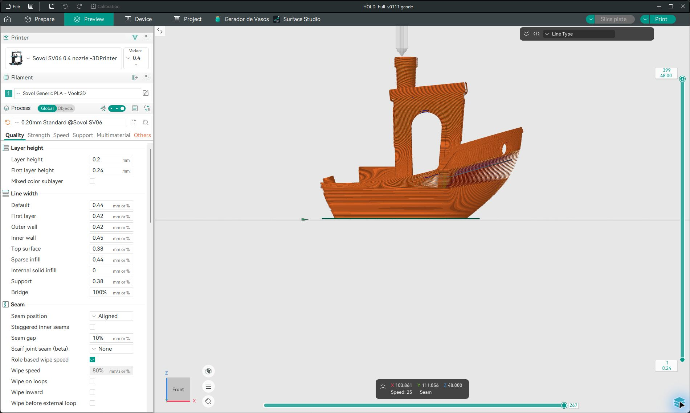
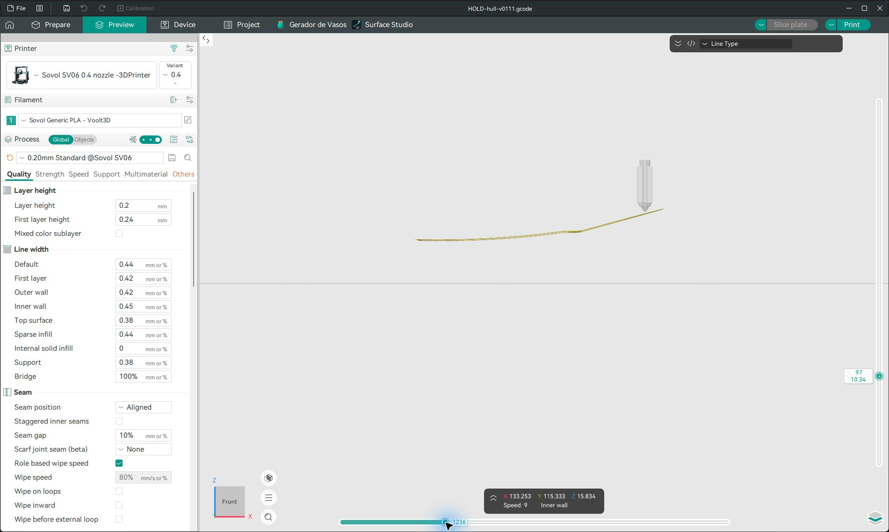
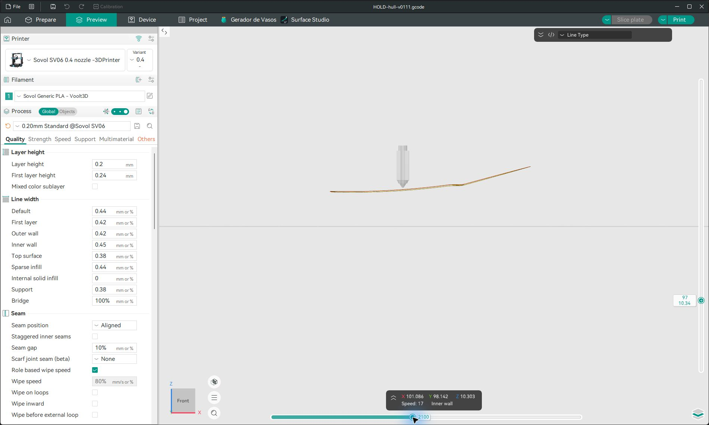

# Transições do casco — Surface Studio 0.11.1 experimental

O objetivo desta rodada é reduzir a faixa de movimentos muito inclinados no
casco frontal do Benchy, mantendo o formato da peça, o teto e a borda da proa.
O estudo digital não libera impressão física.

## Uso pelo plugin

O fluxo continua igual, sem um ajuste adicional para o casco:

1. Selecione o modelo no Surface Studio.
2. Em **Selecionar áreas**, escolha **Peça inteira**.
3. Clique **Estudar movimento** e aguarde o novo cálculo.
4. Com um resultado válido, clique **Mandar para a bandeja** e confira o Preview.

Um resultado da 0.11.0 precisa ser recalculado. Apenas reabrir o arquivo antigo
não aplica a correção. O botão de transferência abre o estudo no Preview e não
inicia impressão.

## Causa e correção

A ordem anterior calculava uma superfície traseira antes da região inclinada
frontal. Mesmo longe da superfície traseira, sua transição vertical esticava a
inclinação da outra região. O efeito aparecia como uma faixa muito concentrada
de subida no casco.

O novo planejador mantém a ordem necessária entre regiões que se sobrepõem.
Entre regiões separadas, calcula primeiro os marcos planos e as referências com
maior extensão vertical. A escolha é geométrica; não depende do nome Benchy ou
de coordenadas específicas do barco. A [decisão técnica](decisions/0016-order-independent-surface-transitions.md)
registra os limites dessa prioridade.

A mudança não esconde cores de overhang, não altera a forma original e não
aumenta o limite digital de 30°. A malha e os movimentos continuam sendo
conferidos com o orçamento total de erro de 0,02 mm.

## Conferência desta rodada

**Resultado parcial: inclinação reduzida e confirmada no Preview; deposição
ainda não aprovada.** Os 242 testes locais e os três cenários da interface
guiada passaram. A nova versão está instalada; a aba e o estado de permissões
existentes foram preservados. O Orca confirmou os 23 campos conferidos do
perfil exportado da SV06, com PLA Voolt3D.

A captura anterior mostra a faixa apontada pelo usuário:

Esta rodada executou a mesma entrada de cálculo do plugin, incluindo sua malha
intermediária correspondente, fatiamento nativo e restauração dos movimentos.
O pacote foi aberto **manualmente** no Preview. A verificação dos quatro passos
foi um teste de componente, separado dessa execução de referência; não se
declara uma nova execução completa dos quatro passos na interface nativa.

| Medida do G-code emitido | 0.11.0 | 0.11.1 |
|---|---:|---:|
| Maior inclinação de movimento durante extrusão, peça inteira | 52,664° | 17,614° |
| Maior inclinação na região frontal examinada | 52,664° | 17,261° |
| Comprimento com etiqueta nativa Overhang wall nessa região | 70,949 mm | 0,038 mm |
| Ocorrências do indicador de espaçamento acima da largura nominal | 1.170 | 2.166 |

A região de medição usa pontos médios com X > 118 mm e 7 < Z < 20 mm,
**somente na posição deste arquivo de referência**. Essas coordenadas não
estão no planejador do plugin. A etiqueta Overhang wall vem do fatiador; sua
redução não é uma prova de apoio físico dos cordões.

O limite digital de 30° passou nos 586.901 movimentos de deposição examinados.
A primeira camada permaneceu em 0,24 mm. Os sete núcleos de referência ficaram
em suas faixas nativas. O maior erro certificado da malha foi 0,009999987 mm,
dentro de sua parcela do orçamento de 0,02 mm. O menor segmento novo subdividido
mediu 0,199909 mm, acima de 0,15 mm. A exceção de arestas curtas originais
continua restrita ao estudo sem liberação física.

A nova vista frontal mostra a subida mais gradual e **ainda mostra lacunas**:

As vistas anterior e posterior usam câmeras e ampliações diferentes. Os valores
da tabela foram medidos nos arquivos, não estimados pelas imagens.

Na camada 97 exibida pelo Orca, o marcador passou por **Z 15,834 mm** e
**Z 10,303 mm**, ambos durante extrusão de Inner wall. A variação de Z ocorre
dentro da mesma camada lógica:

O G-code de referência e o pacote integrado têm conteúdo idêntico. Para a
inspeção manual, uma cópia separada recebeu um comentário inicial **HOLD —
PREVIEW ONLY**. O conteúdo dessa cópia, extraído do pacote e do cache carregado
pelo Orca, tem o mesmo SHA-256. Os [dados sanitizados da comparação](evidence/hull-v0111-benchy.json)
registram os três hashes, os testes e os limites.

## Limite físico

Inclinação do movimento, apoio entre camadas e folga do cabeçote são medidas
diferentes. Reduzir a primeira não comprova as outras. **O indicador de
espaçamento piorou nesta comparação**, de 1.170 para 2.166 ocorrências acima da
largura nominal. Seu máximo amostrado passou de 0,954 para 1,159 mm.

Esse indicador usa a altura de feature informada pelo Orca, incluindo pontes;
ele ainda não certifica a distância real entre cordões adjacentes. O contador
é por contribuição amostrada, não por lacuna física única. O Preview também
mantém anotações de altura de feature do fatiamento intermediário; sua aparência
não substitui a auditoria da deposição. As lacunas visíveis foram mantidas nas
capturas e não foram escondidas alterando cores ou largura de exibição.

Antes de imprimir, falta planejar conjuntamente inclinação e espaçamento local,
separar passo de camada e altura de feature nas pontes, validar a deposição e
concluir a folga do cabeçote. O estado permanece `print_allowed=false`.
**O Benchy não está pronto para imprimir.** Nenhuma impressão foi iniciada
nesta rodada, e o botão Print nativo não foi acionado.
