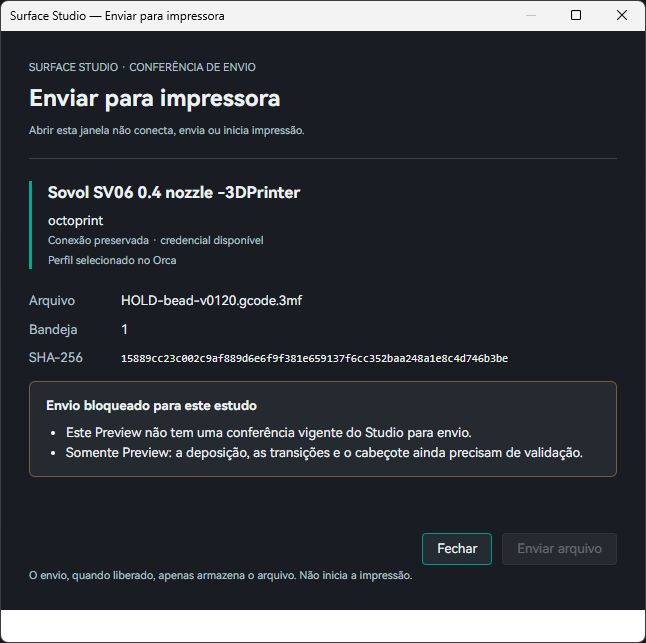

# Envio pelo perfil selecionado — 0.12.1 experimental

Teste realizado em 21/11/2026, Windows, OrcaSlicer 2.5.1.

A versão 0.12.1 abre a conferência de envio pelo botão **Enviar para
impressora…** do Surface Studio. A conexão é obtida do perfil selecionado no
Orca. Não é necessário digitar novamente o endereço ou a chave no plugin.
**Nenhum arquivo foi enviado à SV06 e nenhuma impressão foi iniciada.**

## Como usar

1. Selecionar a impressora e sua conexão no Orca, como de costume.
2. Fazer o estudo e abrir o resultado no Preview pelo passo **Mandar para a
   bandeja**. Os quatro passos de preparação continuam iguais.
3. Voltar à aba **Surface Studio** e clicar em **Enviar para impressora…**,
   no cabeçalho.
4. Conferir o perfil, o tipo de conexão, o arquivo e a bandeja no popup.
   Abrir essa janela não contata a impressora.
5. Se houver impedimentos, o botão **Enviar arquivo** fica desativado e a
   janela informa os motivos. Fechar a janela não envia nada.

Quando todos os critérios estiverem satisfeitos, o adaptador OctoPrint envia
somente o arquivo, sem selecionar uma peça ou iniciar uma impressão. Essa
operação foi testada no simulador; não foi exercitada com o Benchy real.
Outros agentes/protocolos ainda precisam de adaptadores para envio pelo Studio;
a conferência informa isso e não troca de destino automaticamente.

## Resultado observado com este Benchy

O mesmo pacote HOLD da 0.12.0 foi copiado, sem alteração de conteúdo, para o
armazenamento privado do plugin. Foi aberto pelo Orca e manteve 420 camadas,
48 mm de altura e as trajetórias do teste anterior. Não houve refatiamento do
modelo. A eventual indicação nativa de processamento refere-se à leitura do
G-code existente.

O popup abriu pelo botão da aba e mostrou:

- **Sovol SV06 0.4 nozzle -3DPrinter**;
- conexão **octoprint**, configurada e com credencial disponível;
- arquivo **HOLD-bead-v0120.gcode.3mf**, bandeja 1;
- SHA-256 correspondente ao arquivo realmente carregado no Preview;
- **Envio bloqueado para este estudo**, com o botão desativado.

A janela é criada e mantida pelo Orca para o plugin. Ela substitui o caminho
de envio pelo Studio; não é o diálogo legado do botão Print da barra do Orca.
O Print nativo continua com a limitação do pacote sem objetos de modelo.

O Benchy aberto manualmente após o reinício não possui uma autorização vigente
do controller. Além disso, o estudo anterior mantém alturas modeladas de
0,03304 mm abaixo do mínimo de 0,07 mm, e a qualificação física continua
pendente. Abrir o popup não remove essas restrições.

## O que a correção preserva

O plugin lê a conexão viva pela API de presets, separada do pacote de Preview.
Antes da abertura automática de um resultado, lembra a conexão em memória. Se
um preset importado omitir seu destino, recupera apenas a conexão lembrada ou
salva do mesmo perfil. Alterar a impressora ou limpar uma conexão normal não
reutiliza silenciosamente o destino anterior.

Neste ensaio nativo, a conexão veio diretamente do perfil vivo da SV06. A
ausência de endereço no pacote não implica perda da configuração salva.
Endereço, chave, usuário e caminhos de certificado não aparecem na página,
nas capturas ou na evidência pública. Não se acrescentou uma peça fictícia
à bandeja nem se alterou o G-code para abrir o diálogo.

O instalador conservou os bytes do estado existente durante a cópia. Ao
reiniciar, o próprio Orca atualizou o nome/versão registrados para Surface
Studio 0.12.1. Não foram alteradas concessões de segurança por código. Nos
reinícios de validação, os ajustes temporários de comentários e identificação
de objetos foram salvos em cópias de preset de processo, preservando o perfil
original: `0.20mm Standard @Sovol SV06 - Copy` e
`Surface Studio - captura - envio 2026-11-21`.

## Validação

| Verificação | Resultado |
|---|---|
| Testes locais | 259 aprovados |
| Passo a passo, incluindo o botão de conferência | 3 cenários aprovados |
| Popup e contraste com tema injetado | 2 cenários aprovados, 660 e 390 px |
| Abertura no Orca com o Benchy | Observada, conexão configurada |
| Hash do pacote e cache do Preview | Correspondentes |
| Envio autorizado de arquivo | Somente simulador, sem selecionar ou imprimir |
| Envio ou impressão real | Não executados |

Os testes também verificam troca de destino, remoção de endereço, separação de
credenciais, alteração de pacote/hash, protocolo não suportado, resultado
somente de Preview e mensagens que tentem fornecer uma autorização pelo HTML.

O diagnóstico e os hashes sanitizados estão no
[registro de evidência](evidence/send-v0121-benchy.json). A decisão de integração
está na [ADR-0018](decisions/0018-selected-printer-send-review.md).
