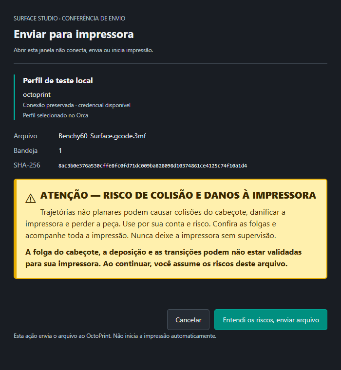
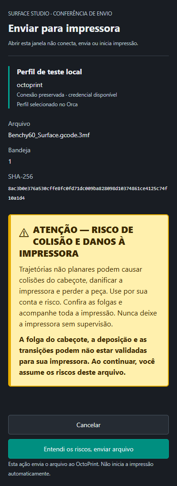
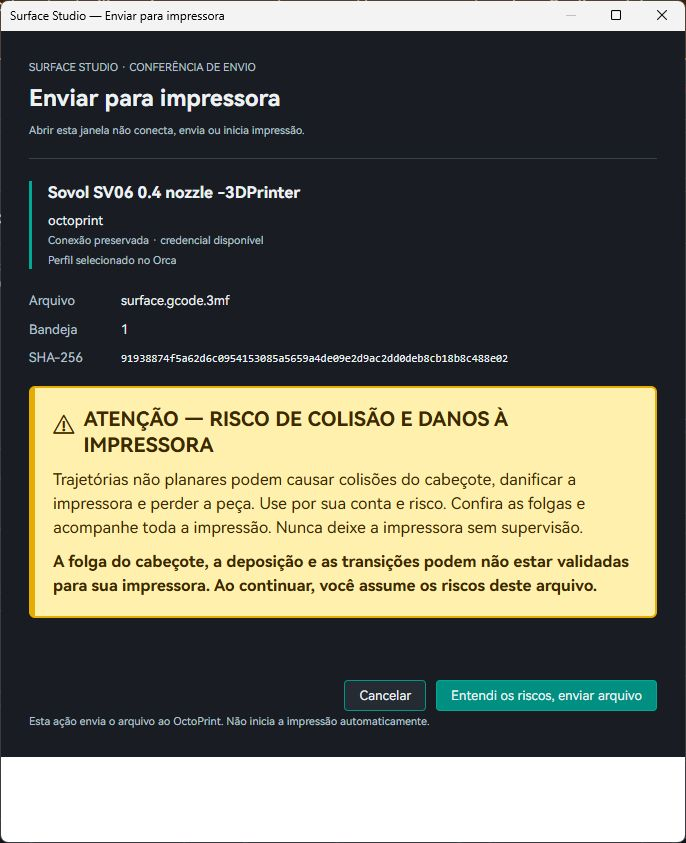
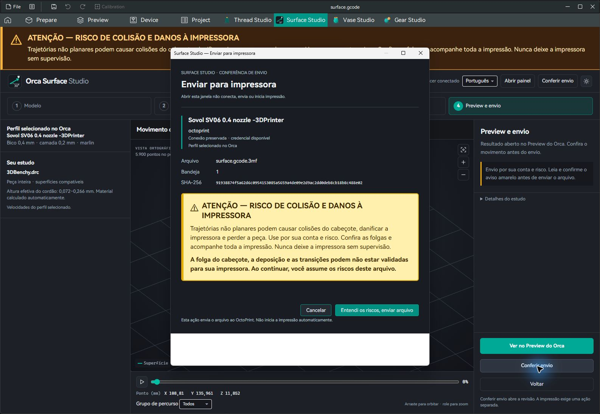

# Envio por conta e risco — Surface Studio 0.16.3

Data: 23/11/2026. Versão experimental; publicação no Orca Cloud suspensa.

## Como usar

1. Gere o resultado no Studio e abra **Ver no Preview do Orca**.
2. Confira as trajetórias. Volte ao Studio e clique **Conferir envio**.
3. Leia o aviso amarelo. Escolha **Cancelar** ou **Entendi os riscos, enviar arquivo**.

A janela mostra a impressora selecionada e o arquivo que será enviado. Não há
caixa extra para marcar nem uma segunda confirmação do mesmo aviso. A decisão
vale para aquele envio; abrir uma nova janela apresenta o aviso novamente.

**O botão envia o arquivo ao OctoPrint sem selecioná-lo nem iniciar a impressão.**
O início continua sendo uma ação separada no receptor. Este comportamento está
escrito na janela; esta versão não acrescenta um comando de início automático.

## O que mudou

A ausência de validação física de deposição, transições e cabeçote deixou de
bloquear o envio. O aviso amarelo informa risco de colisão, danos à impressora
e perda da peça, pede conferir as folgas e acompanhar toda a impressão.

Isso permite ao operador decidir continuar por sua conta e risco. Não altera
os cálculos nem marca o estudo como fisicamente validado.

Arquivo modificado, Preview sem conferência vigente, impressora/conexão
alterada, falta de chave ou adaptador não suportado continuam exigindo correção.
Cordões abaixo ou acima dos limites do perfil também continuam impedindo o envio.
O aviso não remove os limites da máquina.

Nesta versão, o envio direto pelo Studio atende a conexão OctoPrint. Outros
adaptadores continuam com diagnóstico explícito; não há troca silenciosa de
impressora ou destino.

## Verificação

305 testes locais aprovados. O simulador recebeu o conteúdo original, com
`print=False` e `select=False`, somente após confirmação verdadeira. Pedidos
sem confirmação, janela antiga e clique duplicado não geraram outra transferência.

O aviso foi conferido nos sete idiomas, em 700 e 390 px, inclusive sob o tema
que o Orca injeta. A abertura não faz acesso à rede. Erro de envio não reativa
o botão nem repete a transferência automaticamente.

Também foi enviado ao simulador o G-code completo do Benchy já conferido:
38.477.402 bytes, SHA-256
`8ac3b0e376a530cffe8fc0fd71dc009ba828098d10374861ce4125c74f10a1d4`.
O conteúdo recebido foi idêntico; sem confirmação houve zero pedidos, e após
confirmar houve um upload, com seleção e impressão falsas. A validação física
do relatório continuou falsa. Essa foi uma reprodução isolada com o arquivo
da 0.16.2, não um envio à SV06 nem uma nova qualificação do Preview.
Veja o [recibo sanitizado do simulador](evidence/risk-send-v0163.json).

### Capturas do componente isolado

Estas imagens usam um perfil de teste, sem conexão com uma impressora real.

### Conferência no Orca

A 0.16.3 foi instalada preservando ativação e permissões existentes. O Orca foi
reiniciado e o Benchy de 60 mm reaberto com a proa para SOVOL. A preparação do
Preview terminou. G-code, pacote e cache carregado no Orca têm conteúdo idêntico,
com SHA-256
`91938874f5a62d6c0954153085a5659a4de09e2d9ac2dd0deb8cb18b8c488e02`.

**Conferir envio** abriu o aviso amarelo com a conexão da SV06 preservada e
**Entendi os riscos, enviar arquivo** habilitado, mesmo com os campos de
validação física do estudo ainda falsos. A janela foi fechada pelo X sem
transferência. O botão **Cancelar** foi exercitado no teste de componente;
a transferência confirmada foi testada somente no simulador.

Nenhum arquivo foi enviado à impressora real nem houve início de impressão
nesta conferência. Veja o [recibo da conferência nativa](evidence/risk-send-native-v0163.json).

Detalhes da decisão: [ADR-0025](decisions/0025-explicit-risk-acknowledged-upload.md).
