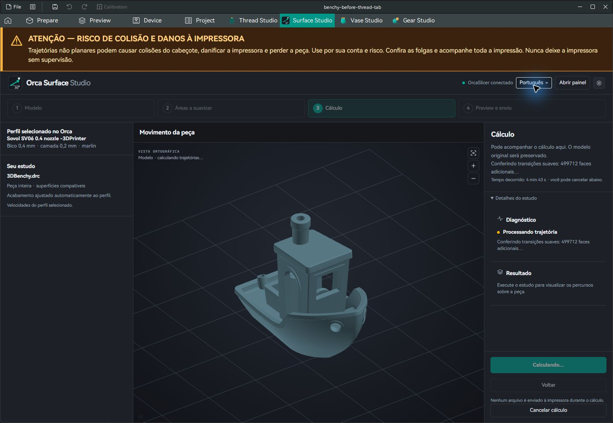
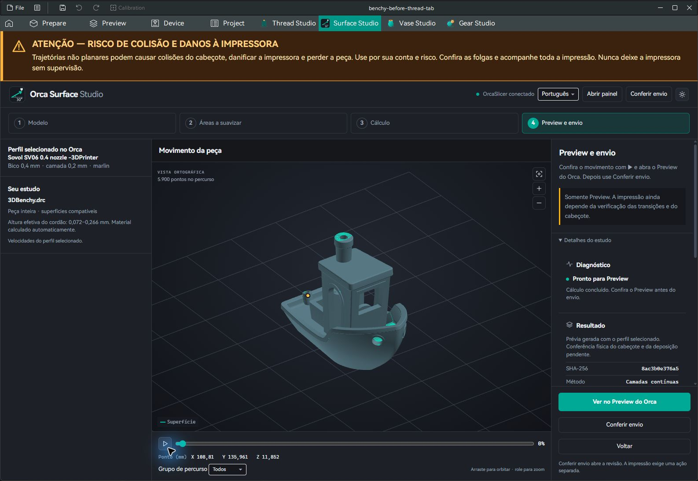
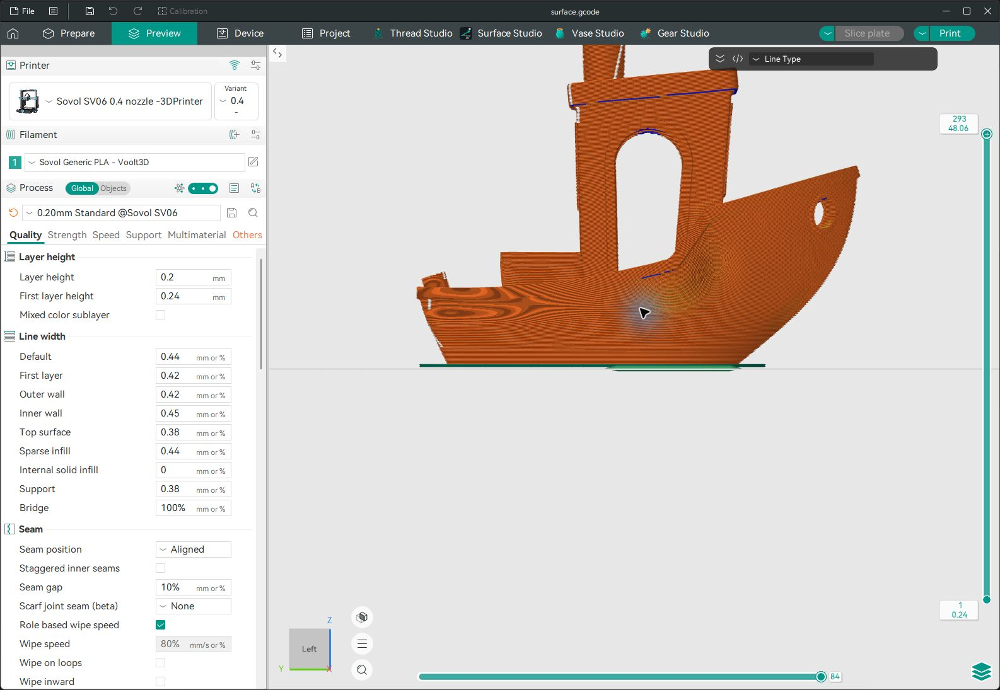
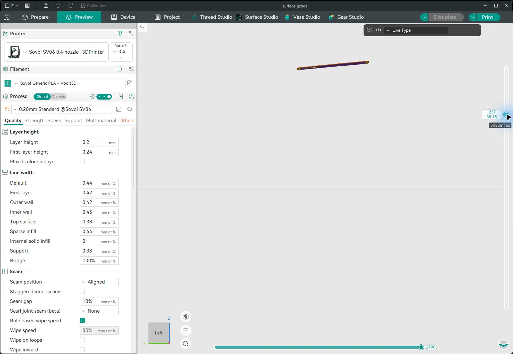
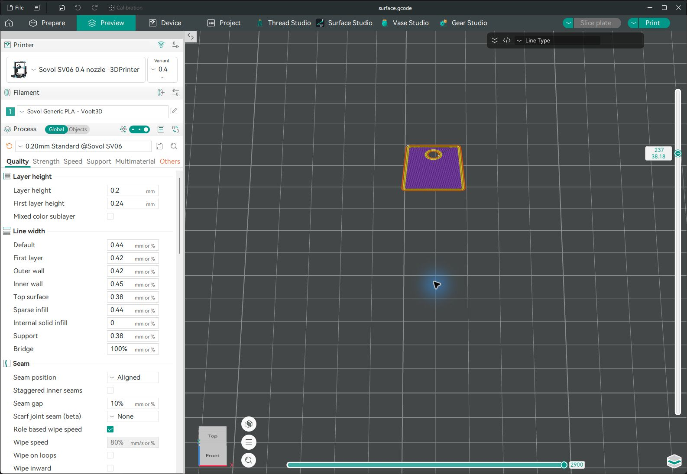
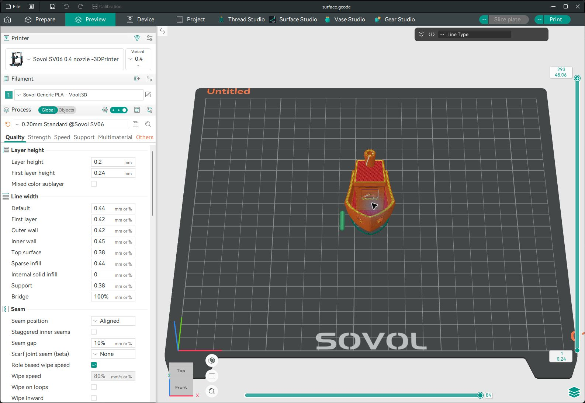
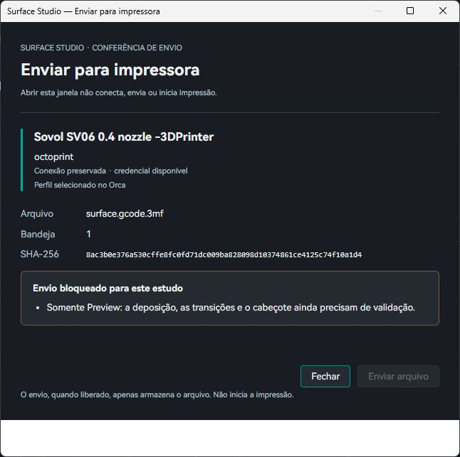

# Surface Studio 0.16.2 — espaçamento dentro do perfil

Data: 23/11/2026. Versão experimental, sem publicação no Orca Cloud.

## Uso

O fluxo permanece: escolher modelo → escolher áreas → **Calcular e preparar
Preview** → **Ver no Preview do Orca**. Não foi acrescentado um controle de
altura para o usuário compensar erros manualmente. O Studio lê os limites
mínimo e máximo do perfil selecionado no Orca.

Em **Peça inteira**, o cálculo pode agora redistribuir as camadas da cópia de
fatiamento e fatiar novamente quando os cordões apoiados saem desses limites.
Isso não modifica o modelo original nem aumenta os limites do perfil.

## Correção

O Benchy falhava no primeiro cordão acima de 0,28 mm. Corrigir somente esse
primeiro ponto deixava outros trechos do casco com alturas maiores. Uma
varredura de proposta percorre agora os caminhos nativos da peça inteira,
excluindo pontes, ironing e outros objetos. Ela estima os extremos pelo mesmo
modelo de distância normal finita usado na deposição.

A proposta balanceia altura mínima e máxima. A nova distribuição mantém o
mesmo campo de superfícies e precisa passar novamente pelos certificados das
faixas de referência. A cópia é dividida nos nós dos mapas antigo e novo antes
da troca afim; assim, a mudança não consome um novo orçamento geométrico.

O passo das camadas da cópia usa múltiplos de 0,001 mm, compatíveis com o XYZ
emitido pelo Orca. A tolerância do leitor de G-code planar não foi relaxada.
São permitidas no máximo quatro tentativas de fatiamento. Sem uma solução,
o cálculo termina com erro e não entrega um G-code final.

**A amostragem orienta a proposta; não aprova o arquivo.** A restauração final
continua verificando todos os segmentos emitidos, extrusão, largura, alturas,
inclinação, velocidades, formato e igualdade do G-code no pacote do Preview.
Os limites do perfil e suas tolerâncias anteriores foram preservados.

## Evidência automatizada

- 304 testes locais aprovados: `python -m unittest discover -s tests -q`.
- Pacote independente e wheel 0.16.2 gerados; importação fora do host aprovada.
- Reprodução offline da captura nativa do Benchy de 60 mm, perfil SV06,
  camada nominal de 0,20 mm, primeira camada de 0,24 mm, limites 0,07–0,28 mm.
- Proposta inicial: 828.451 amostras; extremos de 0,083728 a 0,326835 mm.
- Redistribuição da cópia: 0,200 → 0,169 mm, mesmo campo, referências
  novamente verificadas, novo fatiamento nativo.
- Auditoria final emitida: 0,071540684–0,265717425 mm; zero ocorrências fora
  dos limites. Pontes e ironing mantêm o modelo nativo de seção.
- SHA-256 dessa reprodução offline:
  `3b067a181d1af00ac6aa891ec0f1d3010c172b8d97b82cbb94dceaddb30caf08`.

A reprodução usou a malha refinada capturada para isolar o espaçamento.
Ela não substitui uma execução nova pelo plugin, a conferência visual no Orca
ou a verificação do cabeçote instalado. Seus arquivos continuam marcados como
não qualificados para impressão física.

## Validação nativa e física

0.16.2 instalada, Orca reiniciado com autorização e projeto preservado.
O Benchy de 60 mm já está com a proa voltada para a frente SOVOL; giro adicional
do Studio mantido em 0°. Cálculo novo iniciado pelo botão do plugin.

O novo cálculo pelo plugin terminou em aproximadamente 12 minutos, incluindo
preservação da malha, duas fatias nativas e restauração completa. O cache
reaproveitou somente a proposta do campo; suas verificações foram refeitas.
Esse tempo é uma execução observada, não um benchmark comparativo.

| Verificação do arquivo nativo | Resultado |
| --- | --- |
| Limites do perfil | 0,07–0,28 mm, preservados |
| Cordões apoiados emitidos | 0,071540684–0,265717426 mm |
| Ocorrências fora desses limites | 0 |
| Distribuição da cópia | 0,169 mm; segunda fatia aprovada |
| Maior inclinação emitida | 27,959738°, limite digital 30° |
| Primeira camada | Plana em Z 0,24 mm |
| Camada 237, extrusões | 2.745, das quais 2.744 variam Z |
| Camada 237, Z real | 37,957824–40,099752 mm |
| G-code final, pacote e temporário do Preview | Bytes idênticos |

SHA-256 do resultado **novo, gerado pelo plugin**:
`8ac3b0e376a530cffe8fc0fd71dc009ba828098d10374861ce4125c74f10a1d4`.
Ele é diferente da reprodução offline acima. As trajetórias também não são
idênticas; a verificação de folga não será herdada dessa reprodução.

No botão **Ver no Preview do Orca**, o host abriu a escolha nativa do pacote.
Foi necessário marcar **Open as project** e confirmar. O Orca entrou no Preview
sem refatiar o modelo: processou o G-code existente. A inspeção lateral não
mostrou a lacuna ampla anterior no casco. A camada 237 foi isolada com `L`
para conferir o teto inclinado; a variação XYZ foi verificada no arquivo.
Não se afirma ausência de qualquer defeito físico a partir dessa imagem.

**Conferir envio** abriu a janela com a SV06 selecionada, conexão OctoPrint
preservada, credencial disponível e hash correto. O botão de enviar continua
indisponível pela validação física pendente. Nenhum upload, seleção de trabalho
ou início de impressão foi realizado neste ciclo.

### Capturas do processo

### Cabeçote

A conferência inicial da reprodução offline, com todas as faces da carcaça
inferior e sem deslocar o CAD para a hipótese de 4 mm, ficou **inconclusiva**.
Os limites conservativos se sobrepõem ao material; isso não prova contato.
Está em execução uma revisão mais detalhada, com subdivisões analíticas das
faces inferiores do duto e da carcaça, sobre o arquivo nativo novo.
O registro do cabeçote instalado continua sem medição independente.

Não há liberação física, publicação no Orca Cloud ou início inferido dos testes.
