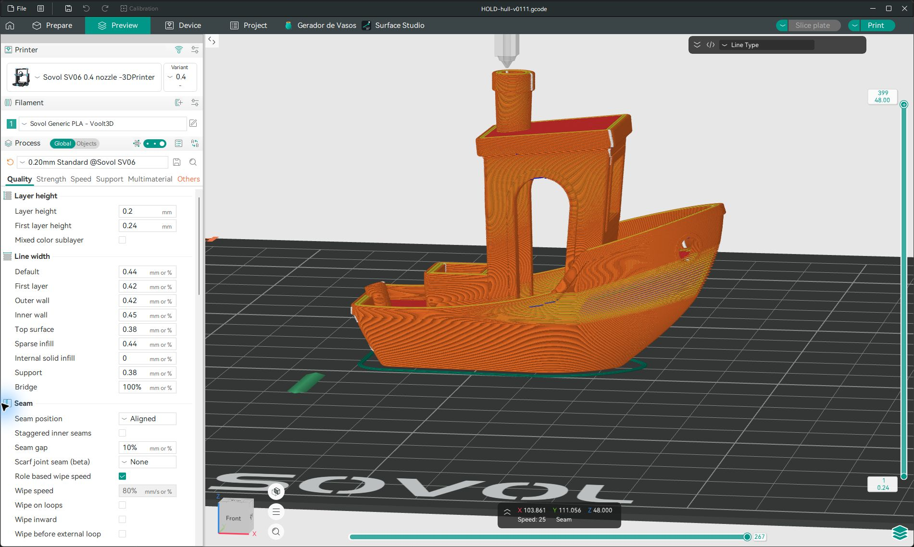
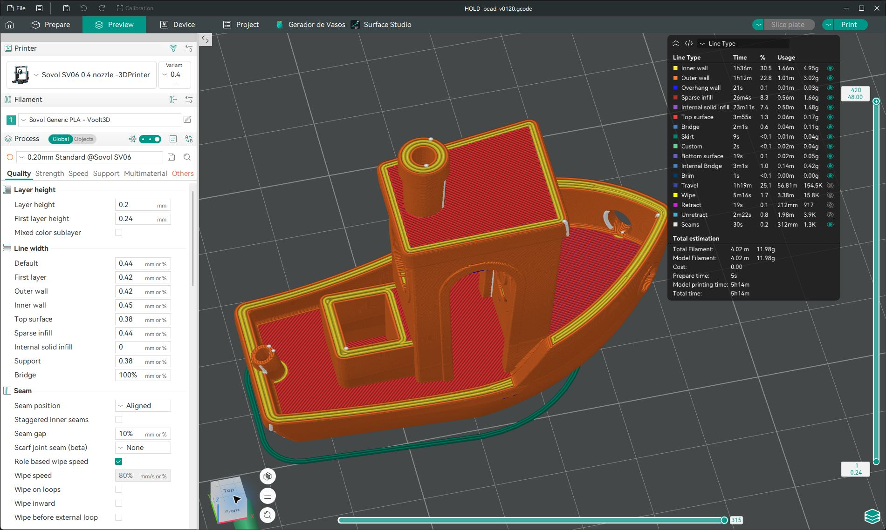
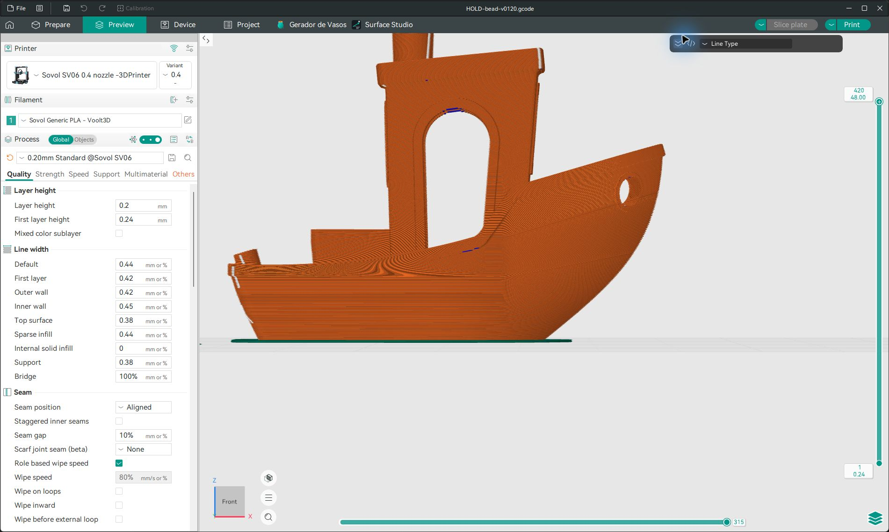
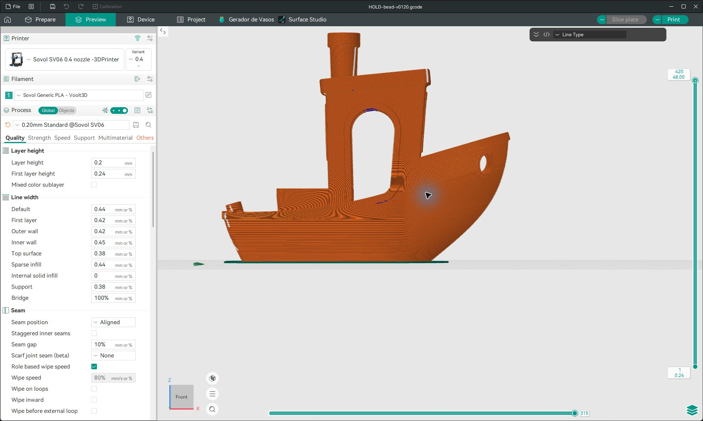

# Espaçamento e material no casco — 0.12.0 experimental

Conferência em 21/11/2026, Windows, OrcaSlicer 2.5.1, perfil selecionado
**Sovol SV06 0.4 nozzle -3DPrinter**, PLA Voolt3D. Nenhuma impressão foi iniciada.

O cálculo foi alterado e a faixa do casco que aparecia aberta ficou preenchida
nas vistas inspecionadas do Preview. Isso ainda não comprova deposição física
adequada: existem trechos cuja altura modelada está abaixo do mínimo do perfil.
O arquivo continua identificado como **HOLD / somente Preview**.

## Uso pelo usuário

O fluxo continua igual, sem um novo ajuste de fluxo ou altura obrigatório:

1. Em **Surface Studio**, selecionar o modelo da bandeja.
2. Selecionar as áreas; para este método experimental, usar **Peça inteira**.
3. Clicar em **Estudar movimento** e conferir o diagnóstico. O material é
   calculado automaticamente e a faixa de altura efetiva aparece no resultado.
4. Usar **Mandar para a bandeja** para abrir o Preview do Orca. Esse passo não
   inicia uma impressão. Um aviso de altura fora do perfil exige nova revisão.

Os limites vêm do perfil resolvido do Orca, sem valores da SV06 fixos no motor.
Isso não certifica todos os modelos, impressoras ou cabeçotes.

## O que mudou no cálculo

A altura nominal de 0,20 mm do perfil não foi aumentada globalmente. A primeira
camada de 0,24 mm foi preservada, assim como o passo de referência de 0,12 mm
da cópia intermediária. O problema estava na distância resultante entre os
percursos depois de restaurar as superfícies curvas.

O Studio agora calcula a altura normal aproximada entre camadas mapeadas e
ajusta o volume de extrusão à seção finita do cordão, mantendo a largura e o
fator de fluxo nativos. Onde o cordão fica mais alto, a quantidade de material
acompanha essa altura. Onde a distância ultrapassaria o limite, a cópia recebe
intervalos adicionais e é fatiada novamente pelo Orca. Neste Benchy foram
necessários **21 intervalos**, totalizando **420 camadas**, antes 399.

Os comentários de altura e largura do G-code passam a corresponder à seção
modelada, junto com a alteração real da extrusão E. A melhoria não é somente
uma alteração de desenho no Preview. Pontes e ironing preservam sua seção
nativa por comprimento; não recebem a dilatação usada nos cordões apoiados.

O material total não precisa aumentar: a correção das pontes e das outras
seções pode compensar o aumento localizado. Aplicar mais fluxo em toda a peça
poderia criar excesso de material sem resolver a distribuição das camadas.

## Comparação nativa

Antes, 0.11.1: os intervalos abertos aparecem na faixa inclinada da proa.

Depois, 0.12.0: conferência em perspectiva, com as 420 camadas visíveis.

Detalhe lateral: a faixa anteriormente aberta aparece preenchida e as
trajetórias continuam acompanhando o casco.

Vista lateral da peça completa, deixada aberta no Orca.

As capturas são imagens nativas sem retoque; câmera e escala diferem entre
antes e depois. Elas documentam a inspeção, não uma medição de todas as
lacunas ou prova de aderência. Permanecem linhas de camada, costuras, marcas
de ponte e detalhes de transição visíveis. Não se declara superfície perfeita.

## Verificações e limites

| Verificação | Resultado |
|---|---|
| Altura normal modelada dos cordões apoiados | 0,03304–0,24000 mm |
| Faixa permitida pelo perfil | 0,07–0,28 mm |
| Ocorrências amostradas abaixo do mínimo | 66.032; não são camadas distintas |
| Ocorrências acima do máximo | 0 |
| Maior inclinação de movimento com extrusão | 17,6143°, limite do estudo 30° |
| Primeira camada | 0,24 mm, preservada |
| Maior erro de corda medido | 0,009996 mm |
| Limite herdado de malha/quinas | 0,010000 mm, orçamento total 0,02 mm |
| Menor segmento novo subdividido | 0,199415 mm, mínimo exigido 0,15 mm |
| Configuração efetiva | 23 campos conferidos, correspondentes |
| Testes locais | 250 aprovados |
| Componente do passo a passo | 3 cenários aprovados: WebGL, fallback, móvel |
| Transporte e impressão | Não executados neste ensaio |

O planejamento verificou o limite superior das células completas, com margem,
e refez o fatiamento uma vez. O maior limite vertical final foi 0,240000012 mm
(inclui tolerância numérica). A geometria original, os furos, a base e as
referências de superfície foram preservados pelo mapeamento reversível.

O antigo indicador de espaçamento incluía alturas de pontes como se fossem
passos entre camadas. Os números antigos não são diretamente comparáveis ao
novo indicador de cordões apoiados. A altura nativa de ponte interna de
0,368782 mm continua separada; ela não representa uma lacuna entre paredes.

**A impressão permanece bloqueada.** O máximo passou, mas o mínimo de
0,03304 mm não satisfaz o perfil. Também continuam pendentes aderência real,
apoio das pontes e qualificação do envelope do cabeçote para este arquivo.
O bom resultado visual não elimina essas pendências.

## Como o ensaio foi produzido

A instalação local foi atualizada para 0.12.0, preservando o estado existente.
O teste do motor retomou a malha intermediária correspondente e certificada da
0.11.1, com 1.758.790 faces, e recalculou as referências a partir do original.
Cada célula acrescentada é afim e restaura exatamente o triângulo precedente,
herdando seu limite de erro. A cópia final tem 1.820.356 faces.

Depois disso houve novo fatiamento pelo Orca em segundo plano, conferência da
configuração e transformação única do G-code correspondente à nova cópia.
Não se reaproveitou G-code de outra geometria nem se aplicou a transformação
duas vezes. Esta rodada não refez do zero o refinamento não linear original.

A abertura e a inspeção do pacote fatiado foram realizadas na interface nativa,
sem refatiamento no Preview. Os três testes do passo a passo foram testes de
componente; não substituem uma execução integral dos quatro passos no Orca.

O G-code gerado e o extraído do pacote integrado têm o mesmo SHA-256. Para
esta abertura manual foi acrescentado um comentário inicial **HOLD**, que muda
o hash sem modificar movimentos ou extrusão. O conteúdo extraído desse pacote
e o cache realmente carregado pelo Preview também correspondem byte a byte.

Os hashes e métricas sanitizados estão no
[registro de evidência](evidence/bead-v0120-benchy.json). Perfis completos,
G-code, projetos 3MF e arquivos de cache não são publicados neste relatório.
A justificativa matemática está na [ADR-0017](decisions/0017-logical-pitch-finite-beads.md).
