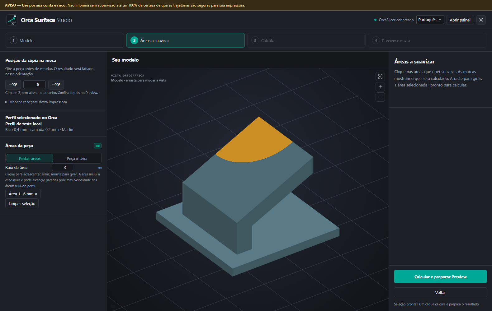
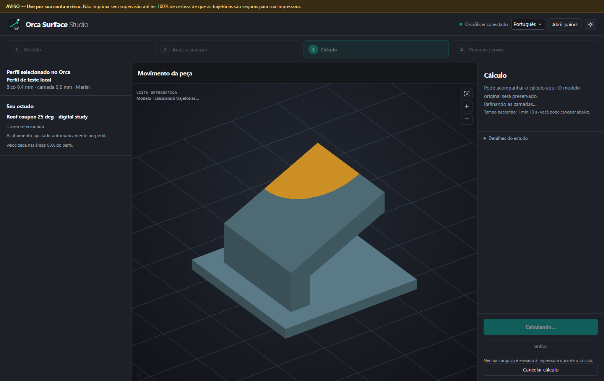
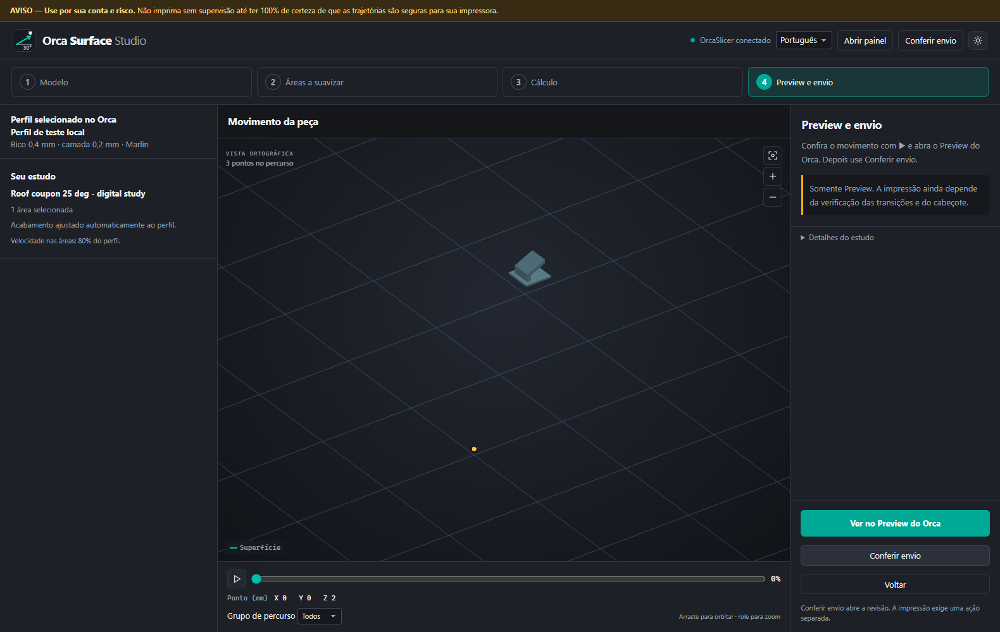

# Surface Studio 0.16.0 — fluxo simples e cálculo sem repetição

Data: 23/11/2026. Versão experimental; publicação no Orca Cloud continua suspensa.

## Como usar

1. Adicione a peça no Orca e escolha os perfis de impressora e filamento.
   Abra **Surface Studio** e clique no nome do modelo. Isso já abre a escolha
   das áreas. Com um único modelo destacado, **Escolher áreas** faz a mesma coisa.
2. Use **Pintar áreas** e clique nas regiões desejadas. As marcas amarelas mostram
   a seleção; arraste para girar e remova uma marca pela lista, se necessário.
   Como alternativa, **Peça inteira** mantém o cálculo conjunto de teto e bordas
   compatíveis. Essa alternativa exige mais trabalho e pode levar vários minutos.
3. Clique uma vez em **Calcular e preparar Preview**. O Studio mostra a operação
   em andamento e o tempo decorrido. **Cancelar cálculo** permanece disponível.
   Não é necessário avançar para uma segunda tela e confirmar o cálculo novamente.
4. No resultado, use **Ver no Preview do Orca** para conferir os movimentos.
   Depois, **Conferir envio** abre a revisão do arquivo, impressora selecionada
   e verificações pendentes. A impressão exige uma ação separada nesse diálogo.

O perfil acompanha o Orca. Não é necessário informar novamente diâmetro do bico,
altura nominal ou filamento. Giro e mapa de cabeçote continuam disponíveis na
escolha das áreas; o mapa visual não constitui uma verificação de colisões.

**Pintar áreas** continua usando o acabamento local nativo do Orca, com suas
limitações de superfícies elegíveis. **Peça inteira** continua usando o campo
conjunto C2. Esta versão não troca esses métodos nem promete suavizar qualquer
face de qualquer modelo. O padrão de peça inteira foi preservado para manter
o cálculo já aprovado visualmente no Benchy.

## O que ficou mais claro

- Clicar no modelo já leva às áreas, sem outra confirmação obrigatória.
- O botão de cálculo fica indisponível durante a execução para evitar pedidos duplicados.
- O andamento fica na tela principal; os detalhes técnicos continuam recolhidos.
- Voltar de um resultado leva diretamente às áreas, sem passar por uma tela de cálculo concluído.
- Sem alterar a seleção, **Ver resultado já calculado** retorna ao resultado imediatamente.
- Um erro de espaçamento orienta voltar e testar uma região menor. O motivo completo fica em **Detalhes do estudo**.
- Um G-code já aberto mostra **G-code aberto no Preview** e **Conferir envio**,
  em vez de exigir um modelo editável que aquele arquivo não possui.

## O que ficou mais rápido

A abertura deixou de construir o catálogo completo de telhados antes de liberar
a lista de objetos. O fluxo guiado usa pintura ou a malha completa; os métodos
antigos continuam construindo seus catálogos quando são efetivamente utilizados.

As consultas dos limites das derivadas do campo C2 passaram a reaproveitar os
mesmos suportes dos nós da spline. Não há arredondamento de coordenadas,
redução de faces ou relaxamento da tolerância de 0,02 mm. O teste de regressão
compara os resultados exatamente, incluindo limites dos nós, valores adjacentes
em ponto flutuante e caixas fora do domínio.

O controlador também reaproveita o resultado atual de um pedido idêntico,
somente na mesma sessão. A identidade inclui revisão do projeto, objeto e
parâmetros. Antes de reaproveitar, confere o SHA-256 do G-code e o conteúdo
extraído da placa correta no pacote. Arquivo alterado, perfil diferente ou
nova seleção exigem um novo cálculo. Esse reaproveitamento não concede
qualificação física nem substitui a conferência do Preview.

### Medição reproduzível com o Benchy

Malha de referência: 225.154 triângulos. Foram consultadas 24.000 caixas
de faces e subdivisões, com três execuções e caches inicialmente vazios.

| Etapa medida | 0.15.4, mediana | 0.16.0, mediana |
|---|---:|---:|
| Limites locais dos coeficientes | 4,696 s | 2,744 s |

Redução de aproximadamente **42% nessa etapa** (1,71×). Todos os limites
comparados foram idênticos. Isso **não mede o tempo total** de otimização,
refinamento, fatiamento e geração do G-code; não se deve atribuir esse ganho
ao fluxo inteiro.

Use `scripts/benchmark_phase_bounds.py` com um retrato JSON e seu cache de fase
salvos. A referência local de código usada foi o commit `032c8e8`.
O [resultado numérico](evidence/v0160-phase-benchmark.json) registra as três execuções.

## Validação

- 301 testes Python passaram, incluindo certificados geométricos, extrusão,
  controle de estado, cancelamento e bloqueios de transporte.
- Ensaio de interface em 1580 × 1000 com WebGL, na alternativa Canvas e em
  390 × 844. Seleção, cálculo com um clique, progresso, erro, repetição,
  invalidação e abertura da revisão de envio passaram, sem erro de JavaScript.
- Os comandos de interface foram inspecionados: somente abertura de Preview
  e revisão de envio; nenhum comando de upload ou início de impressão.
- Conferência desta versão no Orca real: pendente de autorização para assumir
  mouse e teclado. As imagens abaixo são do ensaio local do componente.
- Não foi enviada nem iniciada impressão. A folga física do Benchy permanece
  pendente; esta melhoria de interface não libera esse arquivo para a SV06.

## Imagens do fluxo

Ensaio local com um cupom geométrico de referência, sem conexão com impressora.

