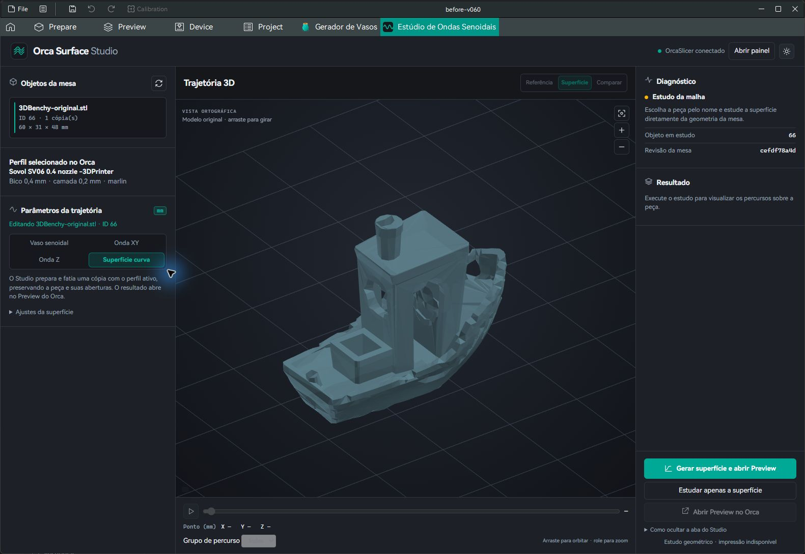
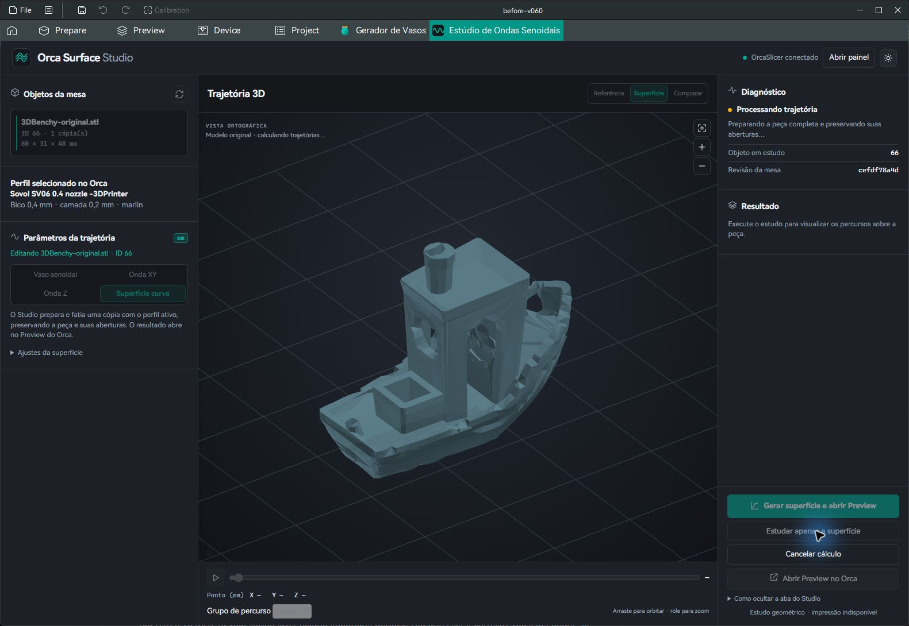
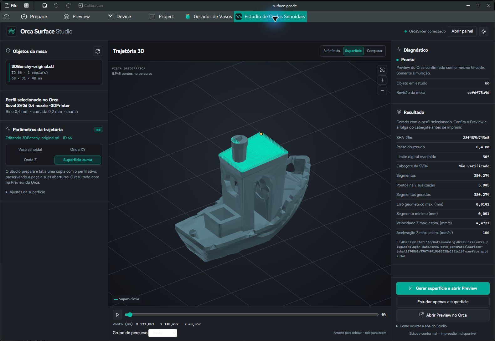
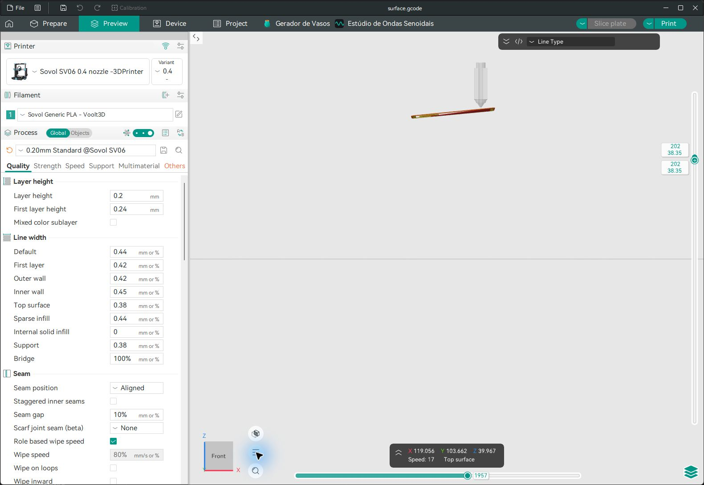
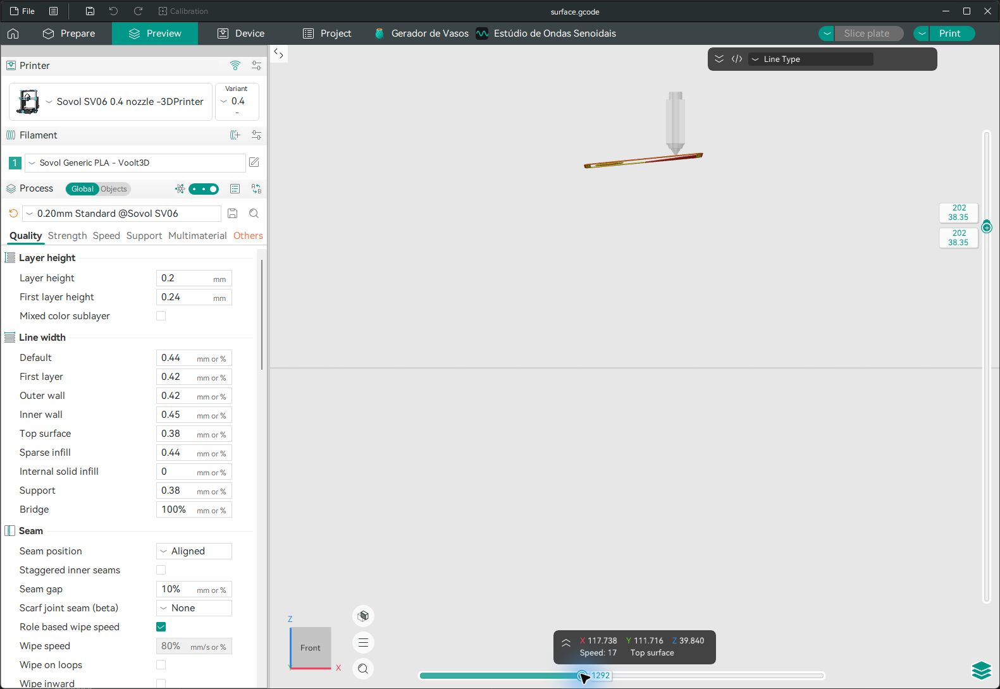
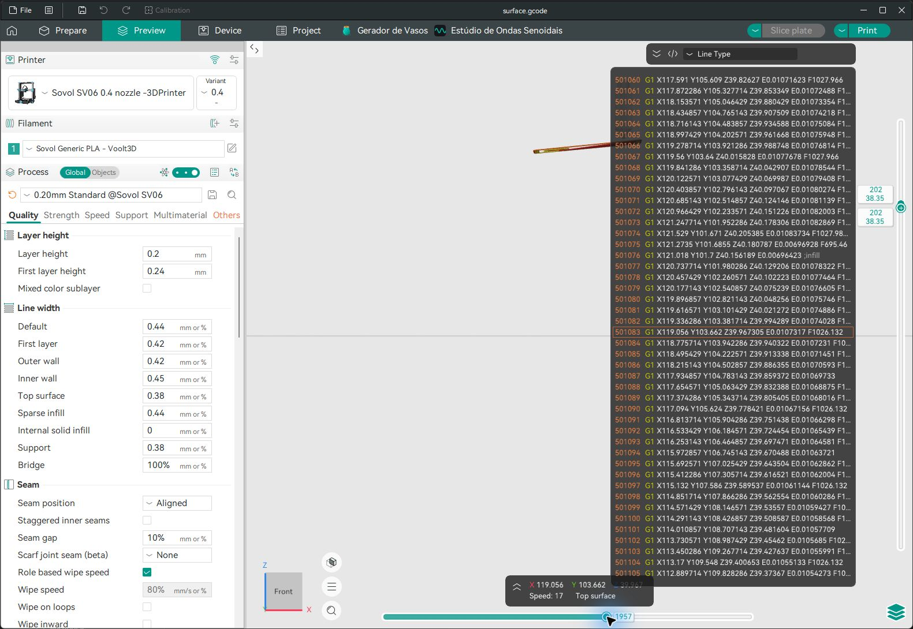

# Surface Studio 0.6 — perfil ativo, modelo visível e Benchy

Implementação de 21/11/2026. Este documento complementa o
[teste histórico 0.5.1](MANUAL_BENCHY.md); os resultados antigos não foram apagados.

## Uso em três ações

1. No Orca, selecionar a impressora, o filamento e o processo desejados e colocar
   a peça na placa.
2. Abrir o Studio, escolher **Superfície curva** e clicar **Gerar superfície e
   abrir Preview**. A preparação, o fatiamento e a transformação usam esse botão.
3. Conferir o resultado no Preview nativo. O envio utiliza a conexão nativa do
   perfil selecionado; o fluxo de impressão física continua sujeito à validação
   do cabeçote e da deposição. Nenhuma impressão foi iniciada neste desenvolvimento.

Não é necessário exportar um STL intermediário, procurar o G-code temporário,
rodar comandos ou abrir um arquivo gerado manualmente. A primeira ativação pode
pedir permissões ao usuário no próprio Orca. O projeto original é exportado para
uma cópia privada antes de começar. O botão **Cancelar cálculo** invalida a tarefa;
um resultado de uma tarefa cancelada não pode abrir o Preview posteriormente.

## A peça aparece antes do resultado

O visor central recebe uma representação leve da malha original. É possível
girar e enquadrar a peça antes de gerar trajetórias. Durante o cálculo e depois
de um erro, a malha permanece visível. Na troca de projeto, a geometria antiga é
removida e a lista é atualizada automaticamente. A análise idêntica já em curso
é reutilizada quando a página é reaberta.



A representação leve serve para exibição. A geometria usada no cálculo conserva
os 225.154 triângulos de entrada do Benchy, com normalização e subdivisões
controladas na cópia. O Studio pode mostrar apenas algumas camadas dos percursos
para limitar o volume de dados enviado à tela; o pacote nativo contém o G-code
completo. O visor também possui renderização por software quando WebGL 2 não está
disponível. O teste isolado verificou ambos os caminhos e a permanência da peça
após erro, sem controlar o Orca nem contactar uma impressora.

## Como o perfil é utilizado

O Studio exporta o projeto pela função pública `export_3mf_copy`, na thread
principal, e lê as configurações resolvidas dessa cópia. Não escolhe presets
pela marca nem substitui a impressora por uma SV06 de bancada. O perfil fornece:

- Diâmetros de bico e filamento, camada normal e primeira camada.
- Contorno da mesa, altura imprimível e limites de velocidade/aceleração em Z.
- Vazão máxima do filamento, quando definida.
- Aquecimento, retrações, comandos de início/fim e transporte nativo.

O resumo da interface omite credenciais. Configurações completas ficam apenas
nos arquivos privados do ensaio. A interface pública do Orca serializa alguns
vetores como `10,10`, enquanto o projeto usa listas JSON; ambos são interpretados.

Na cópia são habilitados comentários/rótulos de objetos e desabilitados ajuste
de arcos, Z Contouring e invocação recursiva de plugins de fatiamento. Um
pós-processador externo configurado provoca uma mensagem antes de executá-lo.
Após fatiar, 22 campos críticos são comparados com o perfil solicitado, incluindo
temperaturas, macros e conexão. Divergência interrompe a transformação.

O fatiador é o executável do próprio Orca, executado sem shell e sem comandos de
envio. O host exige permissão para a linha de comando completa. Por isso o
processo usa argumentos relativos e uma pasta de trabalho fixa dentro do
armazenamento privado fornecido pelo plugin. A entrada é substituída de
forma atômica; cada saída é copiada para o diretório imutável da geração. Um
bloqueio de pasta impede duas execuções simultâneas. A aprovação é feita pelo
usuário no Orca; o instalador não escreve concessões de acesso.

A linha exata é declarada na descoberta do plugin, sem shell ou permissão
genérica para executar outros comandos. Não é solicitado acesso a uma pasta
externa de cache. O caminho privado só é obtido durante o callback autorizado
do Orca; a descoberta não chama `plugin.storage()`.

## O que mudou no Benchy

O motor anterior exigia uma projeção retangular sem fronteiras internas. O novo
motor **roof-aligned bending** encontra a região conectada do teto e ajusta um
plano de referência ponderado pela área das faces. Uma transformação contínua
e invertível achata essas coordenadas para o fatiamento e depois restaura o
G-code. Todas as faces do sólido usam a mesma transformação; aberturas, paredes,
beiral e chaminé permanecem representados. Não existe uma faixa plana artificial
na borda do teto.

O plano de referência não substitui a malha por um teto plano. O pequeno desvio
da superfície original em relação ao plano continua no sólido preparado. Isso
reduz a escada associada à inclinação principal; não é uma promessa de acabamento
perfeito em toda superfície curva, em qualquer modelo.

As faces são divididas nas transições e refinadas com um limite analítico para
o erro de ida e volta. Para o Benchy de referência, a execução isolada obteve:

| Verificação | Resultado |
| --- | --- |
| Inclinação do plano de referência | Aproximadamente 5,499° |
| Faces da região conectada do teto | 1.589 |
| Faces da cópia preparada | 231.992 |
| Limite calculado de erro da malha | 0,0099932 mm |
| Maior erro de corda no G-code | 0,0142379 mm |
| Segmentos de deposição produzidos | 380.311 |
| Segmentos inclinados de superfície superior | 3.105 |
| Segmentos inclinados de parede externa | 46.844 |
| Segmentos inclinados classificados como overhang wall | 607 |
| Maior velocidade Z observada | 4,47214 mm/s, abaixo dos 10 mm/s do perfil |
| Maior limite conservador de aceleração Z observado | Aproximadamente 100 mm/s², conforme o perfil |

Esses números são do ensaio isolado usando o fatiador real. Não são medição de
acabamento ou colisão física. A primeira camada de 0,24 mm e a camada nominal
de 0,20 mm vieram do perfil SV06/PLA Voolt3D selecionado.

## Extrusão, quinas e comandos do perfil

A extrusão considera a variação vertical da célula de camada, por meio do
jacobiano da transformação. Não é multiplicada apenas pelo comprimento 3D.
Velocidade Z e vazão podem reduzir o avanço solicitado pelo Orca.

As pequenas quinas originais podem ser mantidas automaticamente no novo fluxo.
O limite de 0,15 mm continua aplicável aos segmentos novos de deposição; os
segmentos nativos menores são registrados separadamente, com seus extremos e
erro de corda. Isso não converte a antiga autorização de Preview em aprovação
de impressão física.

Também foi necessário contabilizar o arredondamento do wipe relativo emitido
pelo Orca. O parser usa um orçamento de meio quantum por palavra de retração/
recuperação daquele trecho nativo e registra os resíduos aceitos. Uma dívida
de retração maior que esse limite continua sendo recusada.

Macros de início e de fim são conservadas fora do corpo identificado da peça.
O código exige posicionamento absoluto e modo de extrusão inequívoco antes de
transformar movimentos. Um comando desconhecido dentro da deposição provoca
recusa, em vez de presumir que não altera o estado da máquina.

## Teste real pelo botão do Studio

O teste foi executado no OrcaSlicer 2.5.1, no Windows, em 21/11/2026. O projeto
original foi salvo antes da atualização. O gerenciador e os pedidos de permissão
passaram a identificar o plugin como **Orca Surface Studio**. A aba mantém o
identificador anterior **Estúdio de Ondas Senoidais** para preservar a ativação.

1. Abrir o projeto original do Benchy, mantendo **Sovol SV06 0.4 nozzle
   -3DPrinter**, **Sovol Generic PLA - Voolt3D** e **0.20mm Standard @Sovol SV06**.
2. Abrir a aba do Studio. Conferir a peça no centro e o resumo do perfil à
   esquerda. Selecionar **Superfície curva**, sem abrir os ajustes avançados.
3. Clicar uma vez em **Gerar superfície e abrir Preview**. O modelo continua
   visível enquanto o Studio prepara o sólido, fatia a cópia e reconstrói Z/E.



4. Na instalação inicial, avaliar pessoalmente a permissão para executar o
   próprio Orca em segundo plano. No diálogo nativo **Drop project file**,
   escolher **Open as project** e confirmar. A opção **Import geometry only**
   não carrega a trajetória: essa confirmação do Orca ainda acrescenta um passo
   ao fluxo pretendido. Nenhum arquivo foi procurado ou aberto manualmente.
5. O Orca abre `surface.gcode.3mf` diretamente em **Preview**, com **Slice plate**
   desabilitado e **Print** disponível. Avaliar o pedido de leitura do arquivo
   temporário; voltar ao Studio para retomar a verificação após aprová-lo.
6. Conferir a mensagem **Preview do Orca confirmado com o mesmo G-code**. O
   resultado nativo contém 380.274 segmentos de deposição e o visor resumido
   contém 5.945 pontos. Os 22 campos críticos do perfil coincidiram.



7. Voltar ao Preview. Selecionar os dois extremos do intervalo na camada **202**
   para isolar o teto. Em **View → Front**, observar a linha inclinada. Usar o
   seletor horizontal de movimentos para inspecionar dois pontos de **Top surface**.
   O marcador mostra **Z 39,967 mm** em um ponto e **Z 39,840 mm** em outro,
   mantendo a mesma camada selecionada. O número de altura ao lado do seletor
   de camadas não significa que todos os movimentos daquela camada têm Z igual.





8. Pressionar **C** para mostrar os comandos. Foram observados movimentos `G1`
   de superfície superior com Z crescente e decrescente e E relativo positivo
   no mesmo trecho. A captura registra, por exemplo, a sequência de Z 39,826272
   a 40,205385 e a volta a 39,967056, com deposição.



O SHA-256 do G-code gerado, do conteúdo do pacote e do cache efetivamente lido
pelo Preview foi o mesmo:

`28f487b743c5ca777060cd79f6ca5893528539e808aa47e9cd9a55355320d616`

Esse ensaio foi realizado com a malha recebida pela API nativa; pequenas
diferenças de serialização em relação ao ensaio isolado alteram a contagem e o
hash. Não são intercambiáveis. O erro geométrico máximo nativo foi menor que
0,01424 mm e o limite de ida/volta da malha menor que 0,01 mm. O registro público
resumido está em [evidências 0.6.0](evidencias-superficie-v060.json).

**Resultado observado:** geração completa pelo plugin e Preview aprovados para
esse Benchy. O botão **Print** não foi acionado; transporte e impressão física
não foram validados neste ciclo. O Preview ficou aberto com a camada isolada.
Os tempos e consumos apresentados pelo Orca são estimativas do visualizador,
não medições de impressão física ou certificação da deposição não planar.

## Compatibilidade e validação ainda necessária

O objetivo do produto é usar o perfil escolhido pelo usuário em diferentes
impressoras. A validação atual cobre o contrato XYZ linear, ferramenta única,
uma peça, uma instância e um volume sólido fechado. O nome do firmware não é
uma lista de marcas permitidas; o parser verifica os comandos efetivos. Esteiras
e outros referenciais precisam de adaptação própria e são recusados nesta versão.

O perfil padrão do Orca não descreve por completo o bico, a capa, o aquecedor,
o duto e o material já depositado. Portanto, ele não basta para certificar
colisões ou todos os ângulos de impressão. Os relatórios continuam com
`print_allowed=false` e validação física pendente. O transporte nativo preservado
não equivale à certificação de uma impressão não planar.

O cupom anterior de 25° foi um ensaio supervisionado separado. O relato de que
imprimiu perfeitamente permanece válido para aquele caso; não libera todas as
geometrias ou cabeçotes. O Benchy não foi enviado à impressora neste trabalho.

## Referências e reprodução

- [Bindings oficiais de exportação do Orca 2.5.1](https://github.com/OrcaSlicer/OrcaSlicer/blob/eef7710cb102fdb51a9bcdbd9efd61047f44774a/src/slic3r/plugin/host/PluginHostApp.cpp).
- [CLI do Orca](https://www.orcaslicer.com/wiki/cli/cli_mode).
- [Ahlers et al., fabricação com camadas não planares](https://tams.informatik.uni-hamburg.de/publications/2019/case_ahlers_2019.pdf).

```powershell
python -m unittest discover -s tests -v
python scripts/build_and_install.py --test --install-user
```

O teste de interface isolado usa `scripts/check_surface_workflow_ui.cjs` com o
HTML de bancada fornecido como argumento. As capturas desse teste não devem ser
confundidas com observações da janela nativa. Projetos, logs, configurações de
conexão e G-codes completos ficam fora do repositório público.
