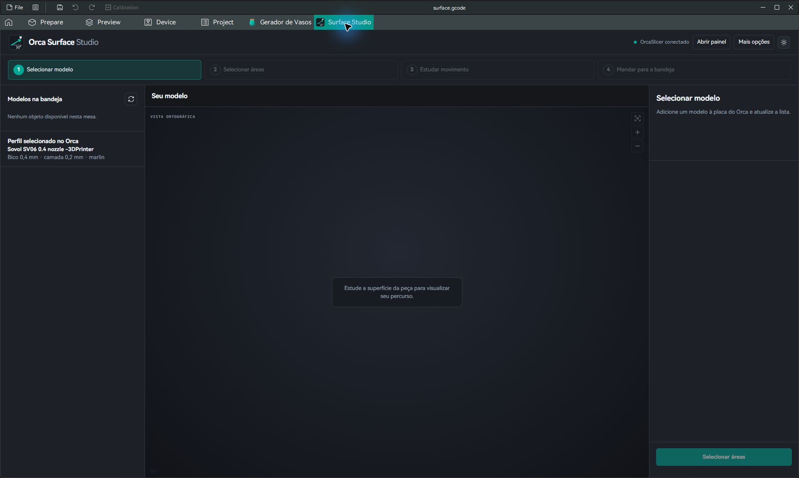

# Surface Studio — aba e ícone na 0.9.1

A aba antes chamada **Estúdio de Ondas Senoidais** passa a se chamar
**Surface Studio**. O novo ícone mostra uma trajetória subindo a 30°, uma seta
na direção do movimento e um pequeno bico acima. A aba nativa e o cabeçalho
usam o mesmo desenho vetorial. O painel lateral também usa o título Surface Studio.

Captura da janela real do OrcaSlicer 2.5.1 no Windows, após instalar a 0.9.1 e
reiniciar. O pacote fatiado anterior foi preservado e reaberto. Por ser um
pacote somente de Preview, ele não oferece um modelo editável na lista do
Studio; para começar outro estudo, abra o projeto original ou importe a peça.
Nenhuma impressão foi iniciada.

O ângulo do símbolo identifica o projeto. Ele não altera o limite do estudo,
o perfil da impressora ou os movimentos de um arquivo.

## Atualização e estado salvo

O nome da capacidade identifica a aba no Orca, conforme a
[documentação oficial](https://github.com/OrcaSlicer/OrcaSlicer/wiki/plugin_development).
O instalador local renomeia somente a chave de visibilidade antiga para
Surface Studio, preservando seu valor verdadeiro/falso. Se a preferência com
o nome novo já existir, ela prevalece. As demais capacidades, ativação e
valores de permissões não são alterados. O estado anterior fica em uma cópia
local de recuperação; não é publicado no repositório.

Em instalações novas, o instalador usa o nome novo desde o início. Os nomes
internos de captura, transporte e ação de painel permanecem para compatibilidade.
A ajuda para ocultar a aba já mostra o nome Surface Studio.

## Verificação

- Cinco testes de empacotamento/instalação e dois testes da interface passaram.
- A migração foi testada com a aba visível e oculta, com preferência nova já
  existente e com uma segunda instalação sem alterações adicionais.
- O fluxo guiado passou com WebGL, renderização alternativa e tela compacta,
  sem erros JavaScript ou contato com impressora.
- Bundle e wheel 0.9.1 foram construídos; a importação do bundle passou.
- Na instalação real, somente o nome salvo da aba mudou: todos os demais
  valores do estado foram comparados e permaneceram iguais.
- Após reiniciar, a aba apareceu ativa como Surface Studio. A captura acima
  confirmou o novo ícone na aba e no cabeçalho, mantendo os quatro passos.
