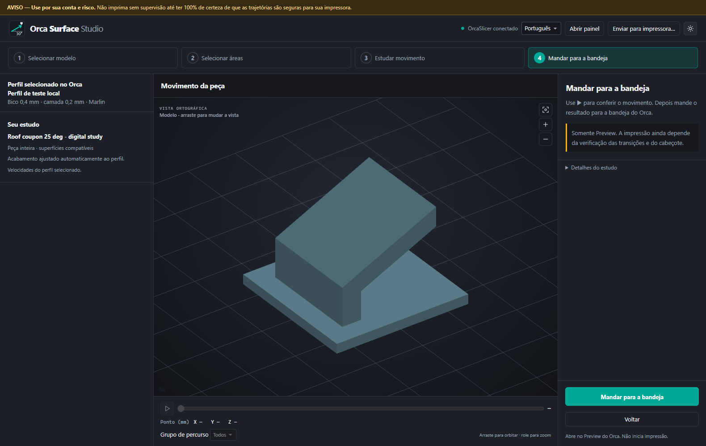
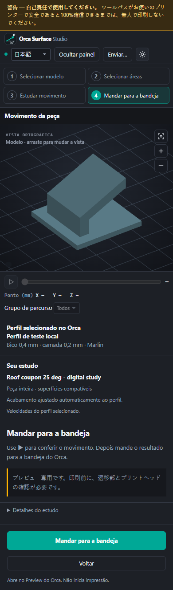

# Surface Studio 0.15.3 — interface e idioma dos avisos

O Studio agora apresenta somente o fluxo de quatro etapas. O botão **Mais
opções**, os formulários antigos de ondas, presets e os botões duplicados de
geração/Preview foram removidos do documento. Seleção de áreas, peça inteira,
rotação, mapa do cabeçote, cancelamento, tema, aba e painel continuam no fluxo
atual. Um resultado atual recuperado ao reabrir a interface permite retornar
diretamente ao Preview pelo quarto passo.

O seletor **Idioma dos avisos** oferece Português, English, Español, Italiano,
Français, Deutsch e 日本語. Ele traduz o banner de risco e os avisos de Preview
e altura mínima do cordão. Os demais textos da interface e os diagnósticos
técnicos do motor continuam em português nesta alteração. A escolha é salva
no armazenamento próprio do plugin em `ui_preferences.json` e compartilhada
pela aba e pelo painel nas atualizações de estado. Trocar o idioma preserva o
estudo, sua identidade e suas restrições de impressão.

## Adicionar idiomas

Os arquivos `src/orca_wave_studio/locales/*.json` usam o mesmo formato modular
dos outros Studios: `schema_version: 1`, `code`, `native_name`, `direction`,
`order` e `translations`. As chaves atuais são `language`, `warning_title`,
`warning_body`, `warning_preview` e `warning_bead`. Copie um arquivo, traduza
o texto e defina o novo código. O seletor descobre os pacotes pelos metadados,
sem uma segunda lista fixa de idiomas. Não use HTML nas traduções. Uma chave
ausente usa inglês; códigos regionais reconhecidos usam o idioma base.

O construtor valida os pacotes e os inclui nos dois scripts standalone e no
wheel. Não há download de idiomas ou dependência externa em execução.

## Verificação

Testes locais: suíte Python com `-W error`, importação dos dois bundles e do
wheel instalado em pasta isolada, persistência dos sete idiomas, navegação em
quatro etapas com WebGL2 e Canvas, apresentação compacta a 390 px, seleção,
invalidação, Preview explícito e rotação/mapa do cabeçote. Os avisos dos sete
idiomas são conferidos tanto na aba quanto no documento do painel, incluindo
reabertura e restauração de um estudo atual. As fixtures são testes de
componentes: não representam um novo teste dentro do Orca nem validação física.

Para reproduzir, com Python/dependências do projeto e Playwright disponíveis:

```powershell
python -B -W error -m unittest discover -s tests -v
python -B -W error scripts/prepare_guided_ui_fixture.py study/evidence/guided-warning-v0153
node scripts/check_guided_studio_ui.cjs study/evidence/guided-warning-v0153/model.html study/evidence/guided-warning-v0153/guided study/evidence/guided-warning-v0153/result.json
node scripts/check_warning_languages.cjs study/evidence/guided-warning-v0153
node scripts/check_placement_ui.cjs study/evidence/guided-warning-v0153/model.html study/evidence/guided-warning-v0153/placement
```

`WAVE_PLAYWRIGHT` e `WAVE_BROWSER` podem indicar instalações locais existentes.
No primeiro comando, disponibilize `src` em `PYTHONPATH` ou instale o projeto.
Fechar e reabrir o Orca é necessário para carregar o pacote atualizado.
A alteração não libera impressão nem publicação no OrcaCloud.




