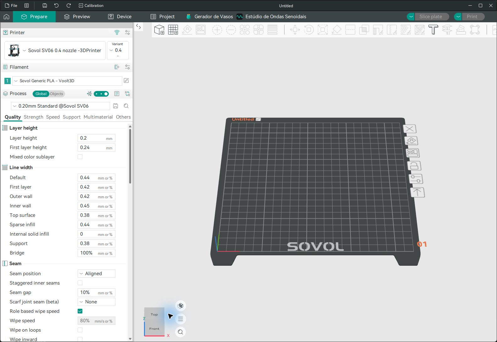
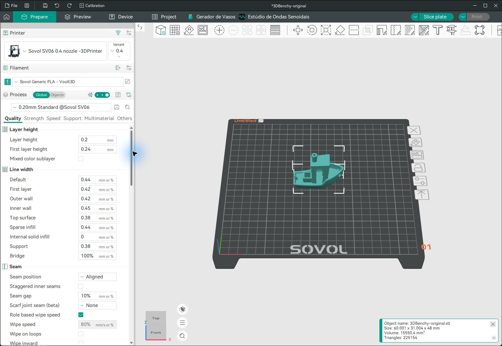
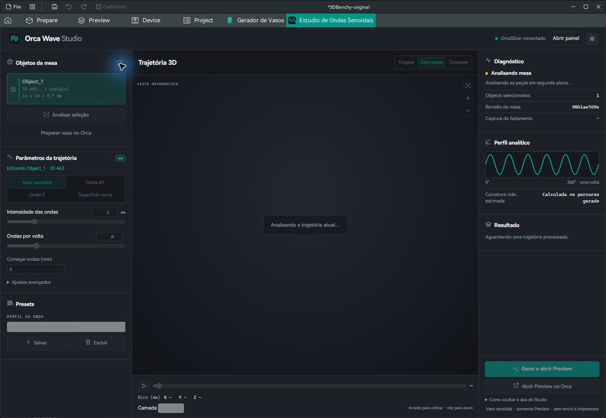
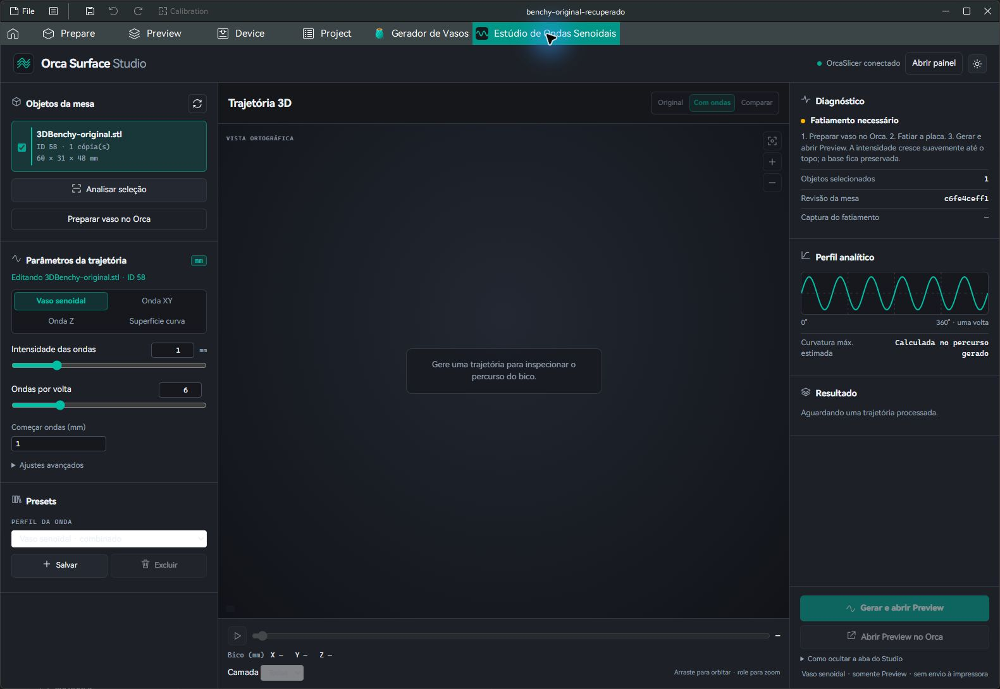
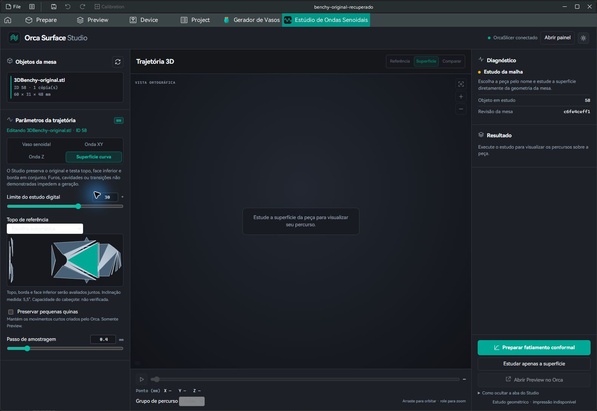
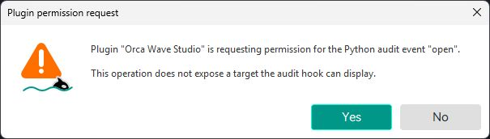
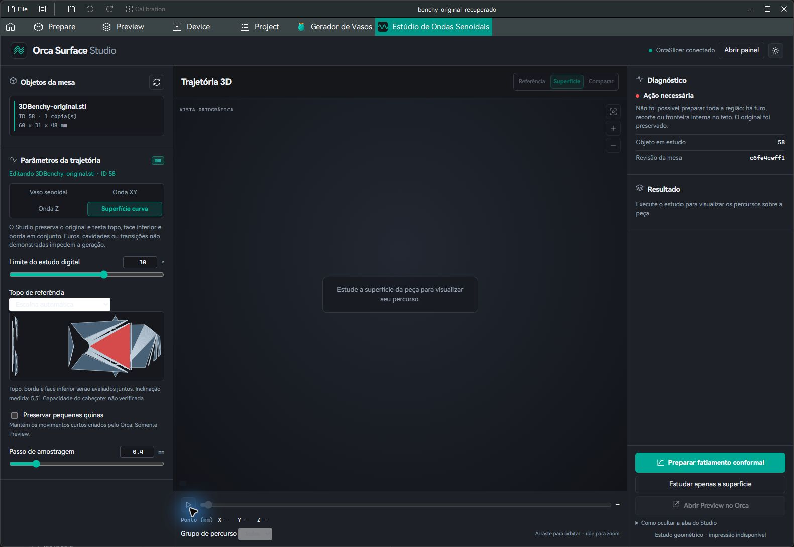

# Orca Surface Studio — uso e teste real com o Benchy

> Registro histórico da 0.5.1. O [teste da 0.6.0](FLUXO_SUPERFICIE_V060.md#teste-real-pelo-botão-do-studio)
> concluiu geração e Preview pelo plugin, com capturas da camada inclinada.
> A impressão física do Benchy permanece pendente.

Data: **21/11/2026**. Plataforma: **Windows, OrcaSlicer 2.5.1**.
Versão inicial: 0.5.0; versão corrigida e instalada durante o teste: **0.5.1**.

**Resultado:** a importação, a identificação da peça e a seleção do modo
funcionaram. A preparação conformal do Benchy completo foi **recusada por
topologia não suportada**. Não houve G-code final, abertura de Preview conformal,
upload ou início de impressão do Benchy neste teste. O resultado do teste de
aceitação ponta a ponta é, portanto, **não aprovado**.

O usuário autorizou o controle da máquina, a impressão na SV06 e a publicação
pública deste registro. A autorização de impressão permaneceu válida, mas o
motor não conseguiu produzir a trajetória necessária para executá-la.

## 1. O fluxo que queremos oferecer

O objetivo da V1 é: colocar a peça na mesa, abrir o Studio, escolher a superfície,
preparar e fatiar, conferir o Preview e imprimir. O teste abaixo mede o estado
real dessa experiência. Ainda existe uma atualização manual da lista de peças,
e o caminho conformal para geometrias como o Benchy ainda não está completo.

O nome do projeto e o cabeçalho passaram a **Orca Surface Studio**. Por
compatibilidade, o gerenciador ainda identifica **Orca Wave Studio**, a aba
continua **Estúdio de Ondas Senoidais** e os módulos internos mantêm o nome
anterior. Isso preserva as escolhas de ativação e as permissões existentes.

## 2. Conferir impressora e filamento antes de importar

Na tela **Prepare**, conferir:

| Campo | Valor observado |
| --- | --- |
| Impressora | Sovol SV06 0.4 nozzle -3DPrinter |
| Bico | 0,4 mm |
| Filamento | Sovol Generic PLA - Voolt3D |
| Material informado pelo usuário | PLA Voolt3D sem FP |
| Processo inicial | 0.20mm Standard @Sovol SV06 |
| Primeira camada no processo inicial | 0,24 mm |

Esses valores são o estado inicial da interface. Não constituem aprovação de
parâmetros conformais para qualquer objeto. Os presets salvos do usuário não
foram substituídos.



## 3. Adicionar o Benchy original

Importar o STL pelo comando normal do Orca. Neste teste foi usado
`3DBenchy-original.stl`, já disponível nos arquivos locais do estudo. Para obter
o modelo, consultar os [arquivos oficiais do 3DBenchy](https://www.3dbenchy.com/download/).
O modelo de terceiros não é redistribuído neste repositório.

| Identificação da entrada | Valor |
| --- | --- |
| Dimensões mostradas pelo Orca | 60,001 × 31,004 × 48 mm |
| Triângulos | 225.154 |
| SHA-256 do STL utilizado | `6ab57f1c3f8e86bc3cbd302c6fa6270acf06277c6335454e922419c25d42e97e` |

Foi mantida a geometria completa: casco, cabine, teto, aberturas e chaminé.
Não houve simplificação, alteração de escala nem substituição por um cupom.



## 4. Abrir o Studio e atualizar a mesa

Abrir a aba **Estúdio de Ondas Senoidais**. Conferir o nome e o tamanho do objeto
antes de preparar qualquer resultado. Nesta execução, a aba ainda mostrava
`Object_1`, o cupom anterior de 14 × 14 × 9,7 mm. Essa lista estava desatualizada.


Clicar no ícone **Atualizar mesa**, ao lado de **Objetos da mesa**. O comportamento
esperado é substituir a lista pelo projeto ativo e concluir a análise em segundo
plano. A versão 0.5.0 entrou em análise e permaneceu ocupada por mais de um minuto.
As capturas seguintes mostram o início e uma observação posterior do mesmo estado;
elas não são uma medição precisa de tempo.




### Problema encontrado e recuperação durante o teste

O catálogo recalculava a revisão de toda a malha para cada plano candidato.
Em uma peça curva, isso repetia a serialização de centenas de milhares de
triângulos muitas vezes. A correção calcula essa revisão uma única vez por
catálogo e mantém todos os candidatos vinculados à mesma origem.

Foi instalado o código 0.5.1 preservando o estado de ativação durante a
atualização. A instância antiga permaneceu ocupada e não aceitou o salvamento;
ela foi encerrada. Ao reabrir, a recuperação automática do próprio Orca restaurou
o Benchy, depois salvo como `benchy-original-recuperado.3mf`. O projeto recuperado
fica no arquivo local do estudo, fora da publicação pública.

Após a atualização, a lista passou a mostrar **3DBenchy-original.stl**, com
**60 × 31 × 48 mm**. O identificador desta sessão era **58**; esse número pode
mudar em outra sessão e não deve ser digitado pelo usuário.



| Verificação da correção | Evidência |
| --- | --- |
| Catálogo do mesmo Benchy, em execução isolada | 7,0523 s; 225.154 triângulos; 100 regiões retornadas |
| Estado do catálogo | `CANDIDATES_ONLY`; não é aprovação de impressão |
| Alteração da geometria nessa análise | Nenhuma |
| Contato com impressora nessa medição | Nenhum |
| Testes automatizados da versão | 176 aprovados, em 15,795 s |
| Interface após reinício | Lista correta e controles disponíveis, observados na captura acima |

O tempo de 7,0523 s é uma medição isolada, não a latência medida da interface.
O novo teste de regressão verifica que a revisão é calculada uma vez e continua
vinculada ao catálogo. A correção não acrescenta suporte a novas topologias.

## 5. Escolher Superfície curva

Para acompanhar o teto inclinado, selecionar **Superfície curva**. **Vaso senoidal**
é outro modo, que modifica contornos radiais; não deve ser usado para fazer o
Benchy passar neste teste.

Foram mantidos os seguintes controles:

| Controle | Valor usado e significado |
| --- | --- |
| Limite do estudo digital | 30°; limite do estudo, não capacidade física do cabeçote |
| Topo de referência | Escolha automática |
| Inclinação da referência escolhida | Aproximadamente 5,5° |
| Passo de amostragem | 0,4 mm |
| Preservar pequenas quinas | Desmarcado; a exceção disponível é somente para Preview |

O mapa oferece regiões candidatas. Escolher uma referência não prova que teto,
face inferior, bordas, furos e transições possam ser processados em conjunto.
O ângulo do Benchy não foi artificialmente mudado para 25°.



## 6. Preparar o fatiamento conformal e responder ao Orca

Clicar **Preparar fatiamento conformal**. A preparação informa que salva uma
cópia do projeto original antes de trabalhar na malha de preparação.

O Orca apresentou uma solicitação do plugin para o evento Python **open**.
A própria janela não exibia um alvo de arquivo. O teste foi pausado para que
o usuário avaliasse e respondesse diretamente; a automação não aprovou a janela.
O usuário informou que havia concluído essa ação e a conferência continuou.



Não é recomendação para aceitar qualquer pedido sem conferir: a captura registra
o comportamento real encontrado nesta sessão. Ativação e permissões dependem
do perfil local do Orca e podem variar em uma instalação nova.

## 7. Ler o diagnóstico antes de tentar fatiar ou imprimir

Após a resposta ao pedido, o Studio mostrou **Ação necessária**:

> Não foi possível preparar toda a região: há furo, recorte ou fronteira interna
> no teto. O original foi preservado.

O botão **Abrir Preview no Orca** permaneceu desabilitado e o rodapé mostrou
**Estudo geométrico · impressão indisponível**. Esse é o ponto final observado.
Não foi clicado Fatiar para produzir uma substituição convencional, nem foi
carregado o arquivo antigo que deformava somente a superfície superior.



O diagnóstico corresponde à limitação de furos/topologia da casca pareada,
registrada no motor como `REGIONAL_HOLES_OR_TOPOLOGY`. A mensagem não identifica
sozinha qual abertura específica causou a recusa; não é uma classificação
completa de todas as regiões do barco.

## 8. Resultado por etapa

| Etapa do usuário | Resultado observado nesta execução |
| --- | --- |
| Conferir SV06 e PLA Voolt3D | Concluído |
| Importar o Benchy original | Concluído |
| Reconhecer o objeto no Studio | Concluído após atualizar e corrigir desempenho |
| Escolher superfície e referência | Concluído |
| Preparar a casca completa | Recusado por topologia |
| Fatiar a cópia conformal | Não atingido |
| Capturar G-code conformal do Benchy | Não atingido |
| Abrir e inspecionar Preview conformal | Não atingido |
| Print nativo, transporte e impressão física | Não atingidos; nenhum envio realizado |

O cupom anterior de 25° foi efetivamente iniciado em um ensaio isolado, e o
usuário relatou que imprimiu perfeitamente. Esse relato é qualitativo, de uma
geometria específica. O início daquele ensaio utilizou a API do OctoPrint;
ele não valida o botão Print nativo nem substitui este teste do Benchy.

## 9. O que precisa mudar para concluir o Benchy

A próxima implementação precisa representar regiões com fronteiras internas,
preservar aberturas e associar teto, face inferior e bordas, mantendo as demais
partes da peça. Também precisa demonstrar a transição com o volume impresso e
o envelope do cabeçote. Remover a recusa ou ondular apenas a última camada não
resolve o degrau no beiral mostrado pelo usuário.

Depois disso, repetir o mesmo caminho da interface, verificar o Z durante
extrusão de uma camada do teto, conferir suportes e deslocamentos e comparar
o conteúdo gerado com o realmente carregado e transportado. A impressão do
Benchy continua pendente dessa implementação e validação.

Para reduzir ações na V1, ficam registradas duas necessidades de uso:

- Atualizar automaticamente a lista ao importar ou trocar o projeto, sem exibir
  um cupom antigo como se fosse a peça atual.
- Informar a incompatibilidade antes da preparação demorada, com indicação
  visual da região responsável e uma explicação do próximo passo.

## 10. Evidências e limites de reprodução

As nove capturas são arquivos originais, sem montagem ou alteração da imagem.
Os hashes estão em [evidencias-benchy.json](evidencias-benchy.json), junto do
resultado observado e da medição isolada. Capturas e o relato da interface
sustentam a observação nativa; os testes automatizados sustentam a regressão
de código. Nenhum desses resultados demonstra uma impressão física do Benchy.

Os arquivos temporários, projetos locais, backups de instalação, G-codes de
ensaios físicos e configurações de conexão permanecem fora do Git público.
Referências históricas a `study/evidence/` nos outros relatórios apontam para
arquivos locais de pesquisa, não para artefatos publicados neste repositório.

Para executar os testes de código sem conectar a uma impressora:

```powershell
python -m pip install -e .
python -m unittest discover -s tests -v
```

Para atualizar o plugin já instalado, fechar o Orca, executar o instalador
e abrir novamente. Avaliar no aplicativo quaisquer solicitações de ativação
ou permissões. A recuperação de falha descrita neste manual é um registro do
incidente, não uma etapa normal de instalação.

```powershell
python scripts/build_and_install.py --test --install-user
```
