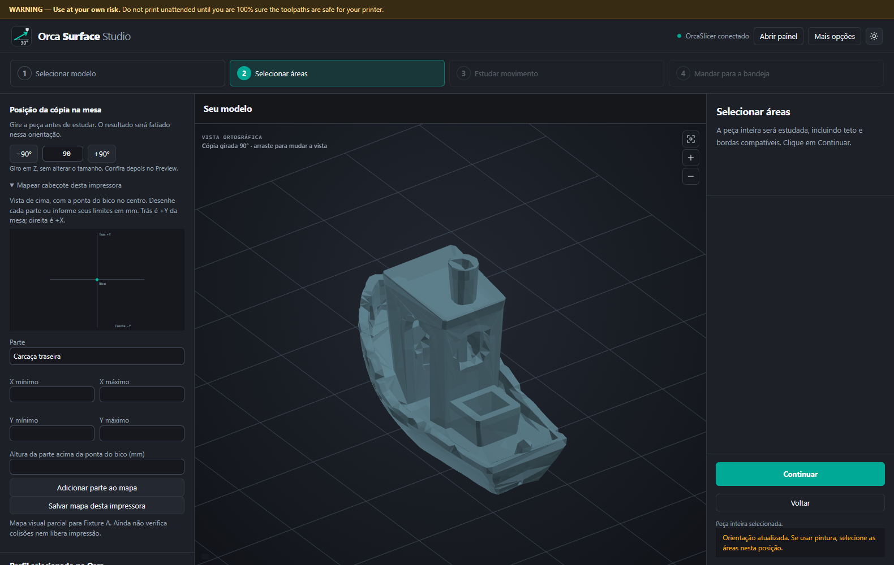
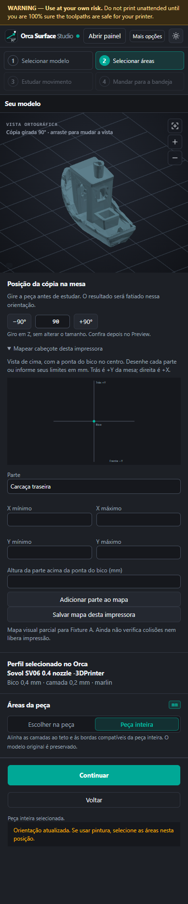

# Mapa do cabeçote e giro da cópia — 0.15.0 experimental

O usuário aprovou o formato e as trajetórias do Benchy, mas relatou contato
da **carcaça traseira do ventilador** com a proa. O ajuste atual trata da
posição da peça e do mapa do cabeçote. O núcleo de cálculo C2, deposição e
transições não foi alterado para disfarçar esse contato.

## Quatro passos

1. Selecione o modelo e o perfil da impressora no Orca; abra Surface Studio.
2. Em **Selecionar áreas**, ajuste **Posição da cópia na mesa** com −90°, +90°
   ou um ângulo numérico. A peça exibida gira em Z, mantendo seu tamanho.
   Arrastar a vista serve apenas para observar outro ângulo.
3. Clique em **Estudar movimento**. O Studio aplica a rotação à transformação
   da cópia antes do fatiamento e usa os mesmos cálculos de trajetórias.
4. Clique em **Mandar para a bandeja** e confira a orientação no Preview.

O giro vale para a cópia estudada. O modelo original no Prepare não é
modificado. A [API pública do Orca](https://github.com/OrcaSlicer/OrcaSlicer/wiki/host)
oferece leitura do modelo; por isso esta versão não simula uma edição direta
da bandeja original. Para editar a posição original, use a ferramenta
[Rotate do Orca](https://github.com/OrcaSlicer/OrcaSlicer/wiki/prepare_object_manipulation).

Ao girar a cópia, o estudo anterior fica desatualizado. Se usar pintura,
selecione as áreas novamente na nova posição. Uma cópia que saia da mesa
é recusada antes de fatiar. Nenhum G-code já processado é girado às cegas.

## Mapear o cabeçote

Abra **Mapear cabeçote desta impressora** no segundo passo. A vista superior
usa a ponta do bico como origem: +X à direita e +Y para o fundo da mesa.

- Desenhe o retângulo de uma parte, ou preencha seus limites X/Y em mm.
- Informe a distância vertical da ponta do bico até a parte mais baixa
  daquela carcaça, duto ou sensor, com a máquina fria.
- Clique em **Adicionar parte ao mapa**, repita para outras partes e use
  **Salvar mapa desta impressora**.

O mapa fica separado pelo nome exato do perfil e pelo diâmetro do bico.
Trocar de perfil não herda as medidas de outra impressora. Ao alterar o
hotend ou suas peças, revise o mapa. Não há medidas presumidas preenchidas.

**Nesta versão, o mapa é um cadastro visual parcial.** Ele ainda não detecta
colisões, não escolhe automaticamente a melhor orientação e não libera
impressão. As fotos solicitadas pelo usuário ajudarão a identificar a
carcaça, mas uma foto sem escala não fornece suas dimensões. O próximo
ensaio depende do mapa real, da direção correta dos eixos e da nova
conferência dos percursos e deslocamentos.

As capturas abaixo são do teste do componente da interface, com o mapa
vazio. Não são capturas da nova versão carregada no Orca nem medidas da SV06.

## Aviso e publicação

O início da página e do painel exibe permanentemente:

> WARNING — Use at your own risk. Do not print unattended until you are 100% sure the toolpaths are safe for your printer.

A publicação no **Orca Cloud está bloqueada** por
`publication-policy.json`. O publicador verifica esse bloqueio antes de
ler credenciais ou solicitar qualquer token/publicação. Política ausente,
inválida ou desativada também bloqueia. Uma liberação futura exige concluir
a validação e obter nova autorização explícita do usuário. Nenhuma release
foi publicada no Orca Cloud neste trabalho.

## Verificação realizada

- 285 testes Python passaram, incluindo giro rígido, preservação das outras
  peças, recusa fora da mesa, mapas separados e bloqueio antes da rede.
- Os quatro passos passaram com WebGL, alternativa sem WebGL e largura de
  390 pixels. O novo teste de controles conferiu giro de 90°, mapa, comando
  de estudo com o ângulo escolhido e ausência de impressão/envio.
- A geometria completa do Benchy manteve 60,001 × 31,004 × 48 mm nas quatro
  orientações cardinais, com troca esperada dos eixos XY e sem alterar a fonte.
- O bundle e o wheel foram gerados e a instalação local foi atualizada.
- A captura da janela do Orca falhou na recuperação do monitor; nenhum clique
  foi enviado com estado desconhecido. A recarga nativa e o novo Preview
  do Benchy continuam pendentes. Não houve nova impressão.

O arquivo do ensaio anterior permanece reprovado **nessa posição e para esse
mapa de cabeçote**, sem repetição automática. A SV06 já estava `Operational`,
sem impressão e com alvos dos aquecedores em zero quando foi consultada após
o relato; não se atribui sua parada ao assistente.
