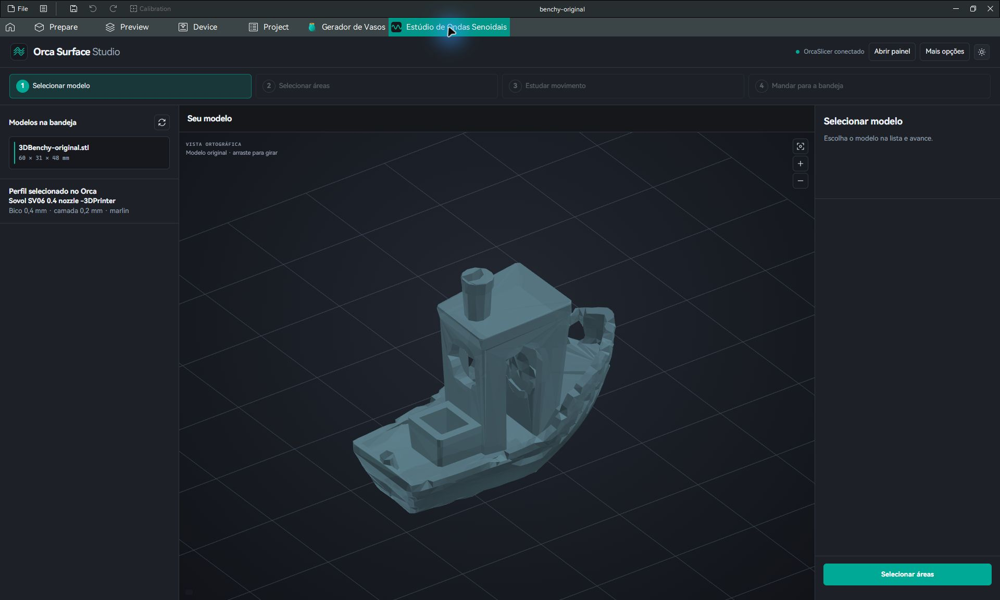
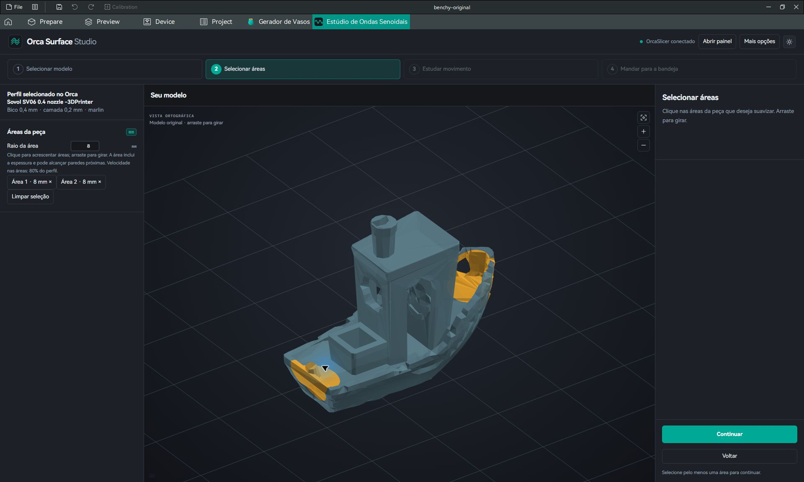
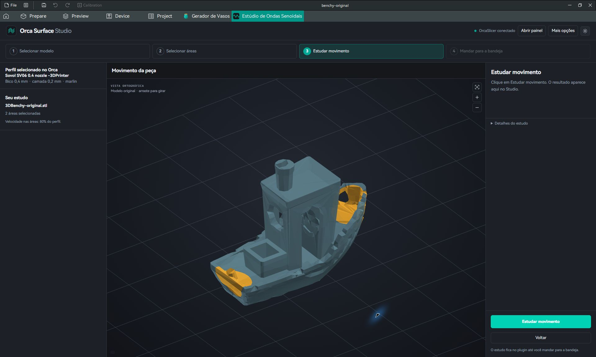
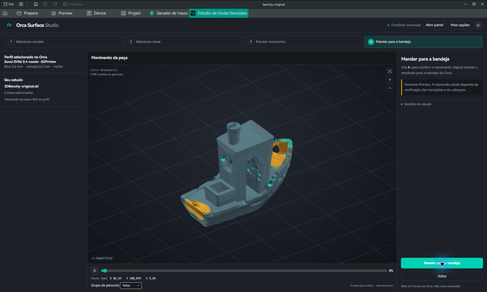

# Usar o Orca Surface Studio — 0.9.0

Coloque a peça na bandeja do Orca e confira impressora, filamento e processo.
Abra o Surface Studio. A tela mostra um passo por vez.

## 1. Selecionar modelo

Escolha a peça na lista **Modelos na bandeja**. Confira a imagem e o perfil
mostrado. Clique em **Selecionar áreas**.

## 2. Selecionar áreas

Clique nas regiões da peça que deseja suavizar. A marca colorida mostra cada
área escolhida. Ajuste o tamanho da área se necessário. Arraste para girar a
peça; arrastar não acrescenta uma seleção. Remova uma área pelo botão ao lado
da sua marca ou use **Limpar seleção** para começar de novo.

Selecione pelo menos uma área e clique em **Continuar**. As áreas têm volume:
uma marca pode incluir a espessura da parede ou uma parede próxima. Esta versão
usa cliques; ainda não tem pincel contínuo.

## 3. Estudar movimento

Confira o modelo e a quantidade de áreas. Clique em **Estudar movimento**.
O Studio prepara uma cópia usando o perfil selecionado no Orca. Aguarde o
resultado sem fechar o plugin. O projeto original é preservado.

O resultado fica no Studio: o estudo não abre automaticamente outra tela.
Se ocorrer um erro, a peça continua visível e o diagnóstico orienta a correção.

## 4. Mandar para a bandeja

Confira o movimento na vista 3D e use ▶ para percorrer a trajetória.
Clique em **Mandar para a bandeja** para abrir o resultado no **Preview do Orca**.
Se o Orca mostrar **Drop project file**, escolha **Open as project** e clique em
**OK**. Respeite os diálogos de salvamento/cancelamento se aparecerem.

**Esse botão não envia à impressora e não inicia impressão.** Uma advertência
de impressão pendente continua valendo mesmo que o Preview abra corretamente.
O Benchy desta série ainda tem transições sem qualificação física.

Para mudar a escolha, use **Voltar**. Alterar áreas exige um novo estudo antes
de mandar o resultado. Alterar o projeto reinicia o passo a passo, evitando
reutilizar uma seleção de outra revisão da peça.

## Opções e limites

Na versão 0.9.0, **Mais opções** abria os controles anteriores, incluindo os
modos de ondas. Esse menu foi removido na 0.15.3; veja a
[interface atual e os idiomas dos avisos](INTERFACE_AVISOS_V0153.md).

A seleção atual admite uma peça com uma instância imprimível e um sólido.
É possível escolher essa peça quando existem outros modelos na bandeja; o
resultado estudado inclui somente a peça escolhida. O projeto completo fica
preservado na cópia de origem. O Studio reduz a velocidade das paredes das
áreas a 80% do valor efetivo do perfil, como mostrado no resumo.

Pedidos de autorização de leitura/execução pertencem ao Orca e precisam ser
avaliados diretamente pelo usuário. O plugin não aprova essas janelas.

## Verificação desta versão

- 210 testes Python aprovados.
- Fluxo isolado testado em 1580 × 1000, com WebGL e renderização alternativa,
  e em 390 × 844: quatro passos, transferência explícita e invalidação de
  seleção antiga. Sem contato com impressora.
- Teste nativo concluído em 21/11/2026 no OrcaSlicer 2.5.1 para Windows:
  Benchy de 60 × 31 × 48 mm, perfil SV06 0,4 mm e PLA Voolt3D. As quatro capturas
  acima são da janela real do Orca, sem usar os resultados simulados da interface.
- Foram escolhidas duas áreas de raio 8 mm, na proa e na popa. **Estudar movimento**
  terminou dentro do Studio, sem abrir o Preview automaticamente. A reprodução
  avançou de 0% a 41% antes de ser pausada. O visor usa uma amostra do percurso;
  o arquivo completo permanece no pacote.
- Somente após **Mandar para a bandeja**, o Orca apresentou seu diálogo de abertura.
  **Open as project → OK** abriu o Benchy na aba Preview, com 240 camadas,
  **Slice plate** desabilitado e o perfil esperado. O botão Print não foi acionado.
- G-code gerado, conteúdo do pacote, arquivo temporário carregado e recibo de
  verificação do plugin tiveram o mesmo SHA-256:
  `6a1151f65431dd6a3d8209f7b683a3220ce4ea850aa41657465d26c60dc79bb4`.
- A atualização preservou a ativação do plugin. Os acessos já autorizados foram
  reutilizados; não houve novo pedido de permissão neste ciclo.
- Esta validação confirma a facilidade do fluxo e a integridade da transferência.
  Não elimina os degraus residuais nem qualifica fisicamente o Benchy.
