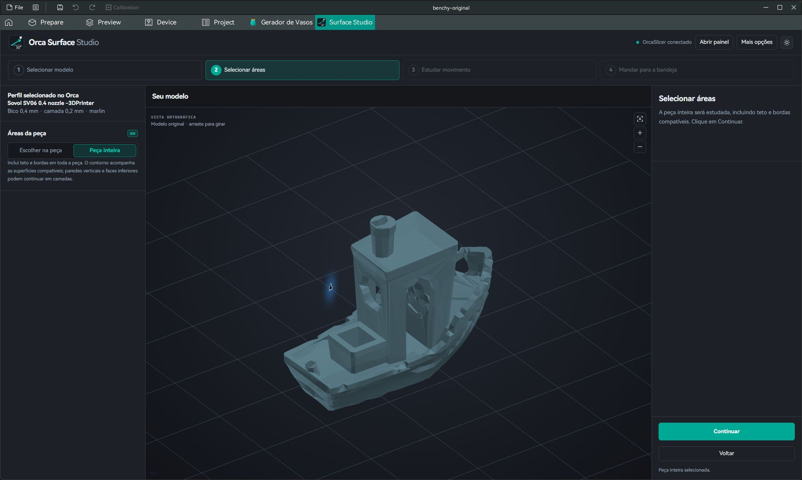
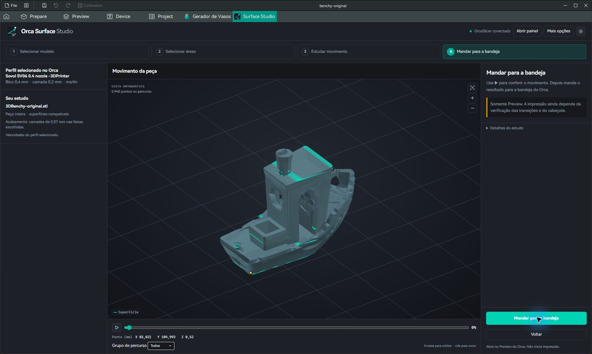
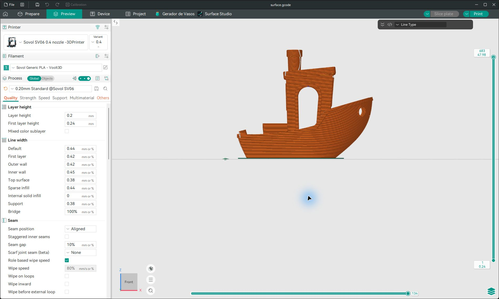

# Peça inteira no passo a passo — 0.10.1

O teste anterior usava duas regiões esféricas de 8 mm. O teto e outras bordas
ficaram fora da seleção. Além disso, o modo simples escondia a opção de estudar
todas as superfícies compatíveis. A 0.10.1 corrige essa limitação de abrangência.
Isso **não equivale a eliminar todos os degraus do Benchy**.

## Como usar

1. Selecione o modelo e avance para **Selecionar áreas**.
2. Escolha **Peça inteira**. Para um acabamento localizado, use **Escolher na peça**.
3. Clique **Continuar** e depois **Estudar movimento**.
4. Confira o estudo e use **Mandar para a bandeja** para abrir o Preview.

O cálculo usa o perfil selecionado e preserva a primeira camada. No estudo da
SV06, o acabamento da peça inteira usa 0,07 mm acima da primeira camada de
0,24 mm. As velocidades são as do perfil; o fator de 80% pertence apenas à
seleção localizada por áreas. Alternar Mais opções e voltar mantém a escolha
Peça inteira. Mudar a seleção invalida o resultado anterior.

## O que foi corrigido

O contorno é explicitamente ativado na peça e em sua parte, mesmo quando a
cópia original possui uma desativação local. A exportação do Orca é conferida:
se a ativação ou os valores locais forem perdidos, a geração é recusada.

O diagnóstico passa a separar **deposição deslocada em Z** de **movimento com
Z variável**. Deslocar uma linha horizontal inteira não comprova uma superfície
contínua. Nenhuma dessas contagens é apresentada como porcentagem da peça lisa.
O limite de inclinação continua sendo aplicado aos movimentos reais de extrusão.

## Limitação encontrada no motor atual

O ContourZ do Orca ajusta pontos próximos à superfície dentro de uma janela
pequena ligada à altura da camada. Quando a superfície está fora dessa janela,
o ponto volta à altura nominal. Também não eleva perímetros acima do plano
nominal. Por isso, ativar o contorno em toda a peça não transforma todas as
camadas em percursos contínuos acompanhando a curvatura.

A implementação está no [ContourZ oficial da revisão usada pelo estudo](https://github.com/OrcaSlicer/OrcaSlicer/blob/eef7710cb102fdb51a9bcdbd9efd61047f44774a/src/libslic3r/ContourZ.cpp).
A inspeção foi feita na cópia dessa revisão usada no projeto. Camadas menores
reduzem a escala dos degraus, mas não removem a descontinuidade desse método.
Paredes verticais, superfícies inferiores e trechos superiores fora da janela
continuam podendo apresentar marcas e degraus.

O motor de alinhamento ao teto é separado e recusa G-code que já recebeu
ContourZ. Ele não foi aplicado por cima do resultado: isso exigiria validar
novamente a transformação, a extrusão e as transições. Não foi feita uma
alteração no Orca nem uma deformação do STL para esconder os degraus.

## Teste no Orca

Concluído em **21/11/2026**, usando os botões do plugin na janela real do Orca.
Abri o projeto original, conferi o perfil SV06/PLA Voolt3D, selecionei **Peça
inteira**, avancei e acionei **Estudar movimento**. O modelo permaneceu visível.
O resultado apareceu no Studio com o resumo de 0,07 mm e velocidades do perfil.

Usei **Mandar para a bandeja**, escolhi **Open as project** no diálogo nativo e
confirmei em **OK**. O Preview abriu com **683 camadas**, sem um novo fatiamento
do modelo na interface. Ampliei a imagem e conferi o teto e as bordas, também
na vista frontal. A imagem ainda mostra marcas e degraus residuais. O pedido
de deixar tudo sem degraus, portanto, **não foi concluído** por esta correção.

| Medida | Duas áreas — 0.10.0 | Peça inteira — 0.10.1 |
|---|---:|---:|
| Movimentos de extrusão com Z variável | 166 | 2.260 |
| Maior inclinação de extrusão | 26,12° | 25,79° |
| Altura de acabamento | 0,07 mm nas faixas selecionadas | 0,07 mm acima da primeira camada |
| Camadas observadas no Preview | 470 | 683 |

Na peça inteira, foram **3.313 segmentos de deposição ajustados em Z**, em
**71 camadas**, entre alturas nominais de **0,59 e 40,28 mm**. Os 2.260
movimentos de Z variável incluem **1.123 de superfície superior, 969 de parede
externa e 168 de parede interna**. Isso demonstra maior abrangência, sem medir
a porcentagem de superfícies lisas ou a qualidade física.

O pós-processamento preservou as **302.490 identidades de movimento XYZ/E**
nativas. A comparação da cópia confirmou os **112.569 vértices e 225.154
triângulos** inalterados. Foram conferidos 26 campos do perfil e a primeira
camada plana de 0,24 mm. Os hashes do G-code gerado, pacote, cache do Preview,
relatório e recibo coincidem:

`a6c424a0d619d90e478e20f7bb67989a2d62cde16fd682d9e8e520dd91c9491e`

O limite do corpo do cabeçote no CAD nominal permaneceu positivo (1,24 mm),
mas registro do cabeçote instalado, contato do bico e deposição não estão
certificados. Veja a [evidência numérica sanitizada](evidence/whole-model-v0101.json).
O resultado ficou aberto no Preview; não foi enviado à impressora.

**220 testes automatizados passaram**, além do teste de interface com WebGL,
desenho alternativo e largura de 390 pixels. A seleção localizada continua
disponível; a opção Peça inteira foi testada sem abrir os ajustes avançados.

Nenhuma impressão é iniciada pelo estudo ou pela transferência ao Preview.
A qualificação física do Benchy continua pendente.
