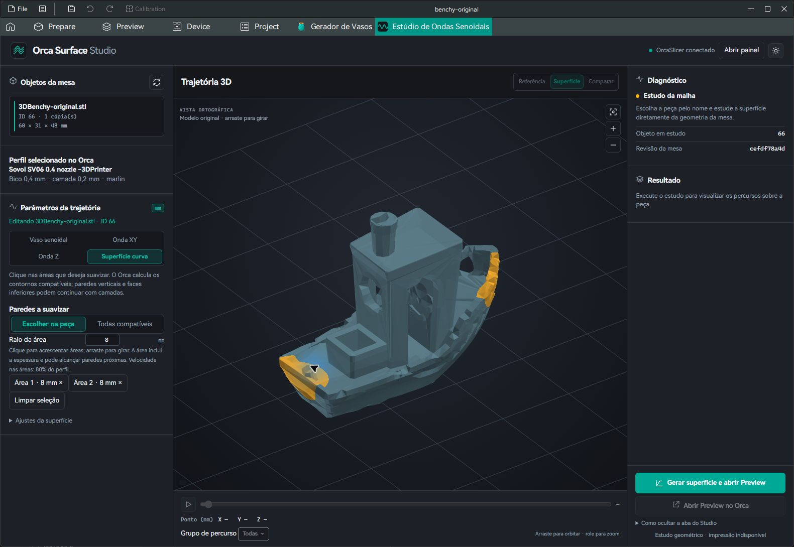
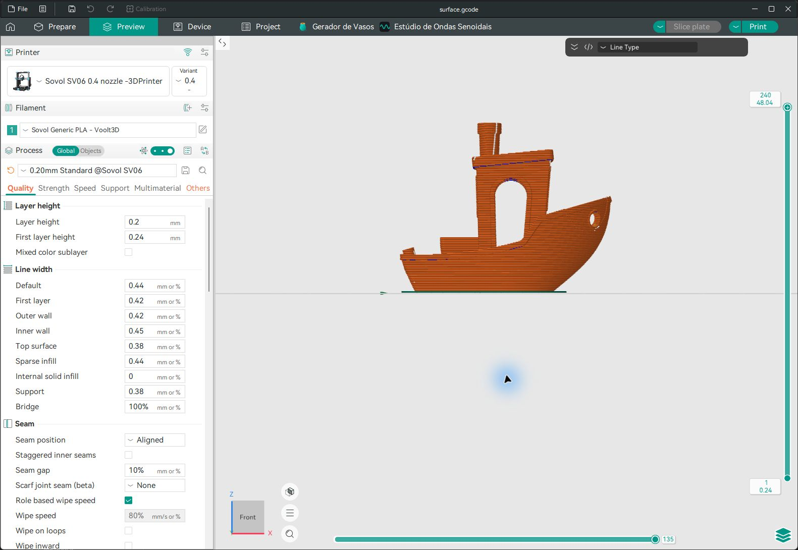
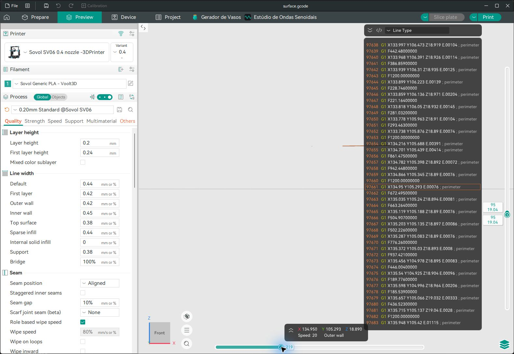

# Escolher paredes pelo clique — Orca Surface Studio 0.8.0

Esta versão permite escolher áreas da peça em 3D para aplicar o contorno local.
O fluxo implementado é **selecionar áreas → gerar → abrir Preview**, dentro do
plugin. A instalação e o teste acompanhado foram concluídos no OrcaSlicer 2.5.1
para Windows, com controle autorizado pelo usuário. As capturas abaixo são
da execução nativa. O arquivo continua sem liberação física pelas razões
registradas ao final.

## Como usar

1. Coloque uma peça na placa e confira impressora e filamento no Orca.
2. Abra o Surface Studio e escolha **Superfície curva**.
3. Em **Paredes a suavizar**, mantenha **Escolher na peça** e clique numa borda
   ou superfície inclinada. O destaque amarelo mostra a área aproximada no
   modelo. Arrastar gira a peça sem acrescentar seleções.
4. Clique em outras áreas se necessário. **Raio da área** controla o próximo
   clique, de 1 a 15 mm. O raio não altera áreas já escolhidas. Cada botão
   **Área N ×** remove uma área; **Limpar seleção** remove todas.
5. Clique **Gerar superfície e abrir Preview**. A peça original é preservada;
   o fatiamento usa uma cópia com as configurações ativas.
6. Confira os percursos no Preview e o diagnóstico do Studio. **Todas
   compatíveis** é uma alternativa explícita para aplicar o contorno em toda
   a peça, sem pintar áreas.



As áreas são esferas que incluem a espessura da parede e podem alcançar uma
parede próxima. Gire a peça para conferir o alcance. O destaque usa o modelo
simplificado do visor; o cálculo resolve cada clique na malha original. Se o
raio não atingir a malha original, o cálculo pede outra seleção. Alterar a
peça, a posição ou as configurações relevantes exige selecionar novamente.

Nas áreas escolhidas, as velocidades externa e interna de parede usam **80%
dos valores do perfil**, mantendo os demais limites do perfil. Os parâmetros
de contorno são aplicados por modificadores nativos; o próprio Orca refaz os
percursos, o preenchimento e a extrusão. Esses modificadores não adicionam
material como se fossem novas peças.

## Ensaio isolado de cálculo

O teste de linha de comando usou o Benchy original de 60 × 31 × 48 mm, perfil
**Sovol SV06 0.4 nozzle -3DPrinter**, PLA Voolt3D e camada de 0,20 mm. Dois
cliques reproduzíveis, um na proa e outro na popa, usaram raio de 8 mm.

- 1.143 segmentos de extrusão com Z variável: 746 externos e 397 internos.
- 1.485 segmentos com altura ajustada, incluindo trechos ajustados horizontais.
- Efeito nas duas áreas: 940 e 545 segmentos, respectivamente.
- Nenhum extremo ajustado fora da união das áreas com a margem do cordão
  verificada. A margem é meia largura mais 0,05 mm, com mínimo de 0,3 mm.
- 26 campos críticos do perfil conferidos e modificadores preservados no
  pacote exportado pelo Orca.
- XYZ/E nativos preservados em 121.539 movimentos; somente avanço limitado.
- Limite nominal do corpo do cabeçote: aproximadamente **+1,24 mm**, em
  118.930 movimentos. Não é uma medição do cabeçote instalado nem uma
  certificação do bico.

O limiar nativo que reduz altura de parede passou de 35° para 1°. Isso permite
aplicar o ajuste também a inclinações suaves, mas não significa que o movimento
está limitado a 1°. No ensaio, a maior inclinação de movimento chegou a
**63,08°** em trechos curtos. O diagnóstico identifica esse caso como acima do
limite do estudo. O arquivo permanece **somente para Preview**.

## Teste acompanhado na janela do Orca

Antes da atualização, foram preservados o original e o pacote do Preview
anterior. A 0.8.0 foi instalada mantendo a ativação. Na peça original foram
escolhidas duas áreas de 8 mm por cliques na proa e na popa. O botão do plugin
gerou a fatia e solicitou sua abertura; no diálogo normal foi escolhido
**Open as project**. Não foi necessário aprovar a leitura de outro arquivo:
o escopo concedido na 0.7.1 continuou válido após os reinícios.

O teste revelou uma falha de interface: a ponte nativa reordenava as chaves
dos dados dos cliques e a comparação textual tratava o resultado como antigo.
Ela foi corrigida com comparação canônica das chaves, preservando a ordem das
áreas e das coordenadas. O teste foi repetido após reinstalação. O Studio
então mostrou os percursos, as métricas e o botão para reabrir o Preview.

Neste ensaio foram gerados **102.437 segmentos da peça**, com **1.353 segmentos
de Z variável**: 984 externos e 369 internos. Foram conferidos 1.837 segmentos
de altura ajustada, 1.170 na primeira área e 667 na segunda, sem extremos
ajustados fora da margem verificada. As seleções diferem das do ensaio isolado;
os números e hashes dos dois casos não são intercambiáveis.

O pacote, o G-code gerado e o cache carregado no Orca coincidiram:

```text
28e653ee25f0eeb1fcb22e3c220eb60c3a9874200bb1552a8137ccdc723cb2df
```

O Studio mostrou **“Preview do Orca confirmado com o mesmo G-code”**, duas
áreas e inclinação máxima de **62,8°**. Seu diagnóstico informou que o arquivo
não está liberado para imprimir. A amostra ciano do visor inclui percursos
planos de outras regiões; a seleção amarela delimita as áreas escolhidas.
A auditoria dos Z ajustados, e não essa cor da amostra, verifica o alcance.



Na camada **95**, nominal **19,04 mm**, o painel nativo mostrou parede externa
com Z como **18,919**, **18,926**, **18,935**, **18,971** e **18,932 mm**, com
extrusão positiva. O controle indicou **20 mm/s**, equivalentes a 80% dos
25 mm/s de parede externa do perfil. Isso demonstra extrusão inclinada na
área escolhida, sem demonstrar a eliminação completa dos degraus.



XYZ/E foram preservados em **120.591 movimentos** do arquivo nativo. A
auditoria do corpo verificou **117.970 movimentos** e manteve o limite nominal
de aproximadamente **+1,24 mm**. **207 testes automatizados passaram**, além
dos testes isolados da interface com e sem WebGL, incluindo a reordenação
dos dados pela ponte nativa. O Preview completo foi deixado aberto.

## O que ainda falta para imprimir este Benchy

Ainda não foi demonstrado um percurso sem os degraus solicitados em todas as
bordas. A seleção funciona e limita onde ocorre o ajuste, mas o antialiasing
nativo pode conservar degraus e produzir transições curtas muito inclinadas.
Paredes verticais e faces voltadas para baixo não ganham automaticamente um
acabamento conformal completo. A [documentação do Orca](https://github.com/OrcaSlicer/OrcaSlicer/wiki/quality_settings_z_contouring)
descreve o contorno para superfícies superiores compatíveis.

Faltam corrigir e conferir essas transições, concluir a verificação do bico
contra o material já depositado e validar a deposição. O sucesso do cupom de
25° e a medida aproximada de 8 mm informada pelo usuário não qualificam
automaticamente um trecho de 63°. **Nenhuma impressão foi enviada.** O relatório
mantém `print_allowed=false`, mesmo quando o limite nominal do corpo passa.

Os dados públicos do ensaio ficam em
[evidencias-selecao-paredes-v080.json](evidencias-selecao-paredes-v080.json).
A decisão de integração está na [ADR-0011](decisions/0011-selective-native-wall-areas.md).
