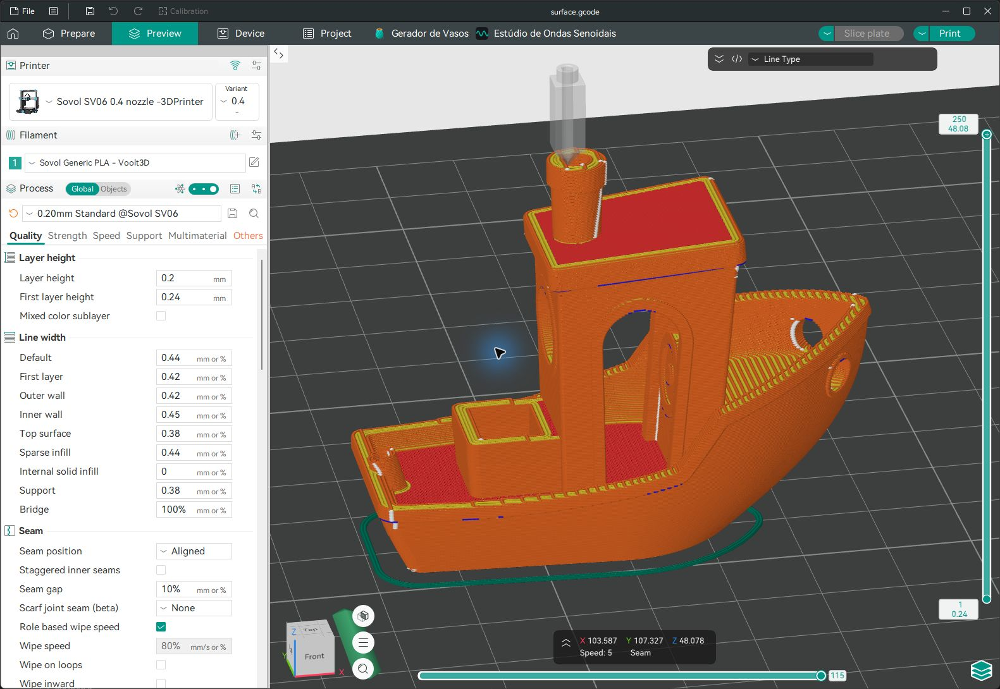
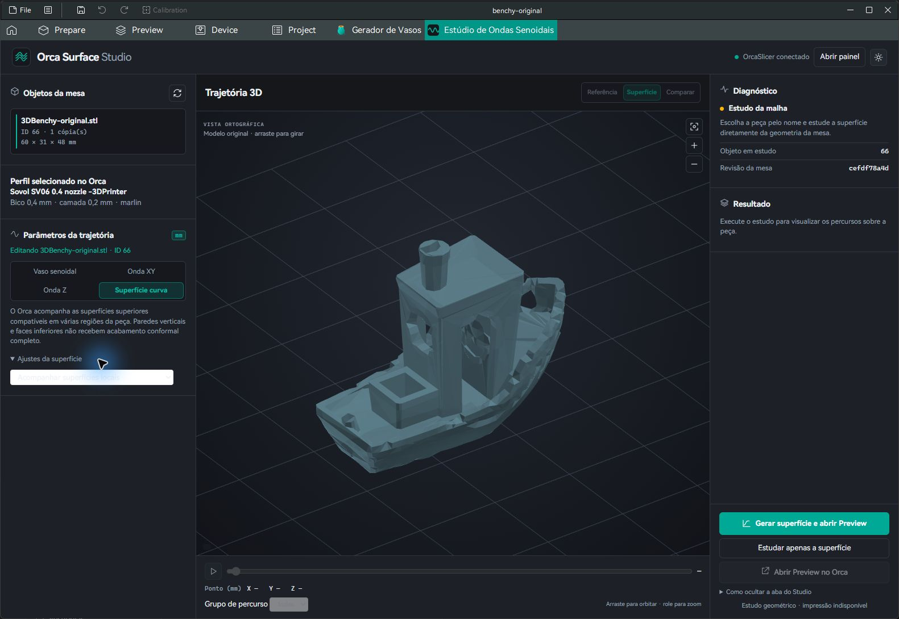

# Superfícies locais e conferência do Benchy — 0.7.0

Registro de 21/11/2026. A versão 0.6.0 alinhava o sólido ao plano de referência
do teto da cabine. Ela alterava trajetórias do casco, mas não calculava um campo
próprio para as curvas da proa, bordas laterais e popa. Contar movimentos com Z
variável não demonstra que eles acompanham a superfície local desejada.

## Comportamento solicitado

Preservar o formato original e reduzir os degraus nas bordas superiores curvas
ou inclinadas. O comportamento deve ser calculado pela geometria de cada novo
arquivo. Não se trata de acrescentar ondas ao barco. As linhas de camada nas
paredes verticais continuam visíveis; faces inferiores e cavidades não recebem
automaticamente o mesmo acabamento de uma superfície voltada para cima.

## Método local separado do alinhamento ao teto

O padrão de **Superfície curva** passa a ser **Acompanhar superfícies locais**.
O Studio prepara uma cópia da malha original e usa o **Z Contouring nativo** do
Orca. O próprio fatiador calcula Z e extrusão contra a malha, em várias regiões
superiores compatíveis. O plugin limita o avanço pelos limites de Z/vazão do
perfil e confere o pacote, sem aplicar a transformação inversa do teto a essa
saída. Não existe empilhamento de duas correções de extrusão.

Em **Ajustes da superfície → Método de superfície**, o antigo
**Alinhar camadas a um teto (experimental)** continua disponível separadamente.
Seus controles de referência, passo e limite angular só aparecem nesse método.
O ângulo de minimizar a altura das paredes do Z Contouring não representa a
capacidade angular do cabeçote e não é apresentado como tal.

As limitações do método nativo são descritas na
[documentação oficial do Orca](https://github.com/OrcaSlicer/OrcaSlicer/wiki/quality_settings_z_contouring):
o alvo são superfícies superiores curvas/inclinadas; superfícies voltadas para
baixo não são tratadas. Isso não é um fatiador universal de todas as faces.

O comando de fatiamento local possui a opção explícita `--zaa-enabled=1`.
O ensaio demonstrou que confiar apenas no valor do projeto não basta neste
Orca: a saída retornou `zaa_enabled=0`. A comparação de configuração interrompeu
a geração. O comando explícito foi então implementado, e 26 campos passaram na
conferência. São declaradas duas linhas exatas de comando no host, sem shell;
qualquer concessão adicional é avaliada pelo usuário no Orca.

## Ensaio com a cópia do projeto real

Foi usada a cópia original exportada antes da geração 0.6.0, com os mesmos
vértices, triângulos e transformação da peça. Perfil: **Sovol SV06 0.4 nozzle
-3DPrinter**, **Sovol Generic PLA - Voolt3D**, **0.20mm Standard @Sovol SV06**.
O teste abaixo usou o executável real do Orca por CLI, sem controlar sua janela.

| Verificação | Resultado |
| --- | --- |
| Segmentos de deposição da peça | 114.348 |
| Segmentos com Z variável em parede externa | 5.202 |
| Segmentos com Z variável em parede interna | 1.058 |
| Segmentos com Z variável em Top surface | 3.675 |
| Identidade de XYZ/E antes/depois da limitação de avanço | 131.782 movimentos iguais |
| Configurações críticas conferidas | 26 |
| Maior velocidade Z comandada | 7,54984 mm/s, limite do perfil 10 mm/s |
| Limite conservador de aceleração Z por segmento | Menor ou igual a 100 mm/s² |
| Conteúdo G-code/pacote | Idêntico |

SHA-256 do candidato local:
`495a3483c3dc315cbe93253dd1c77210b8da4a5966de8567863e3e902abc21f4`.

O ensaio verifica a geração e a preservação dos caminhos emitidos pelo Orca.
Essas contagens não certificam cobertura ou acabamento de cada área da imagem.
A comparação visual das bordas no Orca precisa ser registrada para este novo
método; as capturas da 0.6.0 não são evidência visual da 0.7.0.

## Folga nominal do corpo do cabeçote

A geometria usada veio do
[repositório oficial da SV06](https://github.com/Sovol3d/SV06-Fully-Open-Source),
revisão `75f8a0da6ff822c67b6aff62cfa85c7a441e2271`. O CAD completo foi mantido fora
do repositório deste plugin. A auditoria considera 56 componentes do corpo,
incluindo capa, aquecedor, sensor, ventilador e duto. As duas representações de
bico do CAD são separadas dessa verificação de corpo, não consideradas livres
de colisão por exclusão.

No referencial nominal, o ponto mais baixo do corpo está **1,80 mm** acima da
ponta do bico. Para cada movimento linear no corpo da impressão, foi calculado
um limite conservador contra todo o material anterior e o material em formação
no próprio segmento: altura mínima da ponta no movimento + 1,80 mm menos a maior
altura do material. O teste não depende de amostrar somente os extremos de uma
colisão em XY: se todo o corpo está acima do material, o segmento inteiro está
separado verticalmente, sob esse modelo de deposição.

| Arquivo | Limite nominal mínimo | Interpretação |
| --- | --- | --- |
| 0.6.0, alinhamento ao teto | −0,33986 mm | O limite global não prova separação; não é prova de colisão real. |
| Candidato local 0.7.0 | +1,23999 mm | Separação do corpo nominal no modelo declarado. |

No candidato local foram conferidos 129.257 movimentos e 114.599 movimentos de
deposição, incluindo saias/purgas identificadas. O pior limite foi na descida
inicial para Z 0,24 mm depois de material de purga a Z 0,80 mm.

**Isso não conclui a liberação física.** Não foram medidos o cabeçote instalado,
suas tolerâncias, o contato do bico com o cordão nem o material real. Homing,
macros opacas de início/fim e deformação do plástico não são certificados por
esse limite nominal. O relatório mantém `print_allowed=false`.

O artigo de [Ahlers et al.](https://tams.informatik.uni-hamburg.de/publications/2019/case_ahlers_2019.pdf)
trata a geometria do cabeçote e as transições como problemas próprios, além da
geração do caminho. A capacidade de outra impressora não é inferida da SV06.

## Transição do arquivo anterior

No G-code 0.6.0 foram reavaliados 9.154 segmentos na faixa de ±0,4 mm da âncora
do campo. O modelo de célula deu espaçamento normal de 0,17708 a 0,20851 mm e
nenhuma altura não positiva. Os maiores espaçamentos, até 0,36944 mm, pertencem
às pontes e foram separados das transições regulares. É uma verificação do
modelo geométrico, sem calibração física da deposição. A versão local delega
essas transições ao fatiador e preserva seu XYZ/E; não reutiliza aquela âncora.

## Atualização do teste nativo e informação do cabeçote

O usuário autorizou o controle da máquina e informou que a capa de silicone
está ausente. Relatou aproximadamente **8 mm** da ponta até a parte que poderia
encostar. Essa observação foi registrada como aproximação de componente ainda
não identificado, sem substituir todos os afastamentos por 8 mm. Foi solicitada
apenas a confirmação de que o menor afastamento inclui o duto e o sensor.
O limite CAD anterior, que ainda inclui a capa, foi mantido como referência
nominal conservadora; não representa a medição do conjunto instalado.

A 0.7.0 foi instalada preservando o estado de ativação e os presets. A cópia do
projeto original e o pacote do Preview anterior foram salvos antes do reinício.
O teste pelo botão **Gerar superfície e abrir Preview** concluiu o fatiamento
local e abriu o pacote na aba Preview, sem enviar nada à impressora.

No ensaio nativo foram produzidos **114.311 segmentos da peça**, com **9.933
trechos de Z variável**. Os 26 campos críticos coincidiram. A limitação de avanço
preservou XYZ/E em **131.359 movimentos**, e o pacote contém o mesmo G-code.
O limite nominal do corpo continua em aproximadamente **+1,24 mm**, em 128.855
movimentos verificados. O arquivo nativo difere do ensaio isolado por pequenas
diferenças da malha serializada pela API; não se devem intercambiar seus hashes.

SHA-256 do resultado nativo:
`0e3a6d9e5ed0b7f387a8658343732ca6caf9bd6dba6f1b34fd28544e0e42bbfe`.





O usuário confirmou posteriormente que os aproximadamente 8 mm incluem também
o duto e o sensor. É uma medida relatada como aproximada, não um levantamento
dimensional ou uma calibração do contato do bico. A ausência da capa permanece
registrada; não foi alterado o perfil nominal de fábrica para fingir que ele
representa exatamente o cabeçote instalado.

Na 0.7.0, o Orca solicitou leitura individual do cache e o ciclo foi encerrado
antes da conferência final. A 0.7.1 substituiu esse pedido repetido por um escopo
de pasta aprovado pessoalmente pelo usuário. O novo teste gerou o Benchy, abriu
o Preview e confirmou seu hash em caches distintos, sem novos pedidos por
arquivo. A camada 95 mostrou Z variável durante extrusão da parede externa da
proa. Ainda existem degraus residuais no modelo completo; esse ensaio não
comprova acabamento conformal completo de todas as áreas marcadas pelo usuário.
Veja [a sequência e as capturas da 0.7.1](VALIDACAO_NATIVA_V071.md).

## Estado da entrega

O candidato é de **validação**, não um arquivo liberado para imprimir. O
menor afastamento do cabeçote frio foi relatado como aproximadamente 8 mm,
incluindo duto e sensor. O controle foi autorizado e a geração/abertura pelo
plugin foi observada; a leitura do cache foi confirmada na 0.7.1 e a inspeção
visual encontrou melhoria local com degraus residuais. Nenhum
arquivo foi enviado à SV06 nem iniciado pelo plugin.

Para reduzir os pedidos repetidos, a 0.7.1 usa o
[escopo de leitura persistente do cache](PERMISSOES_PREVIEW.md). A decisão inicial
continua sendo feita pessoalmente pelo usuário no Orca.

Resultados numéricos resumidos:
[evidencias-superficies-locais-v070.json](evidencias-superficies-locais-v070.json).

Reprodução da auditoria nominal com o CAD local:

```powershell
python scripts/audit_nominal_stock_body.py --job <pasta-da-geracao> --cad <assembled-components.json> --output <auditoria.json>
```

O nome do script identifica a fixture SV06; o algoritmo `readiness.py` recebe
o limite geométrico como entrada e não contém valores de fábrica de impressora.
