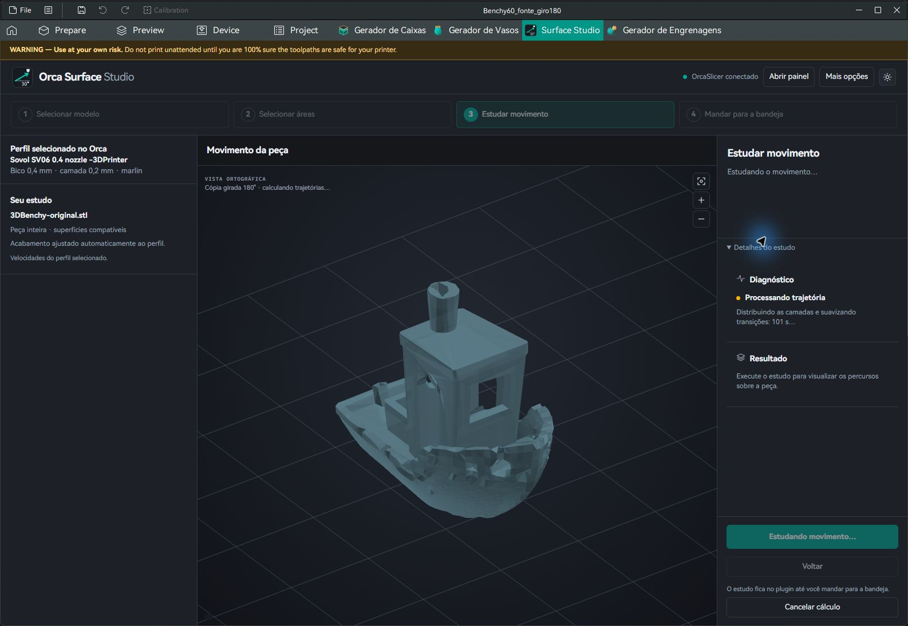
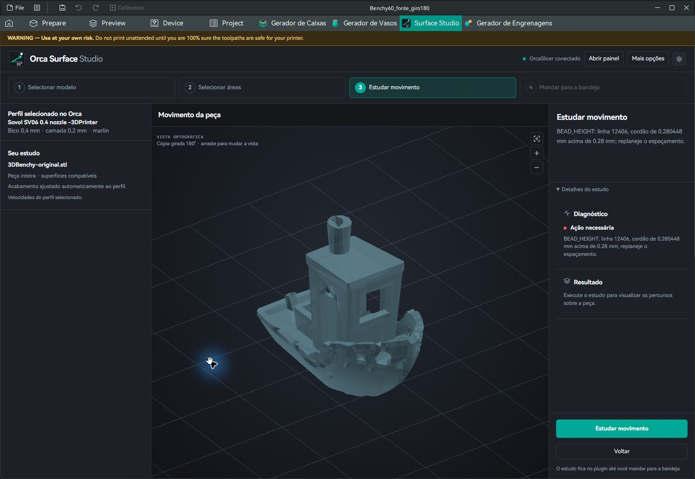
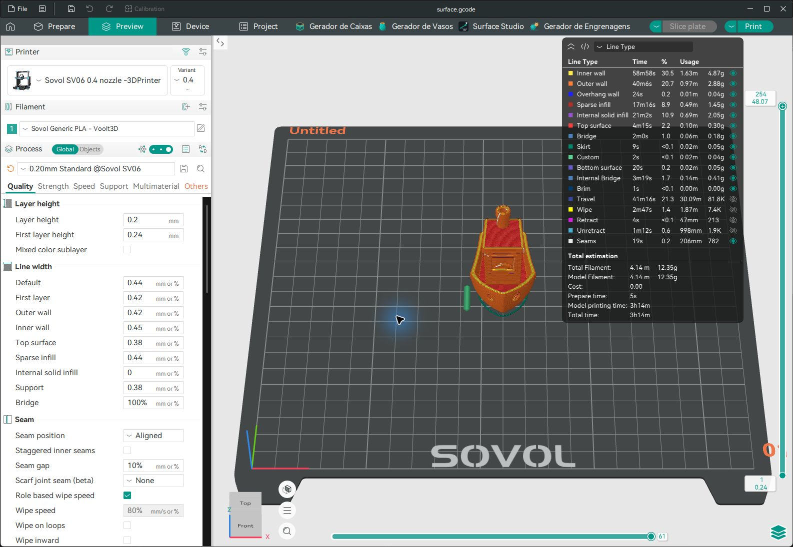
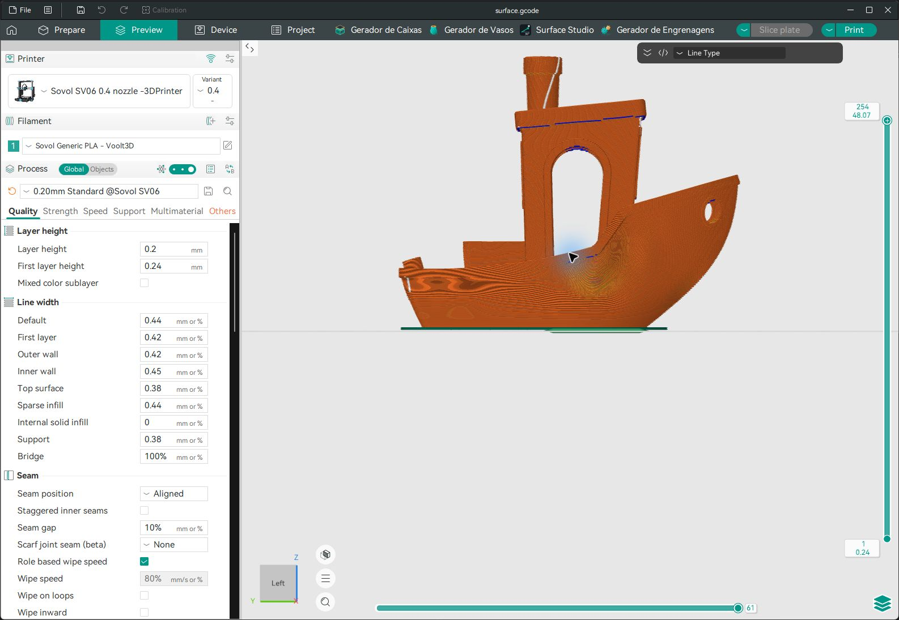

# Benchy de 60 mm girado 180° no Surface Studio

Ensaio digital de 22/11/2026, com OrcaSlicer 2.5.1 no Windows e Surface
Studio 0.15.0. **Preview verificado; folga física inconclusiva. Nenhuma
impressão foi enviada ou iniciada neste ensaio.**

## Objetivo e condições

Colocar a proa na direção da borda da mesa com o texto **SOVOL**, usando o
giro da cópia no plugin, recalcular e conferir o novo Preview. O perfil
selecionado é **Sovol SV06 0.4 nozzle -3DPrinter**, com PLA Voolt3D, camada
nominal de 0,20 mm e primeira camada de 0,24 mm. O Benchy mantém o tamanho
original, aproximadamente 60 × 31 × 48 mm.

O usuário informou contato da carcaça traseira na orientação anterior.
Neste ensaio informou não conseguir medir sua altura e relatou que a proa
voltada para a frente evita o contato. Esse relato é uma observação do
operador; não é uma medição do envelope ou um certificado de folga.

## Passos executados pela interface

1. O Orca foi reaberto para carregar a versão instalada. As opções temporárias
   de identificação do G-code foram preservadas em uma cópia separada do
   preset, sem sobrescrever o preset existente. O aviso no topo do Studio
   apareceu na sessão nativa.
2. Foi aberta uma cópia 3MF da mesma geometria usada no Preview anterior.
   A importação preservou as 225.154 faces e suas conexões. A maior diferença
   de posição dos vértices após a serialização do Orca foi 0,00001221 mm.
3. No Studio: **Selecionar modelo → Selecionar áreas → Peça inteira**.
   Em **Posição da cópia na mesa**, dois cliques em **+90°** chegaram a
   **180°**. A indicação central confirmou o giro da cópia.
4. **Continuar → Estudar movimento** iniciou o recálculo. O botão de envio
   à impressora não foi acionado.



## Bloqueio encontrado e preparação da segunda tentativa

A primeira tentativa foi recusada pelo verificador existente:

```text
BEAD_HEIGHT: linha 12406, cordão de 0.280448 mm acima de 0.28 mm;
replaneje o espaçamento.
```

O limite de 0,28 mm não foi aumentado e a verificação não foi desativada.



Para conservar a distribuição de camadas anteriormente aprovada pelo usuário,
o responsável pelo ensaio preparou manualmente uma proposta C2 girada 180°
em torno do centro da peça. Os eixos XY foram refletidos e os coeficientes
correspondentes invertidos. A conferência numérica em 4.096 pontos encontrou
diferença máxima de 1,07 × 10⁻¹⁴ na fase e 3,22 × 10⁻¹⁵ nas derivadas.

Essa preparação reutilizou somente uma proposta geométrica. Não reutilizou
G-code, fatiamento, autorização de impressão ou aprovação de folga. Depois
dela, **Estudar movimento** foi acionado novamente na interface nativa,
mantendo o fatiamento e os verificadores de deposição e movimento.

**O fluxo deste ensaio teve essa intervenção manual.** A preservação automática
da distribuição anterior ao girar ainda não é uma capacidade implementada
na interface geral do plugin. O ensaio não demonstra um fluxo integralmente
automático para qualquer peça ou impressora.

## Abertura do novo Preview

Após a segunda tentativa, o Studio mostrou **Pronto para Preview**, mas o
passo a passo permaneceu na etapa 3, com o botão **Estudar movimento** e a
etapa 4 desabilitada. Esse comportamento após uma recusa seguida de nova
geração precisa ser corrigido; clicar em estudar outra vez não é o caminho
demonstrado neste ensaio.

A abertura foi feita pelo próprio plugin em **Mais opções → Abrir Preview
no Orca**. No diálogo nativo, foi selecionado **Open as project**, mantendo
o pacote fatiado completo. O Orca processou o G-code existente e abriu o
Preview, com a proa voltada à borda **SOVOL**. A vista lateral foi escolhida
no menu **View → Left** e o zoom usado para conferir casco, teto e transições.





## Resultado digital

| Verificação | Resultado observado |
|---|---|
| Giro aplicado ao estudo | 180°; escala preservada; original não modificado |
| Perfil efetivo | Preservado e comparado após o fatiamento |
| Núcleo geométrico | `cubic_spline_phase_v1`, preservado |
| Segmentos de deposição | 411.530 |
| Espessura efetiva calculada dos cordões apoiados | 0,09481229 a 0,24 mm |
| Limites de espessura do perfil | 0,07 a 0,28 mm; zero violações nos cordões apoiados |
| Maior inclinação emitida | 27,91296°, abaixo do limite digital de 30° |
| Orçamento de erro geométrico | 0,02 mm, dividido entre malha e cordas |
| G-code no pacote final | Idêntico ao arquivo gerado |
| G-code temporário realmente lido pelo Preview | Idêntico ao arquivo gerado |
| Evento de verificação do plugin | `preview_package_verified`, válido |
| Validação física / liberação de impressão | Pendente / falsa |

SHA-256 do conteúdo gerado, empacotado e carregado no Preview:

```text
63c3aead340be99d8c69533c7f52040baa8e6a507ecfccd18beb1ec5e5a1a7b5
```

Esses valores de espessura e inclinação são cálculos do arquivo emitido,
não medições de uma peça impressa ou qualificação do cabeçote. Pontes e
outras contribuições nativas usam a seção específica registrada pelo
fatiador e não estão incluídas no intervalo dos cordões apoiados.

## Conferência nominal da carcaça

A varredura foi refeita sobre o **novo G-code completo**, com o cabeçote
fixo e a orientação já aplicada ao modelo. O G-code não recebeu um giro
adicional durante a análise. Foi usado o CAD nominal sem o deslocamento
global aplicado na antiga hipótese de 4 mm; silicone e bico foram excluídos
do conjunto do corpo conforme o escopo anterior.

As caixas conservadoras do soprador mais baixo apontaram sobreposição
potencial, com limite inferior de folga de **−5,18497 mm**. Esse número é
um limite calculado com caixas e células de material: **não é uma medida
de penetração real da carcaça**. A varredura completa e a conferência
separada desse soprador retornaram `INCONCLUSIVE`.

Para reduzir a ambiguidade dessas caixas, foi examinado também o sólido
BREP do soprador de fábrica, em 32 movimentos candidatos e três posições
por movimento. Dos 1.234.590 pontos de material estimado disponíveis,
6.000 classificações geométricas foram realizadas nas regiões candidatas.
Nenhum ponto testado foi encontrado dentro do sólido. O resultado foi
`INCONCLUSIVE_NO_SAMPLED_WITNESS`; a amostragem não cobre continuamente
toda a trajetória e não prova ausência de contato.

A posição do CAD em relação ao bico instalado, as dimensões reais da
carcaça e o material depositado continuam sem aferição. Portanto, o ensaio
**confirma o giro, o novo cálculo e a identidade no Preview, mas não confirma
folga física suficiente da carcaça traseira**. O relato do operador de que
essa direção evita contato permanece registrado separadamente.

Nenhuma hipótese de 4 mm foi convertida em medição ou aprovação física.
Nenhum comando de envio, seleção de trabalho ou início de impressão foi
acionado. A publicação no Orca Cloud permanece bloqueada.
