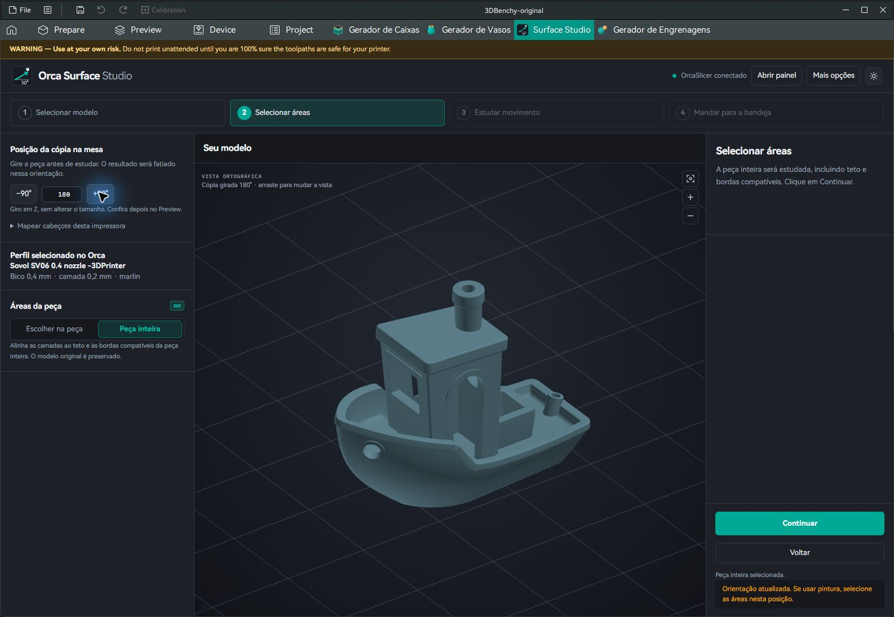
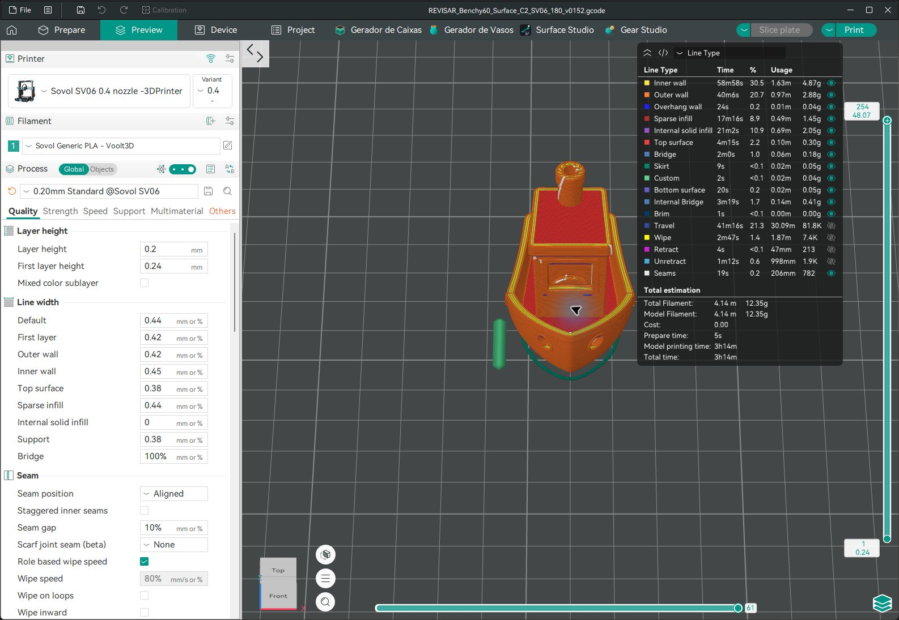

# Benchy 180° após a correção de inversão — 0.15.2

**Arquivo final para revisão aberto no Orca; folga física inconclusiva.**
A inversão numérica foi corrigida. O novo planejamento automático do zero ainda
foi recusado por espessura; a entrega usa a distribuição C2 anterior, retomada
manualmente e processada novamente, com os verificadores ativos.

Ensaio de 22/11/2026 no Windows, OrcaSlicer 2.5.1, Surface Studio local 0.15.2.
Perfil **Sovol SV06 0.4 nozzle -3DPrinter**, bico 0,4 mm, camada nominal 0,20 mm,
primeira camada 0,24 mm e **Sovol Generic PLA - Voolt3D**. Não houve envio à
impressora ou início de impressão. A política do OrcaCloud permanece bloqueada.

## Primeiro caminho: novo estudo pela interface

Após instalar a correção e reiniciar o Orca, foi aberto o Benchy original de
225.154 triângulos. Na aba do Studio, o giro da cópia foi aplicado com dois
cliques em **+90°**, conferindo **180°**, mantendo **Peça inteira** e executando
**Estudar movimento**.



O trabalho `be06b2d5ca9847abb3c97c8431723310` preparou e fatiou a cópia e passou
da falha `SPLINE_INVERSE` encontrada no teste anterior. A geração então parou em:

```text
BEAD_HEIGHT: linha 12569, cordão de 0.280664 mm acima de 0.28 mm;
replaneje o espaçamento.
```

O limite não foi alterado e esse trabalho não produziu um arquivo final
aprovado. A correção de inversão não resolve, sozinha, o espaçamento automático.

## Segundo caminho: retomar a distribuição anterior

Para conservar o padrão já estudado, foi usada a distribuição C2 e a fatia
planar preservadas do trabalho `0700fd6334c74c46b58ac6c42f0a71de`, descrito no
[ensaio anterior de 180°](TESTE_BENCHY_GIRO180_V0150.md). O giro já estava
aplicado à geometria antes daquele fatiamento. Nenhum G-code foi girado depois
de processado, e a escala permaneceu igual.

O campo e a grade lógica foram reconstruídos a partir dos registros daquele
estudo. Uma conferência em 4.096 pares de coordenadas preservados confirmou a
consistência dentro da precisão das coordenadas emitidas, arredondadas a seis
casas decimais: diferença espacial máxima de aproximadamente 0,000000841 mm.
O perfil da fatia preservada foi comparado com o perfil exportado do novo
ensaio nativo. O G-code planar de entrada também foi conferido com o pacote
original e o hash registrado antes de qualquer processamento.

As trajetórias foram recalculadas com a inversão corrigida da versão 0.15.2,
mantendo os limites de deposição e movimento. A saída foi **idêntica byte a
byte ao G-code final de 180° anteriormente verificado**. Isso é retomada
manual de um estudo, não uma demonstração de recálculo automático do zero.

| Verificação do arquivo retomado | Resultado |
| --- | --- |
| Segmentos de deposição | 411.530 |
| Espessura calculada dos cordões apoiados | 0,09481229 a 0,24 mm |
| Limites do perfil para esses cordões | 0,07 a 0,28 mm; zero violações |
| Maior inclinação emitida | 27,91296°, abaixo de 30° |
| Primeira camada | Preservada |
| Giro em Z | 180°; escala preservada |
| G-code dentro do pacote final | Idêntico ao arquivo gerado |
| Cache realmente carregado pelo Preview | Idêntico ao arquivo gerado |
| Folga física / liberação de impressão | Inconclusiva / pendente |

Pontes e outras seções nativas não estão incluídas naquele intervalo de
cordões apoiados; mantêm seu tratamento específico. Os valores são cálculos,
não medições de uma peça impressa ou garantia da deposição física.

## Preview final e identidade

O pacote `REVISAR_Benchy60_Surface_C2_SV06_180_v0152.gcode.3mf` foi aberto
manualmente no Orca. O Preview mostrou o resultado completo, com a proa na
direção da frente da mesa. Foram exibidas 254 camadas lógicas, Z máximo de
aproximadamente 48,07 mm e estimativa de 3 h 14 min. Não foi medido tempo real
de impressão.



Foi confirmada a igualdade entre o G-code entregue, o conteúdo do pacote e o
cache `Metadata/plate_1.gcode` da sessão do processo nativo 31388. Hash comum:

```text
63c3aead340be99d8c69533c7f52040baa8e6a507ecfccd18beb1ec5e5a1a7b5
```

O [recibo do Preview](images/benchy180-v0152/native-preview.json) e os
[resultados digitais](images/benchy180-v0152/candidate-validation.json) registram
essa identidade. Ao detectar interação do usuário na janela, os comandos de
mouse foram interrompidos. O arquivo ficou aberto para inspeção.

## Folga e entrega local

A conferência conservadora de altura usou o CAD nominal do conjunto original,
com o corpo excluindo bico e silicone, sem transformar a hipótese antiga de
4 mm em uma medida. O piso nominal mais baixo considerado foi 2,17298 mm.
Contra o envelope global em Z do material anterior e corrente, o limite
inferior de folga foi −6,53341 mm, retornando **INCONCLUSIVE**. Esse envelope
é conservador e não considera a separação em XY; o resultado não mede uma
penetração real, nem prova contato ou ausência de contato.

A posição e as dimensões do cabeçote instalado continuam sem aferição.
Portanto, o arquivo permanece identificado como **REVISAR**, com
`physical_validation=false` e `print_allowed=false`. A folga da carcaça traseira
precisa ser conferida fisicamente antes de qualquer início manual de impressão.

Os arquivos `.gcode`, `.gcode.3mf`, o resumo `.json` e `-LEIA.txt` foram salvos
na pasta local `Exports/SurfaceStudio` do projeto de trabalho do usuário.
Esses arquivos de ensaio não foram enviados ao Git público. Esta revisão
publica somente código, teste, documentação e capturas sem caminhos pessoais.
