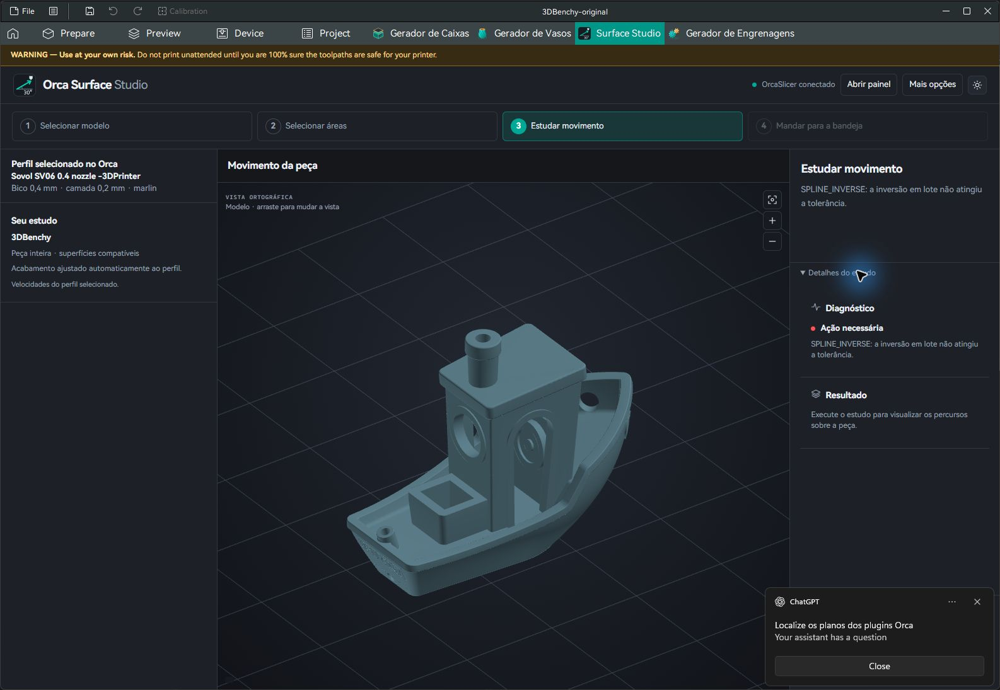
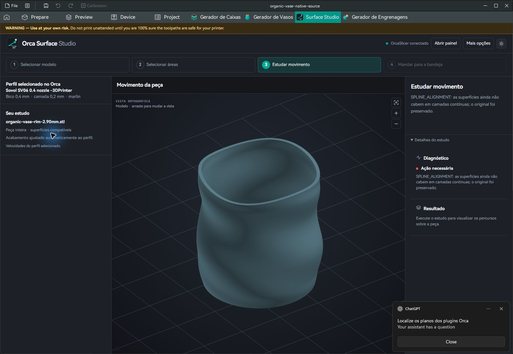

# E2E no Orca: Benchy e vaso orgânico — 0.15.1

**Resultado: reprovado.** A prévia do modelo está completa, mas o fluxo padrão
de estudo não produziu um resultado final aprovado nos casos abaixo.

Em 22/11/2026, o teste foi executado pela interface do OrcaSlicer instalado no
Windows, versão **2.5.1 build eef7710c**, com Surface Studio **0.15.1**. O bundle
instalado corresponde por SHA-256 ao artefato local verificado. O perfil exibido
foi **Sovol SV06 0.4 nozzle -3DPrinter**, bico de 0,4 mm e camada de 0,2 mm.

O caminho exercitado foi selecionar o modelo da mesa, avançar para a seleção
de áreas, manter **Peça inteira** e executar **Estudar movimento**. O diagnóstico
foi acompanhado dentro da aba. Não houve envio à impressora, aquecimento ou
impressão. Como os estudos falharam, não foi aberto um pacote final no Preview.

## Resultados nativos

| Caso | Entrada | Resultado observado |
| --- | --- | --- |
| Benchy | 225.154 triângulos; aproximadamente 60 × 31 × 48 mm | A cópia foi preparada e fatiada pelo Orca. A restauração das trajetórias falhou com `SPLINE_INVERSE: a inversão em lote não atingiu a tolerância.` |
| Vaso orgânico, escala 100% | 76.160 triângulos; aproximadamente 60,4 × 60,3 × 61,5 mm; ondulação vertical de 2,900002 mm | Recusado antes do fatiamento com `SPLINE_COMPLEXITY: reduza a peça para este estudo de camadas contínuas.` |
| Mesmo vaso, escala 90% | Escala uniforme aplicada na interface do Orca; aproximadamente 54,4 × 54,3 × 55,3 mm; ondulação vertical de 2,610001 mm | Passou do limite de complexidade e executou o planejamento, mas foi recusado com `SPLINE_ALIGNMENT: as superfícies ainda não cabem em camadas contínuas; o original foi preservado.` |

A interface permaneceu utilizável após as falhas. Foi possível voltar à mesa,
substituir a entrada de teste, salvar um projeto separado, alterar sua escala
e repetir o estudo. A lista do Studio foi atualizada ao mudar a geometria.
O aplicativo ficou aberto com o diagnóstico do último caso, sem cálculo ativo.

## Definição do vaso e limite de 3 mm

O vaso foi preparado fora da interface como entrada controlada de teste, usando
a geometria orgânica do Vase Studio e uma deformação vertical suave da borda.
Depois foi importado e estudado pela interface real do Orca. Isso não constitui
um teste do fluxo de criação pela interface do Vase Studio.

A altura nominal é 60 mm. A borda segue `60 + 1.45 × sin(3θ)` mm; a deformação
é nula até 42 mm e cresce suavemente acima dessa altura. A primeira camada
permanece plana. A textura orgânica radial é independente dessa ondulação
vertical. O STL contém uma superfície fechada, arestas com orientações opostas,
volume positivo e característica de Euler 2, sem faces degeneradas.

Após a conversão para float32, o mínimo e o máximo da borda medidos na entrada
são 58,549999 e 61,450001 mm. A diferença é **2,900002 mm**, abaixo de 3 mm.
Com a escala uniforme de 90% aplicada no Orca, essa diferença passa a
**2,610001 mm**. Estes números descrevem a geometria de entrada. Não há
trajetória final aprovada para verificar a variação de Z por camada depositada.

Os [parâmetros e medições da entrada](images/native-e2e-v0151/vase-input.json)
permitem identificar a configuração. Também foram preservadas as capturas do
[modelo carregado](images/native-e2e-v0151/vase-model.png) e da
[recusa por complexidade](images/native-e2e-v0151/vase-complexity-error.png).

## Desempenho e diagnóstico do Benchy

O backup do estudo foi gravado às 17:38:26 e a cópia preparada às 17:49:00,
aproximadamente **10 min 34 s** depois. O G-code da cópia foi produzido às
17:49:10; a captura da falha foi gravada às 17:50:11. São marcos desta execução,
não um benchmark de outras máquinas nem uma medição precisa do instante da
falha. A cópia refinada possui 557.546 triângulos, com orçamento geométrico
de aproximadamente 0,01 mm. Não houve simplificação da malha original.

Um diagnóstico numérico separado reutilizou o campo calculado e o G-code
nativo. Reconstruindo a composição das coordenadas de camada registradas,
a preparação da camada lógica 76 reproduziu `SPLINE_INVERSE`. Uma das consultas
problemáticas foi `(80.877, 109.703, 15.404204040573156)`. Tanto a inversão
escalar quanto a versão em lote falharam no limite atual de 40 iterações.

Ao prolongar **somente o diagnóstico local** até 80 iterações, esse ponto
convergiu na avaliação 57, com resíduo de aproximadamente `2.13e-14`, mantendo
a tolerância de `1e-9`. Isso demonstra um caso de convergência insuficiente no
limite atual; não é uma correção instalada nem aprovação das demais trajetórias.
A solução precisa garantir progresso da inversão e passar pelas verificações
geométricas e de deposição existentes, seguidas de novo E2E nativo.

## Preservação e pendências

O 3MF original do Benchy manteve seu SHA-256. As cópias, o projeto separado
do vaso e os intermediários ficaram no armazenamento local de estudo.
Nenhum dos três trabalhos possui `surface.gcode` ou relatório final aprovado.
Os [identificadores, hashes e resultados](images/native-e2e-v0151/validation.json)
estão registrados sem caminhos pessoais ou configurações privadas do perfil.

Esta revisão acrescenta evidências; não altera o motor, os bundles ou a versão
instalada. O teste visual anterior continua descrito em
[TESTE_ORCA_VISUALIZACAO_V0151.md](TESTE_ORCA_VISUALIZACAO_V0151.md), cujo escopo
não incluía a geração do estudo. Sua aprovação visual não aprova este E2E.

Permanecem pendentes a correção da inversão do Benchy, o suporte ao alinhamento
do vaso com borda ondulada e a redução do tempo de preparação. Os limites
geométricos devem continuar ativos. Este resultado não autoriza impressão
física ou publicação no OrcaCloud.
