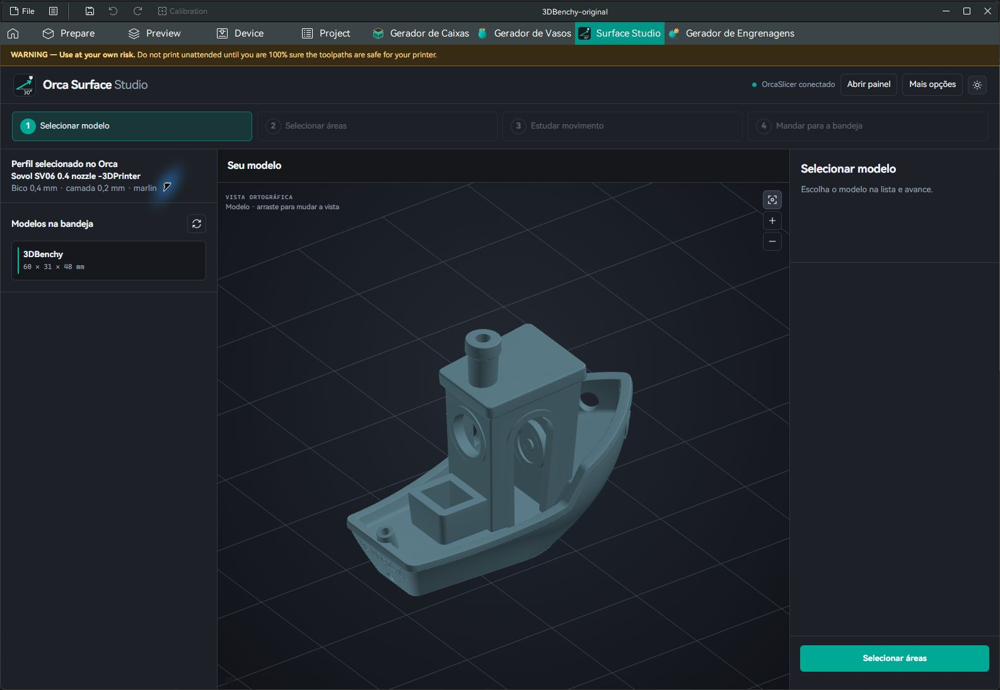
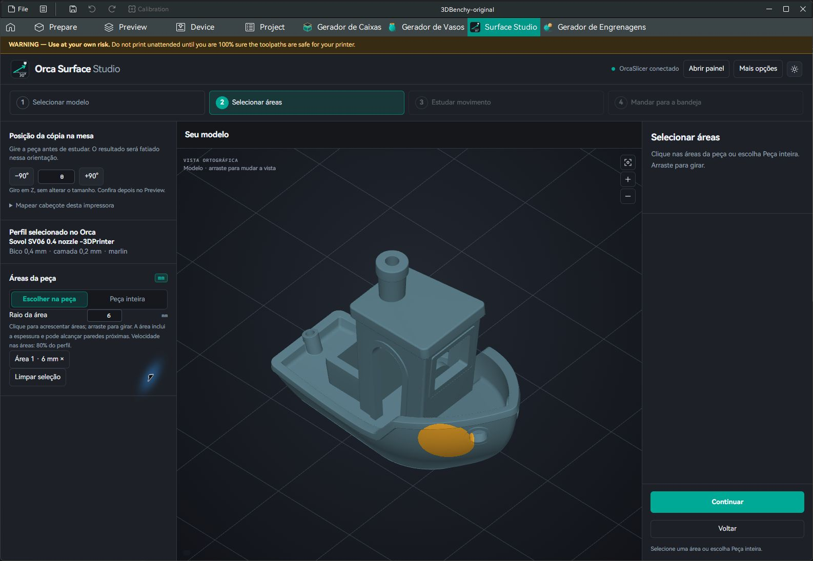

# Conferência direta no Orca — Surface Studio 0.15.1

Em 22/11/2026, após autorização do usuário para controlar a máquina, o Orca foi
fechado e reaberto com o pacote local 0.15.1. O arquivo instalado foi comparado
por SHA-256 com o bundle verificado. Esta conferência foi feita no aplicativo
Windows, além dos testes isolados já registrados.

Foi carregado o `3DBenchy-original.3mf` de referência, com 225.154 triângulos e
dimensões de aproximadamente 60 × 31 × 48 mm. O perfil exibido no Studio foi
**Sovol SV06 0.4 nozzle -3DPrinter**, bico de 0,4 mm e camada de 0,2 mm. O SHA-256
do 3MF permaneceu igual ao da comparação isolada.

## Resultado observado

- O modelo carregou na aba Surface Studio com casco contínuo, curvas suaves,
  chaminé circular e contornos definidos nas janelas.
- Arrastar o modelo mudou a vista, mantendo a superfície completa. O zoom
  pelo mouse respondeu normalmente.
- No passo Selecionar áreas, **Escolher na peça** permitiu clicar no casco.
  Apareceram o destaque laranja e **Área 1 · 6 mm**, com Continuar habilitado.
- Ao terminar, a opção Peça inteira foi restaurada, a marca de teste foi limpa
  por essa troca de modo e a câmera foi enquadrada. O Orca ficou aberto na aba
  Surface Studio, no primeiro passo.

As [evidências e identidades dos arquivos](images/model-preview-v0151/validation.json)
registram a versão, os hashes e o escopo. Há também capturas do
[carregamento inicial](images/model-preview-v0151/01-native-model.png) e do
[giro da vista](images/model-preview-v0151/02-native-orbit.png).

## Preservação da sessão e escopo

Ao fechar, o Orca apresentou alterações pendentes em Verbose G-code e Label
objects. Os valores foram preservados em uma cópia chamada
`0.20mm Standard @Sovol SV06 - Surface preview backup 2026-11-22`, evitando
sobrescrever o preset existente. O aplicativo também apresentou um aviso de
nova versão, que foi fechado com Cancel; a versão do Orca não foi atualizada.

A conferência cobriu a visualização, o giro, o zoom e a seleção. Não houve
estudo de trajetórias, geração/envio de G-code ou impressão física. Os critérios
de liberação física e a política de publicação no OrcaCloud seguem os registros
do projeto. Esta execução não mediu FPS ou desempenho em outras máquinas.
