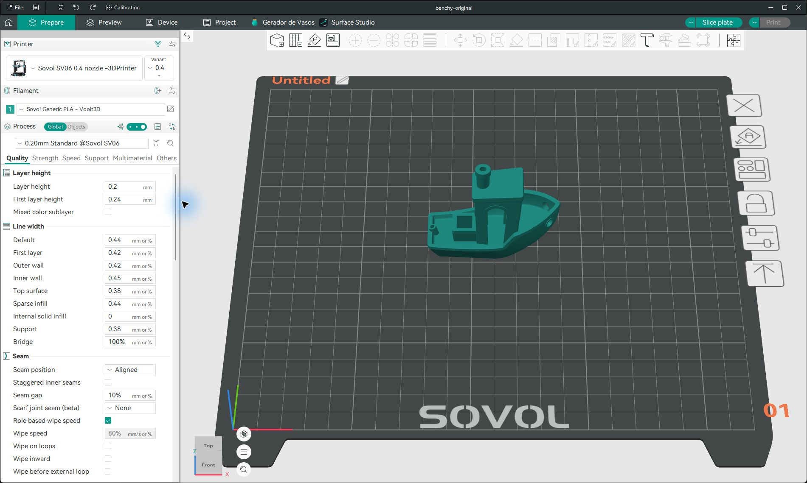
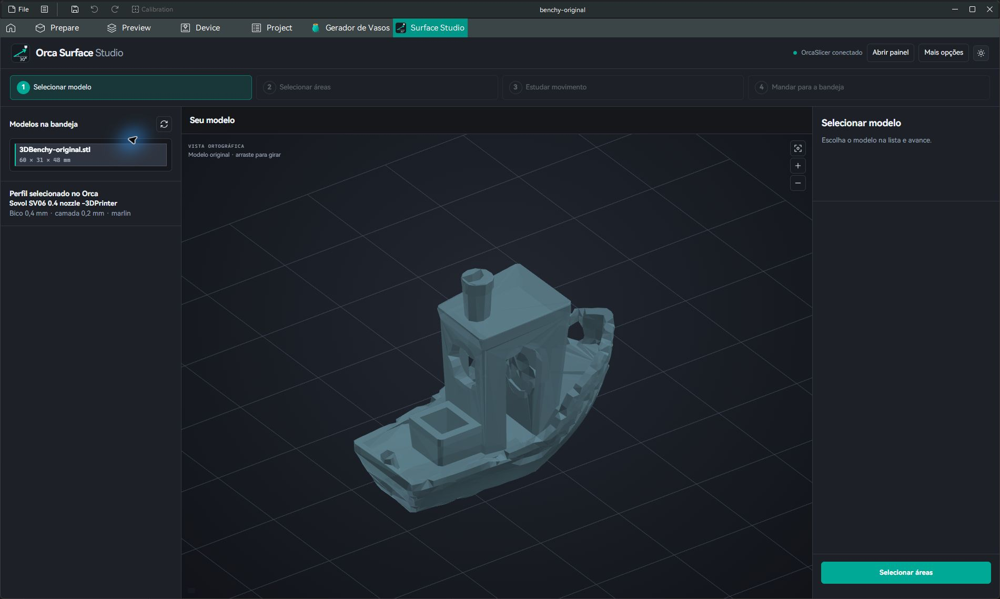
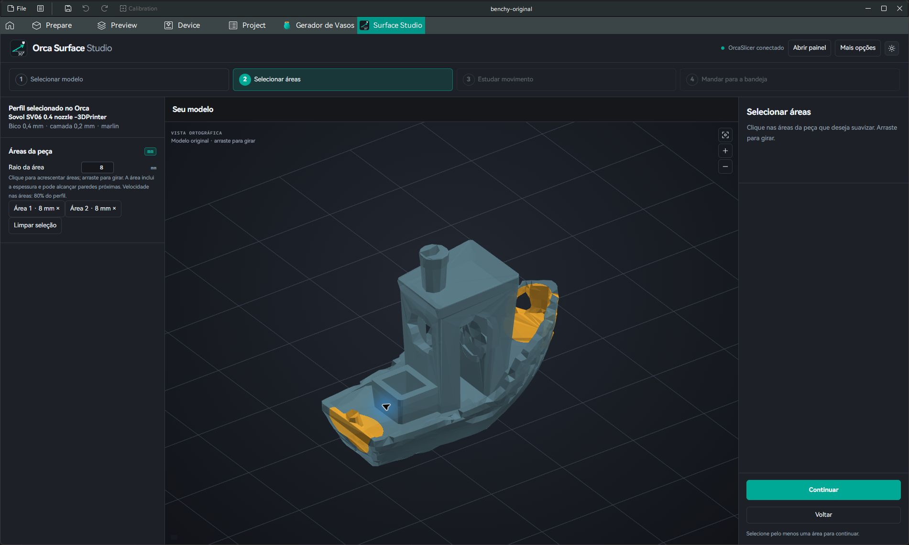
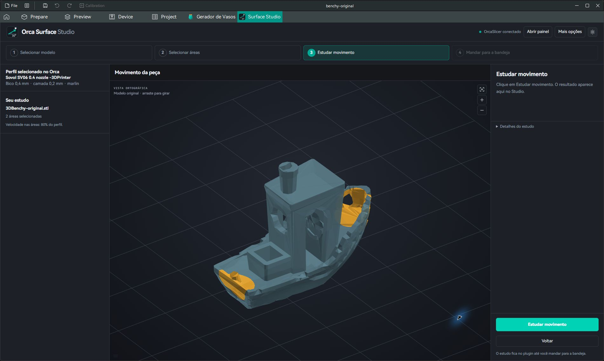
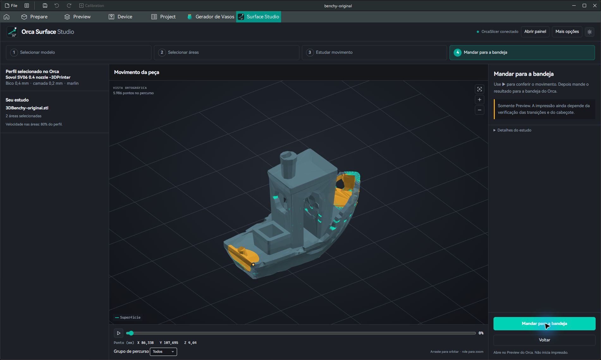
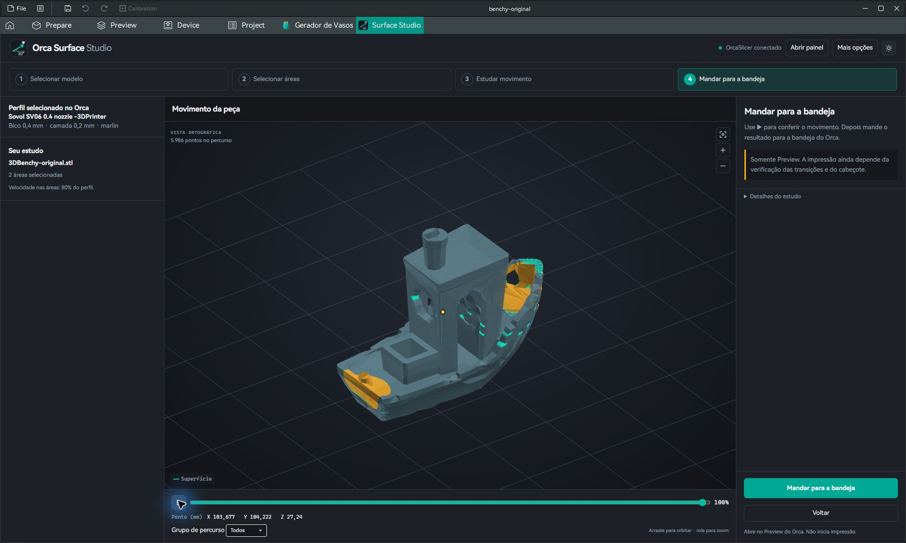
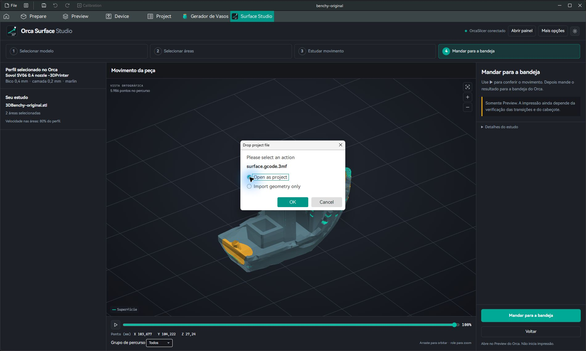
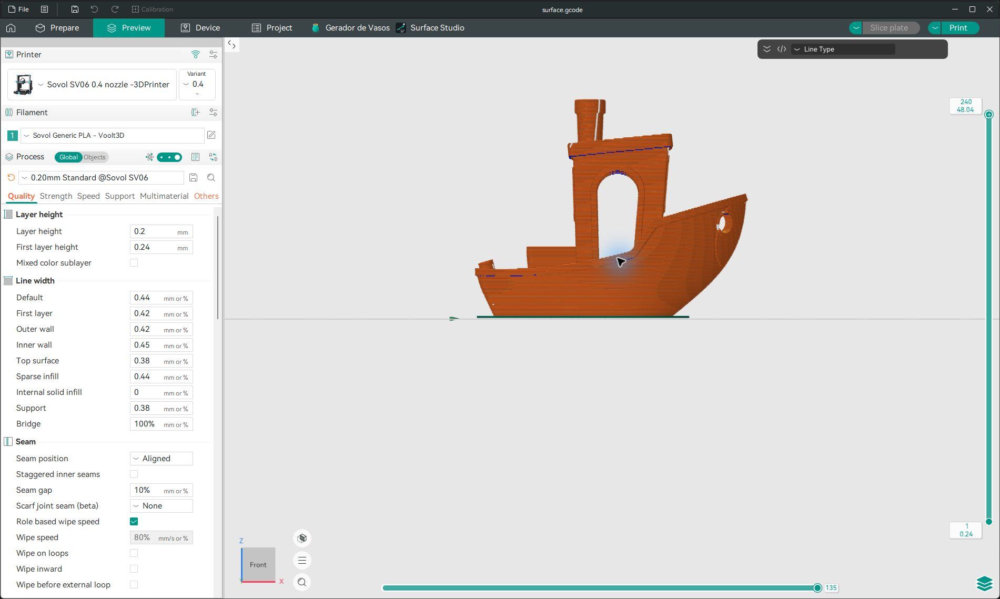
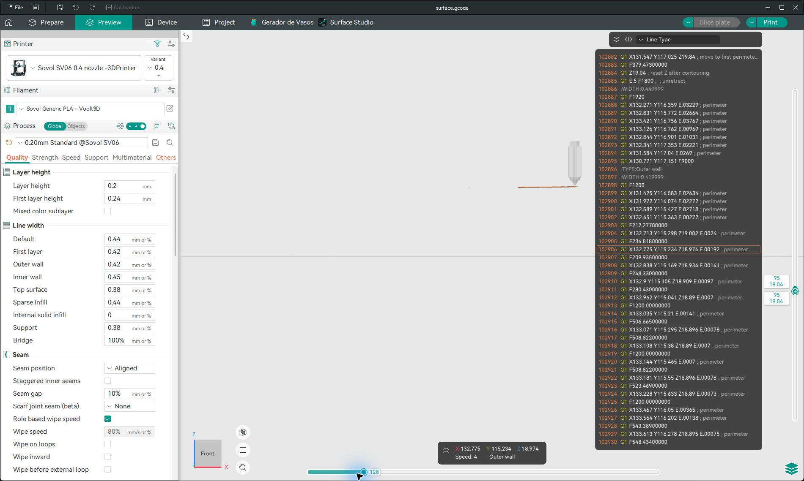

# Teste de uso — Benchy no Surface Studio 0.9.1

**Data:** 21/11/2026. **Ambiente:** OrcaSlicer 2.5.1 no Windows.

O fluxo foi executado na janela real do Orca, usando mouse, teclado e os
botões do plugin. A geração não foi feita por um comando externo ao fluxo
da interface. Depois, os arquivos foram apenas lidos para conferir integridade
e medir o efeito das áreas. **Nenhuma impressão foi iniciada.**

O resultado confirmou os quatro passos e movimento em Z durante a extrusão
nas bordas selecionadas. Não confirmou acabamento sem degraus ou liberação
física do Benchy: continuam existindo trechos de transição muito inclinados.

## Preparar o teste

O Orca estava com um pacote já fatiado aberto. Abri o **projeto original** do
Benchy para ter um modelo editável na bandeja. O diálogo de alterações de
presets mostrava apenas os ajustes temporários do Preview anterior, já
preservados; eles foram descartados sem salvar sobre os presets do usuário.

Conferi impressora **Sovol SV06 0.4 nozzle -3DPrinter**, filamento **Sovol Generic
PLA - Voolt3D** e processo **0.20mm Standard @Sovol SV06**. O Benchy mede
60 × 31 × 48 mm.

## 1. Selecionar modelo

Abri a aba **Surface Studio**, cliquei em **3DBenchy-original.stl** e conferi
sua imagem no centro. Cliquei em **Selecionar áreas**. Não foi necessário
abrir Mais opções ou configurar o método avançado.

## 2. Selecionar áreas

Ajustei **Raio da área** para **8 mm**. Cliquei em uma região da borda da proa
e em outra da popa. As duas marcas ficaram amarelas e apareceram os botões
Área 1 e Área 2. Antes da primeira seleção, **Continuar** estava desabilitado;
depois, ficou disponível. Cliquei em **Continuar**.

As marcas abrangem a espessura da parede; não são pintura apenas sobre a
pele externa. Nesta versão, cada clique acrescenta uma região esférica.

## 3. Estudar movimento

O resumo mostrou o Benchy, **2 áreas selecionadas** e a velocidade local de
**80% do perfil**. Cliquei em **Estudar movimento** e aguardei. O modelo
continuou visível durante o cálculo, e o resultado apareceu dentro do Studio.
O Preview nativo não abriu automaticamente.

## 4. Conferir e mandar para a bandeja

O quarto passo mostrou o modelo, as seleções e o percurso calculado. A tela
manteve o aviso **Somente Preview**. Usei ▶ e acompanhei a reprodução de 0%
até 100%. O visor do Studio mostrava uma amostra de 5.986 pontos; o pacote
nativo contém o percurso completo.

Cliquei em **Mandar para a bandeja**. No diálogo **Drop project file**, o Orca
selecionou inicialmente **Import geometry only**. Troquei para **Open as
project** e confirmei em **OK**. O pacote abriu na aba **Preview**, com 240
camadas e **Slice plate** desabilitado. Não houve refatiamento do modelo pela
janela principal nem pedido novo de permissão neste ciclo.

## Conferir o resultado no Preview

Usei a vista frontal e ampliei o modelo. As camadas convencionais continuam
visíveis nas regiões que não receberam contorno local. Há degraus residuais:
a seleção não transforma todas as paredes em superfícies perfeitamente lisas.

Isolei a **camada 95**, de Z nominal **19,04 mm**, usando os dois limites do
controle vertical. Ativei a exibição do G-code e avancei pelo percurso com o
controle inferior. O marcador do bico e os comandos mostraram **Outer wall**
com variação de Z durante extrusão positiva, por exemplo:

| Linha do arquivo | Z final (mm) | Extrusão do movimento (mm) |
|---|---:|---:|
| 102904 | 19,002 | 0,00240 |
| 102906 | 18,974 | 0,00192 |
| 102908 | 18,934 | 0,00141 |
| 102910 | 18,909 | 0,00097 |
| 102912 | 18,890 | 0,00070 |
| 102916 | 18,896 | 0,00078 |

A descida e a pequena subida estão dentro da mesma camada lógica, sem se
limitarem ao deslocamento entre camadas. O arquivo usa extrusão relativa
nesses trechos. Deixei o Orca aberto neste detalhe, sem acionar Print.

## Resultado medido

Uma nova leitura do arquivo após a geração confirmou:

- 2.397 segmentos com ajuste de altura local; 1.740 associados à primeira
  área e 657 à segunda.
- 1.752 segmentos de extrusão com Z inicial e final diferentes.
- Nenhuma extremidade ajustada fora da união das áreas sob a margem definida
  pelo verificador: metade da largura do cordão mais 0,05 mm, mínimo 0,3 mm.
  Essa verificação de extremidades não certifica colisão do cabeçote inteiro.
- Maior inclinação de movimento: **63,36°**, acima do limite de estudo de 30°.
  O arquivo manteve `print_allowed=false` e a advertência de validação física.

O G-code gerado, o conteúdo do pacote, o arquivo temporário do Preview e o
recibo de verificação do plugin tiveram o mesmo SHA-256:

`386c5faedefa8c58bc8ce9b7c40215e78741f75a96dd29c10c0bf84e5eb006d7`

Os números dependem das regiões clicadas neste ensaio; não devem ser
substituídos pelos de testes anteriores. A [evidência resumida em JSON](evidencias-benchy-guiado-v091.json)
registra este ciclo sem caminhos privados, configurações de conexão ou arquivo
pronto para impressão.

## Pontos de atenção para o uso

O passo a passo do plugin funcionou sem ajustes avançados. Dois pontos ainda
exigem atenção do usuário: começar pelo modelo original, porque um pacote
somente de Preview não oferece peça editável, e escolher **Open as project**
no diálogo nativo de transferência, que começa na outra opção. O botão final
abre o Preview e não inicia impressão. A melhoria dessas duas mensagens pode
reduzir dúvidas, mas não foi implementada neste teste de uso.
