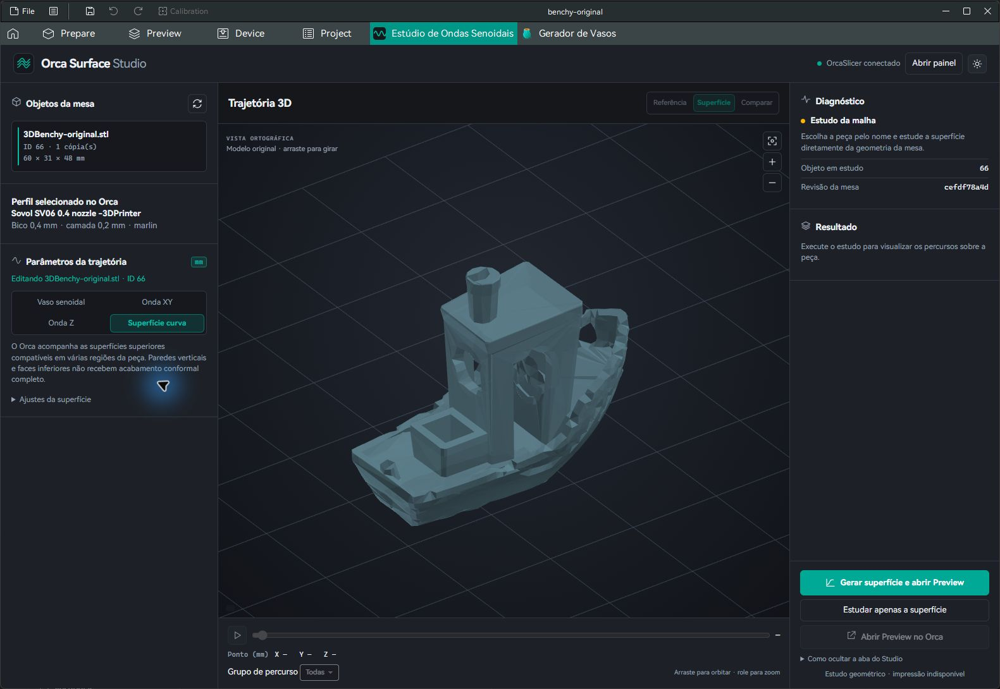
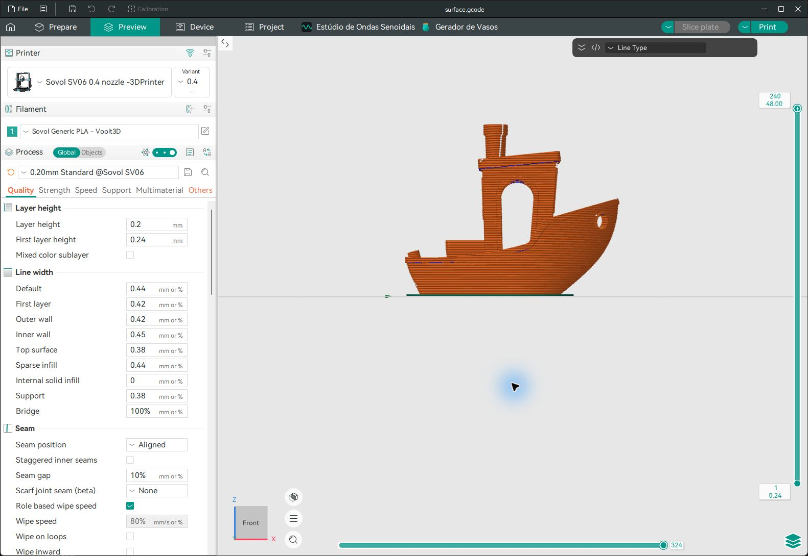
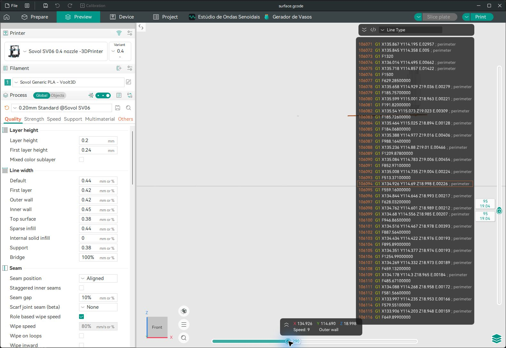

# Benchy no Orca Surface Studio 0.7.1 — teste acompanhado

Registro de 21/11/2026, Windows e OrcaSlicer 2.5.1. O usuário autorizou o
controle da interface e aprovou pessoalmente a leitura da pasta de temporários
de modelos do Orca. Nenhuma impressão foi iniciada ou enviada neste teste.

## Processo seguido

1. Instalar a 0.7.1 com o Orca fechado, preservando o estado existente.
2. Abrir a cópia salva do Benchy original, em tamanho 60 × 31 × 48 mm.
3. Conferir os perfis **Sovol SV06 0.4 nozzle -3DPrinter**,
   **Sovol Generic PLA - Voolt3D** e **0.20mm Standard @Sovol SV06**.
4. Abrir o Studio, aguardar a análise e escolher **Superfície curva**.
   O modelo permanece visível antes e durante o cálculo.
5. Clicar **Gerar superfície e abrir Preview**. O Studio chama o contorno local
   do próprio Orca numa cópia da peça, com os limites do perfil selecionado.
6. No diálogo de abertura, escolher **Open as project**. Essa escolha carrega
   o pacote fatiado. Importar apenas a geometria não demonstra esse percurso.
7. Voltar ao Studio e conferir **“Preview do Orca confirmado com o mesmo
   G-code. Somente simulação.”**
8. Repetir **Abrir Preview no Orca** duas vezes. Os diálogos normais de
   alterações temporárias foram respondidos com **Discard**, sem salvar no
   preset. Não houve novo pedido de leitura por arquivo.
9. No Preview, usar vista frontal, limitar os dois extremos à camada **95**
   (**19,04 mm**) e mover o controle inferior para examinar a extrusão.
   A tecla **C** abre o texto do G-code. Ao terminar, restaurar as 240 camadas
   e deixar o Preview aberto, sem clicar em Print.







## O que foi comprovado

O processo gerou **114.311 segmentos da peça**, com **9.933 segmentos de Z
variável**. Os 26 campos críticos do perfil coincidiram. A limitação do avanço
preservou XYZ/E em 131.359 movimentos. Duas aberturas tiveram recibos retidos
em caches diferentes, ambos iguais ao G-code gerado e ao conteúdo do pacote:

```text
74beedcb06a601aa653987416bdebb2086bbbe585b4b8358a6068cb0facb6219
```

Na camada 95, o painel mostrou extrusão positiva com Z alternando entre valores
como **19,036**, **18,963**, **19,023** e **18,894 mm** na parede externa da
proa. Portanto, existe movimento não planar fora do teto. A indicação nominal
19,04 mm no seletor da camada não descreve todos os Z dos seus movimentos.

A autorização inicial eliminou os pedidos individuais nas três aberturas
observadas. Duas possuem recibos guardados para comparação. A persistência
após outro reinício, posterior à aprovação, não foi testada neste ciclo.
Os 202 testes automatizados passaram antes da instalação.

## Limitações encontradas

A vista completa ainda apresenta degraus nas bordas e camadas horizontais em
paredes verticais. O teste comprova contorno local em regiões superiores
compatíveis, não o acabamento contínuo de todas as regiões roxas. O Studio
não deve apresentar esse resultado como solução completa para qualquer modelo.

O limite geométrico nominal do corpo do cabeçote foi novamente positivo:
**aproximadamente +1,24 mm**, em 128.855 movimentos. Esse cálculo usa o CAD de
referência, incluindo a capa ausente na máquina, e um limite conservador de
altura de material. Os aproximadamente 8 mm informados pelo usuário, incluindo
duto e sensor, permanecem uma observação aproximada. O cálculo não certifica
o contato do bico com o cordão, tolerâncias, macros de início/fim ou a deposição
real. As transições locais vêm do Orca e foram preservadas, mas sua qualidade
física neste Benchy ainda não foi ensaiada.

O resultado permanece candidato de validação, com **`print_allowed=false`**.
O sucesso do cupom anterior não libera automaticamente este Benchy.

Os [dados resumidos](evidencias-validacao-nativa-v071.json) omitem caminhos
privados, configurações de conexão e arquivos completos de impressão.
